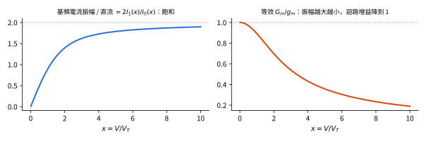

# 第 07 集 · Lec07：振幅怎麼穩下來（非線性）、輸出負載會改頻率、Colpitts 與 Hartley、差動對當乘法器 [▶ 影片](https://www.youtube.com/watch?v=qAzqKSU8EYo)

← 上一集：[06](06-oscillator-conditions-rlc-transformer.md) ｜ [總目錄](../README.md) ｜ 下一集：[08](08-mos-mixer-gilbert-multiplier-vco-fm.md) →

> **課程**：電子學（三）前導課程，陽明交大 電子物理系，113 學年度 — 第 07 集
> **講者**：陳振芳 老師
> **來源**：YouTube 錄影逐字稿（1:57:20，whisper）＋ Sedra & Smith《Microelectronic Circuits》7th ed. Ch18
> **標記說明**：`【口頭】` 老師口頭補充；`【課本補充】` 課本有、課堂沒講；`[▶ mm:ss]` 影片時間點

---

## 目錄

- [0. 這堂課要做什麼](#0-這堂課要做什麼)
- [1. 複習：變壓器耦合振盪器](#1-複習變壓器耦合振盪器)
- [2. 非線性：$g_m$ 隨振幅下降](#2-非線性g_m-隨振幅下降)
- [3. op amp 版：飽和成方波，再濾成正弦](#3-op-amp-版飽和成方波再濾成正弦)
- [4. 回授接到射極](#4-回授接到射極)
- [5. 負載會把振盪頻率拉走](#5-負載會把振盪頻率拉走)
- [6. 差動對振盪器：從另一邊拉輸出](#6-差動對振盪器從另一邊拉輸出)
- [7. 三阻抗 LC 振盪器：Colpitts 與 Hartley](#7-三阻抗-lc-振盪器colpitts-與-hartley)
- [8. 差動對當乘法器（混頻器 / AM 調變）](#8-差動對當乘法器混頻器--am-調變)
- [9. 一頁速查表](#9-一頁速查表)
- [10. 與後續集數的連結](#10-與後續集數的連結)

---

## 0. 這堂課要做什麼

1. 振盪器起振後振幅為什麼會停下來——非線性。
2. 振盪頻率會被負載影響，怎麼避免。
3. 通用的 LC 振盪器：**Colpitts**、**Hartley**。
4. 差動對把兩個信號相乘：**混頻器**（mixer）。

---

## 1. 複習：變壓器耦合振盪器

[▶ 00:30](https://youtu.be/qAzqKSU8EYo?t=30)

集極接 $L_1 \parallel C \parallel R$，二次側接回基極（看進去 $r_\pi$，反映到一次側是 $(N_1/N_2)^2r_\pi$）。

$$
\frac{v_r}{v_t} = \frac{N_2}{N_1}g_m\left[R\parallel\left(\tfrac{N_1}{N_2}\right)^2r_\pi\parallel C\parallel L_1\right]
$$

振在 $\omega_0 = 1/\sqrt{L_1C}$（RLC 相位 0、只剩電阻），條件 $\frac{N_2}{N_1}g_m\left[R\parallel(\frac{N_1}{N_2})^2r_\pi\right] \ge 1$，設計稍大於 1。[▶ 09:25](https://youtu.be/qAzqKSU8EYo?t=565)

直流：電感對直流短路，集極直流 $= V_{CC}$，交流正弦疊在上面。[▶ 12:03](https://youtu.be/qAzqKSU8EYo?t=723)

---

## 2. 非線性：$g_m$ 隨振幅下降

[▶ 15:04](https://youtu.be/qAzqKSU8EYo?t=904)

迴路增益設計 > 1，振幅一直長大，但最後會平——因為 $g_m$ 是**小信號**的值，振幅大了就不對了。[▶ 16:35](https://youtu.be/qAzqKSU8EYo?t=995)

$v_{BE} = 0.7 + V\cos\omega t$：

$$
i_C = I_Se^{0.7/V_T}e^{(V/V_T)\cos\omega t}
$$

- $V \ll V_T$：泰勒展開 $1 + \frac{V}{V_T}\cos\omega t + \cdots$，後面越來越小 → 線性（小信號）。[▶ 22:09](https://youtu.be/qAzqKSU8EYo?t=1329)
- $V$ 變大：後面的項比前面大，泰勒展開散掉 → 改用**傅立葉級數**（週期函數）：[▶ 24:43](https://youtu.be/qAzqKSU8EYo?t=1483)

$$
i_C = I_C\left[1 + \frac{2I_1(x)}{I_0(x)}\cos\omega t + \frac{2I_2(x)}{I_0(x)}\cos2\omega t + \cdots\right],
\qquad
x = \frac{V}{V_T}
$$

（係數是**修正貝索函數**（modified Bessel function），老師不進數學。）[▶ 29:57](https://youtu.be/qAzqKSU8EYo?t=1797)

- $2\omega$、$3\omega$ 的成分在 RLC 那裡振不起來（只有 $\omega_0$ 有阻抗 $R$），只剩基頻。[▶ 27:52](https://youtu.be/qAzqKSU8EYo?t=1672)
- 基頻振幅 $\frac{2I_1(x)}{I_0(x)}I_C$ 隨 $x$ 增加會**飽和**（趨近 $2I_C$）→ 等效轉導 $G_m = g_m\frac{2I_1(x)}{xI_0(x)}$ 越來越小 → 迴路增益從 > 1 降到 = 1，振幅停在那裡。[▶ 30:57](https://youtu.be/qAzqKSU8EYo?t=1857)

【口頭】有個概念就好：振幅大到一個地步，非線性讓增益降下來，就平了。[▶ 33:01](https://youtu.be/qAzqKSU8EYo?t=1981)

> 【課本補充】§18.1 (p. 1380)：實用振盪器常另加**振幅控制**（例如二極體限幅、JFET 自動增益），不只靠電晶體本身的非線性。

---

## 3. op amp 版：飽和成方波，再濾成正弦

[▶ 33:33](https://youtu.be/qAzqKSU8EYo?t=2013)

兩級反相 + RLC 的振盪器：設計 $(R_2/R_1)^2$ 稍大於 1，越振越大 → op amp **飽和**在 ± 電源附近（例 ±4 V）→ 輸出變**方波**。[▶ 36:41](https://youtu.be/qAzqKSU8EYo?t=2201)

方波經過 RLC：只留 $\omega_0$ 那一根（大小 $\frac{4}{\pi}\times$ 振幅），3ω、5ω 都濾掉 → 變回正弦。【口頭】要正弦就再經過一次 RLC；$Q$ 不夠高，旁邊會有一點小樓。[▶ 42:21](https://youtu.be/qAzqKSU8EYo?t=2541)

---

## 4. 回授接到射極

[▶ 46:02](https://youtu.be/qAzqKSU8EYo?t=2762)

同樣用變壓器，二次側接到**射極**（共基）。從射極看進去是 $r_e$（不是 $r_\pi$），相位反過來，所以繞線方向（點）也要反過來才是正回授。[▶ 46:32](https://youtu.be/qAzqKSU8EYo?t=2792)

$$
\frac{v_r}{v_t} = \frac{N_2}{N_1}g_m\left[R\parallel\left(\tfrac{N_1}{N_2}\right)^2r_e\parallel C\parallel L_1\right],
\quad
\omega_0 = \frac{1}{\sqrt{L_1C}}
$$

[▶ 50:44](https://youtu.be/qAzqKSU8EYo?t=3044)

---

## 5. 負載會把振盪頻率拉走

[▶ 52:22](https://youtu.be/qAzqKSU8EYo?t=3142)

輸出從集極拉到下一級。下一級看進來如果是**電容性**負載 $C'$：對交流它就並在 tank 的 $C$ 上——

$$
\omega_0 = \frac{1}{\sqrt{L_1(C + C')}}
$$

振盪頻率變了。電感性負載也一樣。你不知道後面會接什麼——非常嚴重。[▶ 54:25](https://youtu.be/qAzqKSU8EYo?t=3265)

---

## 6. 差動對振盪器：從另一邊拉輸出

[▶ 55:57](https://youtu.be/qAzqKSU8EYo?t=3357)

用差動對：一邊集極接 RLC tank，經變壓器回到其中一顆的基極；兩個射極共用電流源。（從射極看進去是兩個 $r_e$ 串聯之類，所以式子多一個 1/2、2 倍。）[▶ 58:02](https://youtu.be/qAzqKSU8EYo?t=3482)

$$
\frac{v_r}{v_t} = \frac{N_2}{N_1}\cdot\frac12g_m\left[R\parallel\left(\tfrac{N_1}{N_2}\right)^2 2r_\pi\parallel\cdots\right]
$$

**輸出改從另一顆的集極拉**：它的電流和 tank 那顆大小一樣、方向相反，但**不在回授迴路裡**。那邊接電容性負載只會影響輸出大小，**不會影響振盪頻率**（頻率由繞一圈的那條路決定）。[▶ 1:03:13](https://youtu.be/qAzqKSU8EYo?t=3793)

---

## 7. 三阻抗 LC 振盪器：Colpitts 與 Hartley

[▶ 1:09:59](https://youtu.be/qAzqKSU8EYo?t=4199)

放大器（增益 $-A_v$、輸出電阻 $r_o$，輸入電阻當作無窮大）+ 三個電抗：$Z_1$ 從輸出接到輸入、$Z_2$ 在輸出到地、$Z_3$ 在輸入到地（都是純電容或純電感，$Z = jX$）。[▶ 1:14:06](https://youtu.be/qAzqKSU8EYo?t=4446)

繞一圈：

$$
\frac{v_r}{v_t} = \frac{-A_vZ_2Z_3}{r_o(Z_1 + Z_2 + Z_3) + Z_2(Z_1 + Z_3)}
$$

分母第一項有 $j$，其餘是兩個 $j$ 相乘（實數）。要相位 0：[▶ 1:20:24](https://youtu.be/qAzqKSU8EYo?t=4824)

$$
X_1 + X_2 + X_3 = 0
$$

代回去 $Z_1 + Z_3 = -Z_2$：

$$
\frac{v_r}{v_t} = A_v\frac{X_3}{X_2}
$$

要 0°，$Z_2$、$Z_3$ 必須**同類**（都電容或都電感），而要三個加起來 0，$Z_1$ 必須是**另一類**。[▶ 1:23:31](https://youtu.be/qAzqKSU8EYo?t=5011)

**Colpitts**（$Z_2$、$Z_3$ 電容，$Z_1$ 電感）[▶ 1:24:32](https://youtu.be/qAzqKSU8EYo?t=5072)：

$$
\omega_0 = \frac{1}{\sqrt{L_1\dfrac{C_2C_3}{C_2 + C_3}}},
\qquad
A_v\frac{C_2}{C_3} \ge 1
$$

【口頭】全部都是電容不行（有一個 $j$ 跑不掉），一定至少一個電感。[▶ 1:29:14](https://youtu.be/qAzqKSU8EYo?t=5354)

**Hartley**（$Z_2$、$Z_3$ 電感，$Z_1$ 電容）[▶ 1:30:19](https://youtu.be/qAzqKSU8EYo?t=5419)：

$$
\omega_0 = \frac{1}{\sqrt{(L_2 + L_3)C_1}},
\qquad
A_v\frac{L_2}{L_3} \ge 1
$$

> ⚠️ 逐字稿缺字：whisper 寫「Covid Oscillator」，應是 Colpitts oscillator。增益條件中 $C_2$、$C_3$ 的位置依上面的推導寫（$X_3/X_2 = C_2/C_3$）；老師板書的編號若和這裡相反，比值就倒過來。

**VCO** [▶ 1:33:26](https://youtu.be/qAzqKSU8EYo?t=5606)：用電壓控制的電容（變容二極體）調頻率 → **壓控振盪器**（voltage-controlled oscillator）。

> 【課本補充】§18.3 (p. 1396)：Colpitts $\omega_0 = 1/\sqrt{L\frac{C_1C_2}{C_1+C_2}}$、$g_mR = C_2/C_1$；Hartley $\omega_0 = 1/\sqrt{(L_1+L_2)C}$。

---

## 8. 差動對當乘法器（混頻器 / AM 調變）

[▶ 1:33:58](https://youtu.be/qAzqKSU8EYo?t=5638)

**混頻器**（mixer）就是把兩個信號相乘。從最基本的差動對開始：差動輸入 $v$，單端輸出增益 $\frac12g_mR$，$g_m = \frac{I/2}{V_T}$（每顆分到 $I/2$）。[▶ 1:36:02](https://youtu.be/qAzqKSU8EYo?t=5762)

**讓尾電流跟著另一個信號變** [▶ 1:37:04](https://youtu.be/qAzqKSU8EYo?t=5824)：尾電流源那顆 BJT 的基極再加一個慢的信號 $f(t)$（聲音）：

$$
I(t) = I_0 + \frac{f(t)}{r_e'}
$$

（從尾電流源射極看下去是一個小 $r_e$ 類的電阻。）$f(t)$ 比載波慢很多，對差動對來說 $I$ 幾乎是直流，只是慢慢在變 → $g_m$ 跟著 $f(t)$ 變：[▶ 1:44:50](https://youtu.be/qAzqKSU8EYo?t=6290)

$$
v_o = \frac12\cdot\frac{I(t)}{2V_T}R\,v
= \frac{R}{4V_T}\left[I_0 + \frac{f(t)}{r_e'}\right]v
$$

$v$ 是很快的載波 $\sin\omega_ct$ → 輸出 $= A\left[1 + mf(t)\right]\sin\omega_ct$——**AM 信號**，兩個信號相乘了。[▶ 1:49:33](https://youtu.be/qAzqKSU8EYo?t=6573)

頻譜：載波一根，兩邊是聲音的邊帶；送出去，接收端用 RLC tuner 抓，頻寬要蓋住邊帶、不能蓋到隔壁台。【口頭】這種電路在通訊（communication）裡很常用。[▶ 1:52:43](https://youtu.be/qAzqKSU8EYo?t=6763)

> 【課本補充】這種「尾電流調變 $g_m$」的乘法是 Gilbert cell 乘法器的基礎。

---

## 9. 一頁速查表

| 項目 | 公式／重點 | 關鍵 |
|---|---|---|
| 大信號展開 | $i_C = I_C[1 + \frac{2I_1(x)}{I_0(x)}\cos\omega t + \cdots]$ | $x = V/V_T$ |
| 振幅穩定 | $G_m = g_m\frac{2I_1(x)}{xI_0(x)}$ 隨振幅降，迴路增益降到 1 | 非線性 |
| op amp 振盪器 | 飽和成方波，RLC 濾回正弦 | |
| 射極回授 | 負載用 $(N_1/N_2)^2r_e$ | 繞向反過來 |
| 負載影響 | $\omega_0 = 1/\sqrt{L(C + C')}$ | 嚴重 |
| 差動對振盪器 | 輸出從迴路外那顆拉 | 頻率不受負載影響 |
| 三阻抗條件 | $X_1 + X_2 + X_3 = 0$，$A_vX_3/X_2 \ge 1$ | $Z_2$、$Z_3$ 同類 |
| Colpitts | $\omega_0 = 1/\sqrt{L\frac{C_2C_3}{C_2+C_3}}$ | 兩 C 一 L |
| Hartley | $\omega_0 = 1/\sqrt{(L_2+L_3)C}$ | 兩 L 一 C |
| 乘法器 | $v_o = \frac{R}{4V_T}I(t)v$，$I(t) = I_0 + f(t)/r_e'$ | AM 調變 |

---

## 10. 與後續集數的連結

| 本集觀念 | 後面在哪裡用到 |
|---|---|
| 乘法器 | 下一集起：調變、解調電路 |
| VCO | 鎖相迴路、FM |
| 差動對 | 第 7 章差動放大器 |

---

## 附：本集一句話總結

> **振盪器起振後振幅變大，大信號下 $i_C$ 要用傅立葉（貝索函數）展開，基頻成分飽和使等效 $G_m$ 下降，迴路增益降到 1 就穩住；op amp 版則飽和成方波再被 RLC 濾成正弦。tank 上接電容性負載會把頻率拉走，改用差動對從迴路外那顆拉輸出就不受影響。三阻抗 LC 振盪器要 $X_1+X_2+X_3=0$，兩 C 一 L 是 Colpitts、兩 L 一 C 是 Hartley；讓差動對的尾電流跟著聲音變，$g_m$ 就跟著變，輸出就是載波乘聲音的 AM 信號。**

---

*筆記依據陳振芳老師「電子學（三）前導課程」113 學年度 Lec07 錄影逐字稿（whisper，1:57:20）與 Sedra & Smith《Microelectronic Circuits》7th ed. 整理。*
