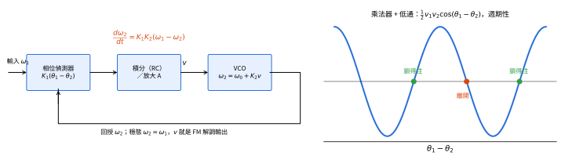

# 第 09 集 · Lec09：積分器跟隨與跟得上的條件、大電流電壓源、鎖相迴路（頻率的亦步亦趨）與 FM 解調 [▶ 影片](https://www.youtube.com/watch?v=WwW3E7PSHEA)

← 上一集：[08](08-mos-mixer-gilbert-multiplier-vco-fm.md) ｜ [總目錄](../README.md) ｜ 下一集：[10](10-schmitt-trigger-digital-oscillator-pwm.md) →

> **課程**：電子學（三）前導課程，陽明交大 電子物理系，113 學年度 — 第 09 集
> **講者**：陳振芳 老師
> **來源**：YouTube 錄影逐字稿（1:42:02，whisper）＋ Sedra & Smith《Microelectronic Circuits》7th ed.
> **標記說明**：`【口頭】` 老師口頭補充；`【課本補充】` 課本有、課堂沒講；`⚠️ 逐字稿缺字` whisper 聽錯，已修正；`[▶ mm:ss]` 影片時間點

---

## 目錄

- [0. 這堂課要做什麼](#0-這堂課要做什麼)
- [1. 積分器裡的兩個亦步亦趨](#1-積分器裡的兩個亦步亦趨)
- [2. 跟得上的條件](#2-跟得上的條件)
- [3. 加放大器：$\tau = RC/A$](#3-加放大器tau--rca)
- [4. 大電流電壓源：推挽 BJT 放進回授](#4-大電流電壓源推挽-bjt-放進回授)
- [5. 鎖相迴路：頻率的亦步亦趨](#5-鎖相迴路頻率的亦步亦趨)
- [6. 推導：$\omega_2$ 指數趨近 $\omega_1$](#6-推導omega_2-指數趨近-omega_1)
- [7. 追 FM 信號：FM 解調](#7-追-fm-信號fm-解調)
- [8. 實際的相位偵測器：乘法器 + 低通](#8-實際的相位偵測器乘法器--低通)
- [9. 一頁速查表](#9-一頁速查表)
- [10. 與後續集數的連結](#10-與後續集數的連結)

---

## 0. 這堂課要做什麼

1. 再把「跟隨」講清楚：積分器什麼時候跟得上。
2. 做一個能給大電流的電壓源。
3. 把同樣的觀念用在**頻率**上：**鎖相迴路**（PLL, phase-locked loop），並用它做 FM 解調。

---

## 1. 積分器裡的兩個亦步亦趨

[▶ 00:34](https://youtu.be/WwW3E7PSHEA?t=34)

積分器：正端接參考電壓 $V_r$，負端經 $R$ 接輸入 $v_i$，回授電容 $C$；把輸出 $v_o$ 拉回當輸入。

- **第一個**：op amp 本身的虛短路——輸出是有限值時一定成立，負端 = $V_r$。[▶ 01:37](https://youtu.be/WwW3E7PSHEA?t=97)
- **第二個**：積分器的跟隨——差值 $(V_r - v_o)/R$ 一直充電，直到電容沒電流（穩態）→ $v_o = V_r$。[▶ 04:43](https://youtu.be/WwW3E7PSHEA?t=283)

$$
v_o(t) \to V_r,
\qquad
\tau = RC
$$

【口頭】只要正負端接對，最後一定亦步亦趨。前面那個（op amp 自己的）很強，這個比較弱，要一個 $RC$ 的時間。[▶ 09:21](https://youtu.be/WwW3E7PSHEA?t=561)

---

## 2. 跟得上的條件

[▶ 09:52](https://youtu.be/WwW3E7PSHEA?t=592)

$V_r$ 改成正弦 $V_r\sin\omega t$。比「最陡的斜率」：

- 輸入最陡：$V_r\omega$。
- 電路追趕最快：起始斜率 $\approx V_r/(RC)$。[▶ 10:52](https://youtu.be/WwW3E7PSHEA?t=652)

要隨時跟上，追的速度要遠大於輸入變的速度：

$$
V_r\omega \ll \frac{V_r}{RC}
\quad\Longleftrightarrow\quad
\omega \ll \frac{1}{RC}
$$

[▶ 12:24](https://youtu.be/WwW3E7PSHEA?t=744)

---

## 3. 加放大器：$\tau = RC/A$

[▶ 13:56](https://youtu.be/WwW3E7PSHEA?t=836)

積分器後面加一個增益 $A$ 的放大器再拉回來：積分器輸出只要充到 $v_o/A$ 就夠了，不需要充那麼多：

$$
\tau = \frac{RC}{A}
$$

等於 $R$ 或 $C$ 變小，反應快 $A$ 倍，輸入頻率可以更高。[▶ 16:29](https://youtu.be/WwW3E7PSHEA?t=989)

---

## 4. 大電流電壓源：推挽 BJT 放進回授

[▶ 18:03](https://youtu.be/WwW3E7PSHEA?t=1083)

op amp 最大的問題：輸出電流有限（741 約 20 mA），推不動小負載（喇叭）。

把**推挽**（push-pull）BJT 放進 op amp 的回授迴路（輸出取自射極，拉回負端）：[▶ 20:42](https://youtu.be/WwW3E7PSHEA?t=1242)

- $v_i > 0$：NPN（$Q_1$）導通，電流往下流進負載；$v_i < 0$：PNP（$Q_2$）導通，電流反向。[▶ 24:47](https://youtu.be/WwW3E7PSHEA?t=1487)
- op amp 增益無窮大，看不到那 0.7 V；回授讓輸出亦步亦趨。
- op amp 只要給基極電流：20 mA × $(1+\beta)$ → $\beta = 100$ 時約 2000 mA。[▶ 24:16](https://youtu.be/WwW3E7PSHEA?t=1456)

電壓增益只有 1 沒關係——電壓在前面已經放大了；它的工作是**電流驅動能力**。[▶ 27:22](https://youtu.be/WwW3E7PSHEA?t=1642)

輸入接定值就是大功率直流電源：接上負載 $R_L$ 電壓往下掉，回授把它拉回來（兩個亦步亦趨：積分器的、op amp 的）。[▶ 29:25](https://youtu.be/WwW3E7PSHEA?t=1765)

【口頭】電流真的好幾 A，兩顆 BJT 要大顆、金屬殼、散熱好，比 IC 本身大得多 → 後面要另一個方法（PWM），體積小又能大功率。[▶ 31:59](https://youtu.be/WwW3E7PSHEA?t=1919)

---

## 5. 鎖相迴路：頻率的亦步亦趨

[▶ 33:30](https://youtu.be/WwW3E7PSHEA?t=2010)

前面都是電壓跟電壓；現在讓**頻率**跟頻率。

**瞬間頻率** [▶ 34:37](https://youtu.be/WwW3E7PSHEA?t=2077)：信號 $\cos\theta(t)$ 不一定只有單一頻率，用相位定義：

$$
\omega(t) = \frac{d\theta}{dt}
$$

**三個方塊** [▶ 42:25](https://youtu.be/WwW3E7PSHEA?t=2545)：

1. **相位偵測器**（phase detector）：輸出 $K_1(\theta_1 - \theta_2)$。（雷達：打出去碰到物體回來，相位差就知道距離。）
2. **積分（RC）/ 放大**：把相位差轉成控制電壓 $v$。
3. **VCO**：$\omega_2 = \omega_0 + K_2v$（頻率只能在 $\omega_0$ 附近調一點）。[▶ 49:38](https://youtu.be/WwW3E7PSHEA?t=2978)

VCO 輸出拉回相位偵測器。

> ⚠️ 逐字稿缺字：whisper 寫「Face Lock Loop」「face detector」，應是 phase-locked loop、phase detector。

---

## 6. 推導：$\omega_2$ 指數趨近 $\omega_1$

[▶ 43:57](https://youtu.be/WwW3E7PSHEA?t=2637)

$$
\theta_1 - \theta_2 = \int_0^t(\omega_1 - \omega_2)\,dt + \left[\theta_1(0) - \theta_2(0)\right]
$$

所以相位偵測器 = 偵測兩個**頻率的差**，對時間積分——和電壓版的積分器一模一樣。最後一項是開機瞬間的**初始相位差**：隨機、無法控制，但它只是常數。[▶ 47:34](https://youtu.be/WwW3E7PSHEA?t=2854)

代入 VCO：$\omega_2 = \omega_0 + K_2K_1\left[\int(\omega_1 - \omega_2)dt + \text{常數}\right]$，微分：[▶ 52:13](https://youtu.be/WwW3E7PSHEA?t=3133)

$$
\frac{d\omega_2}{dt} = K_1K_2(\omega_1 - \omega_2)
$$

和起點無關。$\omega_1$ 固定時，$\omega_2$ 不管從哪裡開始都以

$$
\tau = \frac{1}{K_1K_2}
$$

指數趨近 $\omega_1$——頻率亦步亦趨。[▶ 55:49](https://youtu.be/WwW3E7PSHEA?t=3349)

---

## 7. 追 FM 信號：FM 解調

[▶ 57:23](https://youtu.be/WwW3E7PSHEA?t=3443)

輸入是 FM：$\omega_1 = \omega_c\left[1 + kf(t)\right]$，$f$ 是聲音（最高約 $10^5$），$\omega_c$ 幾百 MHz，$k$ 很小。[▶ 58:26](https://youtu.be/WwW3E7PSHEA?t=3506)

**跟得上的條件**（比最陡斜率）：輸入頻率變化最快 $\sim k\omega_c\omega_m$，電路追的最快 $\sim k\omega_c/\tau$ →

$$
\omega_m \ll \frac{1}{\tau}
$$

把 $k$ 取最大 1 都成立就一定成立；聲音那麼慢，很容易。加放大器 $A$ 還能讓 $\tau$ 再小。[▶ 1:05:14](https://youtu.be/WwW3E7PSHEA?t=3914)

**解調** [▶ 1:12:07](https://youtu.be/WwW3E7PSHEA?t=4327)：鎖住後 $\omega_2 = \omega_1$，VCO 的 $\omega_2 = \omega_0 + K_2v$ → 控制電壓

$$
v = \frac{\omega_1 - \omega_0}{K_2} \propto f(t)
$$

**$v$ 就是聲音**——FM 解調。開機時 $\omega_2$ 可能在任何地方，經過約 $\tau$ 後鎖住，之後跟著 $\omega_1$ 上下走。[▶ 1:16:47](https://youtu.be/WwW3E7PSHEA?t=4607)

【口頭】FM 信號不能直接灌進 VCO 的控制端，要經過相位偵測器那一套。[▶ 1:19:52](https://youtu.be/WwW3E7PSHEA?t=4792)

---

## 8. 實際的相位偵測器：乘法器 + 低通

[▶ 1:21:28](https://youtu.be/WwW3E7PSHEA?t=4888)

用上一集的乘法器：

$$
v_1\cos\theta_1\cdot v_2\cos\theta_2 = \frac12v_1v_2\left[\cos(\theta_1 - \theta_2) + \cos(\theta_1 + \theta_2)\right]
$$

$\theta_1 + \theta_2$ 那項在很高頻（$\omega_1 + \omega_2$），低通濾掉，剩 $\frac12v_1v_2\cos(\theta_1 - \theta_2)$。[▶ 1:24:01](https://youtu.be/WwW3E7PSHEA?t=5041)

它不是 $K_1(\theta_1 - \theta_2)$，而是**週期函數**：[▶ 1:25:37](https://youtu.be/WwW3E7PSHEA?t=5137)

- 在斜率「對」的區段，局部等效 $K_1$ 是正確的號 → 鎖得住。
- 在斜率「反」的區段 → 方程式變成越差越大，**離開**（departure）。[▶ 1:28:46](https://youtu.be/WwW3E7PSHEA?t=5326)
- 但因為是週期函數，離開後會走到下一個斜率對的區段，最後還是鎖住——只是開機時走遠路、多花一點時間。[▶ 1:35:36](https://youtu.be/WwW3E7PSHEA?t=5736)

$K_1$ 不是常數，所以畫成指數曲線不完全對，但不影響結論。[▶ 1:39:10](https://youtu.be/WwW3E7PSHEA?t=5950)

【口頭】用途：量兩個信號的相位差（測距）、FM 解調。FM 也可以先微分再用 AM 解調，但微分會放大很多雜訊，不好用。[▶ 1:40:44](https://youtu.be/WwW3E7PSHEA?t=6044)

> 【課本補充】實際 PLL 的低通濾波器（loop filter）設計決定鎖定範圍和穩定度；乘法器型相位偵測器在相位差 90° 附近才近似線性。

---

## 9. 一頁速查表

| 項目 | 公式／重點 | 關鍵 |
|---|---|---|
| 積分器跟隨 | $v_o \to V_r$，$\tau = RC$ | 比較 + 充電 |
| 跟得上 | $\omega \ll 1/RC$ | 比最陡斜率 |
| 加放大 $A$ | $\tau = RC/A$ | |
| 大電流電壓源 | op amp + 推挽 BJT 在回授內 | 電流 × $(1+\beta)$ |
| 瞬間頻率 | $\omega = d\theta/dt$ | |
| PLL 方程 | $\dot\omega_2 = K_1K_2(\omega_1 - \omega_2)$ | 初始相位無關 |
| 鎖定時間 | $\tau = 1/(K_1K_2)$ | |
| FM 解調 | $v = (\omega_1 - \omega_0)/K_2 \propto f(t)$ | $\omega_m \ll 1/\tau$ |
| 乘法器相位偵測 | $\frac12v_1v_2\cos(\theta_1 - \theta_2)$ | 週期，有鎖得住和離開的區段 |

---

## 10. 與後續集數的連結

| 本集觀念 | 後面在哪裡用到 |
|---|---|
| 小體積大功率 | 下一集：PWM / 切換式電源 |
| PLL | 頻率合成、時脈 |
| 推挽輸出級 | 電子學（四）輸出級 |

---

## 附：本集一句話總結

> **積分器靠「比較差值、充電到差為 0」讓輸出跟著參考電壓，條件是 $\omega \ll 1/RC$，加放大器可縮成 $RC/A$；把推挽 BJT 放進 op amp 回授就成了能給上 A 電流的電壓源。同樣的觀念用在頻率上就是鎖相迴路：相位偵測器 + 積分 + VCO，$\dot\omega_2 = K_1K_2(\omega_1-\omega_2)$，鎖住後 VCO 的控制電壓正好就是 FM 的聲音；實際的相位偵測器用乘法器 + 低通，輸出是週期性的 $\cos(\theta_1-\theta_2)$，開機時可能繞遠路，但最後一定鎖住。**

---

*筆記依據陳振芳老師「電子學（三）前導課程」113 學年度 Lec09 錄影逐字稿（whisper，1:42:02）與 Sedra & Smith《Microelectronic Circuits》7th ed. 整理。*
