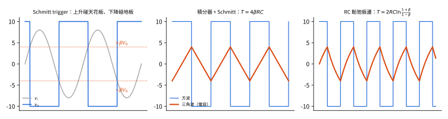

# 第 10 集 · Lec10：Schmitt trigger、三角波／方波振盪器、PWM、數位式 VCO、RC 鬆弛振盪器 [▶ 影片](https://www.youtube.com/watch?v=1pBn5kOZAn0)

← 上一集：[09](09-tracking-power-source-pll.md) ｜ [總目錄](../README.md) ｜ 下一集：[11](11-mos-bias-review-toward-diff-pair.md) →

> **課程**：電子學（三）前導課程，陽明交大 電子物理系，113 學年度 — 第 10 集
> **講者**：陳振芳 老師
> **來源**：YouTube 錄影逐字稿（1:37:37，whisper）＋ Sedra & Smith《Microelectronic Circuits》7th ed. Ch18
> **標記說明**：`【口頭】` 老師口頭補充；`【課本補充】` 課本有、課堂沒講；`[▶ mm:ss]` 影片時間點

---

## 目錄

- [0. 這堂課要做什麼](#0-這堂課要做什麼)
- [1. 正回授的 op amp：只會在 $\pm V_0$](#1-正回授的-op-amp只會在-pm-v_0)
- [2. Schmitt trigger：有兩個門檻的比較器](#2-schmitt-trigger有兩個門檻的比較器)
- [3. 三角波／方波振盪器](#3-三角波方波振盪器)
- [4. PWM：工作週期被電壓調變](#4-pwm工作週期被電壓調變)
- [5. 數位式 VCO（FM）](#5-數位式-vcofm)
- [6. 用差動對當開關的振盪器](#6-用差動對當開關的振盪器)
- [7. RC 鬆弛振盪器](#7-rc-鬆弛振盪器)
- [8. 一頁速查表](#8-一頁速查表)
- [9. 與後續集數的連結](#9-與後續集數的連結)

---

## 0. 這堂課要做什麼

前面的振盪器都是類比（正弦）；今天是**數位振盪器**（digital oscillator）：輸出 0/1 的方波。關鍵元件是 **Schmitt trigger**。順便做出 PWM 和數位式的 VCO。[▶ 00:00](https://youtu.be/1pBn5kOZAn0?t=0)

---

## 1. 正回授的 op amp：只會在 $\pm V_0$

[▶ 01:01](https://youtu.be/1pBn5kOZAn0?t=61)

$R_1$、$R_2$ 接到**正端**（以前負回授是接負端）。把負端暫時看成常數，正端的電容（任何腳都有）被差值充電：

$$
v_+(t) = v_+(0)e^{t/\tau} + \cdots,
\qquad
\tau = \frac{R_2C}{A}
$$

指數是**正**的——差值越來越大，而且 $A$ 無窮大，幾乎不要時間就衝到底，輸出**飽和**在 $+V_0$ 或 $-V_0$（例 741 約 ±10 V），沒有中間值。[▶ 09:48](https://youtu.be/1pBn5kOZAn0?t=588)

$$
v_+ = \beta v_o,
\qquad
\beta = \frac{R_1}{R_1 + R_2}
$$

---

## 2. Schmitt trigger：有兩個門檻的比較器

[▶ 16:07](https://youtu.be/1pBn5kOZAn0?t=967)

輸入從負端進，和正端的 $\pm\beta V_0$ 比 → 一個**比較器**，但有兩個比較位準：

- 輸出 $+V_0$ 時，門檻是 $+\beta V_0$（天花板）。
- 輸出 $-V_0$ 時，門檻是 $-\beta V_0$（地板）。

**輸入正弦** [▶ 17:43](https://youtu.be/1pBn5kOZAn0?t=1063)（例 $\beta = 1/10$、$V_0 = 10$ → 門檻 ±1 V）：輸入最低時輸出 $+V_0$；輸入**上升碰天花板** → 輸出翻成 $-V_0$；門檻變成地板；**下降碰地板** → 翻回 $+V_0$。輸出是**方波**。[▶ 21:18](https://youtu.be/1pBn5kOZAn0?t=1278)

**加參考電壓 $V_R$** [▶ 22:50](https://youtu.be/1pBn5kOZAn0?t=1370)：$R_1$ 下端接 $V_R$，疊加後天花板、地板一起上移 → 方波一胖一瘦，**工作週期**被 $V_R$ 調變（輸入是正弦時不是線性關係；輸入是三角波就是線性）。[▶ 26:56](https://youtu.be/1pBn5kOZAn0?t=1616)

> 【課本補充】§18.4 (p. 1404)：這叫雙穩態電路（bistable）；兩個門檻的差 $2\beta V_0$ 叫**遲滯**（hysteresis），可以抵抗雜訊造成的來回亂跳。

---

## 3. 三角波／方波振盪器

[▶ 28:33](https://youtu.be/1pBn5kOZAn0?t=1713)

要自己振：讓一個電壓**上升碰天花板、下降碰地板**，一直來回 → 用**積分器**：方波 ±$V_0$ 進去，電容電壓就是斜直線（三角波）。[▶ 30:06](https://youtu.be/1pBn5kOZAn0?t=1806)

迴路：Schmitt trigger → **CMOS 反相器**（把方波反相，讓回授方向對；接 ±$V_0$ 電源，MOS 在三極管區、$R_{DS}$ 幾乎 0）→ 積分器 → 回 Schmitt trigger。[▶ 33:14](https://youtu.be/1pBn5kOZAn0?t=1994)

- 輸出 $-V_0$ 時積分器斜率 $+V_0/RC$，電容電壓往上，碰到天花板 $+\beta V_0$ → 翻轉；往下碰地板 → 再翻。[▶ 37:55](https://youtu.be/1pBn5kOZAn0?t=2275)
- 半週期：高度 $2\beta V_0$ ÷ 斜率 $V_0/RC$：

$$
\frac{T}{2} = 2\beta RC
\quad\Longrightarrow\quad
T = 4\beta RC
$$

工作週期 1/2。電容上是三角波，輸出是方波。振盪頻率用 $RC$ 調。[▶ 41:02](https://youtu.be/1pBn5kOZAn0?t=2462)

【口頭】CMOS 反相器是重點，它有非常重要的特色（不耗功率）。[▶ 40:31](https://youtu.be/1pBn5kOZAn0?t=2431)

---

## 4. PWM：工作週期被電壓調變

[▶ 45:39](https://youtu.be/1pBn5kOZAn0?t=2739)

積分器正端改接 $V_R$（不是 0）：充電電流變成 $(V_0 \pm V_R)/R$——上升、下降斜率一快一慢：[▶ 46:40](https://youtu.be/1pBn5kOZAn0?t=2800)

$$
T_1 = \frac{2\beta V_0RC}{V_0 - V_R},\quad T_2 = \frac{2\beta V_0RC}{V_0 + V_R}
\quad\Longrightarrow\quad
D = \frac{T_1}{T_1 + T_2} = \frac12 + \frac{V_R}{2V_0}
$$

$V_R$ 是**慢**的信號（聲音），要比振盪頻率慢很多 → **PWM**（pulse-width modulation）：中心 $D = 1/2$，跟著聲音變寬變窄。類比信號就變成**數位**信號。[▶ 50:50](https://youtu.be/1pBn5kOZAn0?t=3050)

**還原** [▶ 58:10](https://youtu.be/1pBn5kOZAn0?t=3490)：低通 = 取平均：

$$
\overline{v} = \frac{V_0T_1 - V_0T_2}{T} = V_0(2D - 1) = V_R
$$

完全回來了。【口頭】PWM 在通訊、電路處理裡非常重要：數位處理雜訊小、而且開關**沒有功率消耗**，類比做不到；所以放得進手機。[▶ 1:01:17](https://youtu.be/1pBn5kOZAn0?t=3677)

---

## 5. 數位式 VCO（FM）

[▶ 1:02:54](https://youtu.be/1pBn5kOZAn0?t=3774)

另一種調變：CMOS 反相器的電源改成 $V_0\left[1 + mf(t)\right]$（$\omega_m$ 遠小於振盪頻率）。天花板、地板（Schmitt 的 $\pm\beta V_0$）不變，只有積分器的斜率變：[▶ 1:06:31](https://youtu.be/1pBn5kOZAn0?t=3991)

$$
T = \frac{4\beta RC}{1 + mf(t)}
$$

振盪頻率在中心值附近跟著 $f(t)$ 變 → **壓控振盪器**（數位版），輸出 FM。【口頭】上一次的 PLL 是 FM 解調；這次又有 PWM 和 VCO。[▶ 1:11:13](https://youtu.be/1pBn5kOZAn0?t=4273)

---

## 6. 用差動對當開關的振盪器

[▶ 1:12:17](https://youtu.be/1pBn5kOZAn0?t=4337)

把 CMOS 反相器換成 BJT **差動對**當數位開關：兩基極電壓差超過約 0.3 V，電流 $I$ 就**全部**走一邊（差動對的數位用法）。電流經電流鏡對電容充電或放電，斜率 $I/C$；Schmitt trigger 決定翻轉。[▶ 1:14:23](https://youtu.be/1pBn5kOZAn0?t=4463)

$$
T = \frac{4\beta V_0C}{I}
$$

$I$ 由電流鏡給（例 $9.3/R$）。在電流鏡加一個慢信號 $f(t)$ → $I = I_0 + f(t)/r$ → 頻率被調變 → VCO。直接拉線就好，不需要再加反相器。[▶ 1:22:35](https://youtu.be/1pBn5kOZAn0?t=4955)

---

## 7. RC 鬆弛振盪器

[▶ 1:27:45](https://youtu.be/1pBn5kOZAn0?t=5265)

最簡單：op amp 正回授（Schmitt），輸出經 $R$ 對負端的 $C$ 充電。輸出不是 $+V_0$ 就是 $-V_0$。

電容以 $RC$ **指數**充向 $+V_0$（不是直線），碰到天花板 $\beta V_0$ 就翻成 $-V_0$，改向 $-V_0$ 放電，碰到地板再翻。[▶ 1:29:22](https://youtu.be/1pBn5kOZAn0?t=5362)

從 $-\beta V_0$ 充到 $+\beta V_0$：$v_c(t) = V_0 - (V_0 + \beta V_0)e^{-t/RC}$，令 $= \beta V_0$：[▶ 1:32:31](https://youtu.be/1pBn5kOZAn0?t=5551)

$$
\frac{T}{2} = RC\ln\frac{1 + \beta}{1 - \beta},
\qquad
T = 2RC\ln\frac{1 + \beta}{1 - \beta}
$$

一樣可以讓 $f(t)$ 去調變它，變成 VCO。【口頭】數位波形只要抓基頻就能變成正弦；直接用數位波形來做電路處理，有很重要的特色。[▶ 1:36:07](https://youtu.be/1pBn5kOZAn0?t=5767)

> 【課本補充】§18.5 (p. 1412)：這是**非穩態多諧振盪器**（astable multivibrator），課本結果同上式。

---

## 8. 一頁速查表

| 項目 | 公式／重點 | 關鍵 |
|---|---|---|
| 正回授 | 輸出只在 $\pm V_0$ | 指數發散，$\tau = R_2C/A$ |
| 門檻 | $\pm\beta V_0$，$\beta = \frac{R_1}{R_1+R_2}$ | 上升碰天花板、下降碰地板 |
| 加 $V_R$ | 門檻一起移 → 工作週期改變 | |
| 三角／方波 | $T = 4\beta RC$ | Schmitt + 反相器 + 積分器 |
| PWM | $D = \frac12 + \frac{V_R}{2V_0}$ | 平均 $= V_R$ |
| 數位 VCO | $T = 4\beta RC/[1 + mf(t)]$ | 調反相器電源 |
| 差動對開關 | $T = 4\beta V_0C/I$ | 調電流鏡 |
| RC 鬆弛 | $T = 2RC\ln\frac{1+\beta}{1-\beta}$ | 指數充放電 |

---

## 9. 與後續集數的連結

| 本集觀念 | 後面在哪裡用到 |
|---|---|
| PWM、CMOS 開關 | D 類放大、切換式電源 |
| 差動對 | 下一集起：第 7 章差動放大器（112 學年度 Lec01 起） |
| 比較器、遲滯 | ADC、數位介面 |

---

## 附：本集一句話總結

> **op amp 接正回授只會飽和在 $\pm V_0$，正端看到 $\pm\beta V_0$ 兩個門檻，就是 Schmitt trigger；配上積分器和 CMOS 反相器，電容電壓在天花板和地板間來回成三角波、輸出方波，$T = 4\beta RC$；積分器參考電壓改成慢信號 $V_R$ 就得到 PWM（$D = \frac12 + \frac{V_R}{2V_0}$，取平均就還原），改反相器電源或充電電流就是數位 VCO；最簡單的 RC 鬆弛振盪器週期是 $2RC\ln\frac{1+\beta}{1-\beta}$。**

---

*筆記依據陳振芳老師「電子學（三）前導課程」113 學年度 Lec10 錄影逐字稿（whisper，1:37:37）與 Sedra & Smith《Microelectronic Circuits》7th ed. 整理。*
