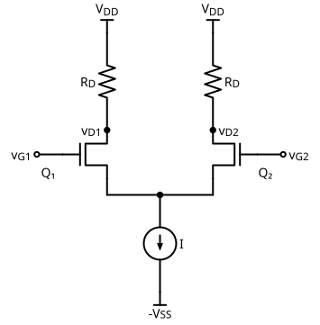

# 第 11 集 · 112-Lec01：MOS 偏壓總複習——從分壓電阻、電流鏡，走到差動對 [▶ 影片](https://www.youtube.com/watch?v=AbLF-GsNCJo)

← 上一集：[10](10-schmitt-trigger-digital-oscillator-pwm.md) ｜ [總目錄](../README.md) ｜ 下一集：[12](12-diff-amp-cm-dm-icmr-half-circuit.md) →

> **課程**：電子學（三），陽明交大 電子物理系，112 學年度 — 第 11 集（112 學年度 Lec01）
> **講者**：陳振芳 老師
> **來源**：YouTube 錄影逐字稿（1:43:15，whisper）＋ Sedra & Smith《Microelectronic Circuits》7th ed.
> **標記說明**：`【口頭】` 老師口頭補充；`[▶ mm:ss]` 影片時間點

---

## 目錄

- [0. 這堂課要做什麼](#0-這堂課要做什麼)
- [1. 分壓偏壓 + 耦合電容（複習）](#1-分壓偏壓--耦合電容複習)
- [2. 小信號與負載線（複習）](#2-小信號與負載線複習)
- [3. 夾止的物理再講一次](#3-夾止的物理再講一次)
- [4. MOS 為什麼重要](#4-mos-為什麼重要)
- [5. $k$ 是未知數 → 電流鏡偏壓](#5-k-是未知數--電流鏡偏壓)
- [6. 電流源偏壓的共源放大器](#6-電流源偏壓的共源放大器)
- [7. 輸入直流的範圍](#7-輸入直流的範圍)
- [8. 下一步：把電容換成一顆 MOS](#8-下一步把電容換成一顆-mos)
- [9. 一頁速查表](#9-一頁速查表)
- [10. 與後續集數的連結](#10-與後續集數的連結)

---

## 0. 這堂課要做什麼

（這一集開始是 112 學年度的電子學（三）正式課程。）【口頭】電子學（三）看起來好像比較難，其實不會，電子學（四）更簡單。從**差動放大器**（differential amplifier）開始；為了說明為什麼需要它，先把 MOS 偏壓從頭複習一次。[▶ 00:00](https://youtu.be/AbLF-GsNCJo?t=0)

（內容和電子學（二）第 15–20 集大幅重疊，這裡只整理重點，細節見那幾集。）

---

## 1. 分壓偏壓 + 耦合電容（複習）

[▶ 02:38](https://youtu.be/AbLF-GsNCJo?t=158)

$k = 2$ mA/V²、$V_t = 1$ V、$V_{DD} = 10$ V、$R_D = 5$ kΩ，設計 1 mA → $V_{GS} = 2$ V、$V_D = 5$ V。閘極用 $R_1$、$R_2$（例 8 MΩ、2 MΩ）分壓到 2 V。[▶ 05:42](https://youtu.be/AbLF-GsNCJo?t=342)

信號直接接上去，閘極被釘成 $v_s$，2 V 不見 → 要串**耦合電容**：開機時電容 0 V、電流從 10 V 經 $R_1$ 充電，充到兩電阻電流相等（2 V）就停，穩態電容開路。[▶ 09:54](https://youtu.be/AbLF-GsNCJo?t=594)

交流：電容要短路，$\frac{1}{\omega C} \ll R_1\parallel R_2$（帶最低頻）。[▶ 17:35](https://youtu.be/AbLF-GsNCJo?t=1055)

（詳見 [電子學（二）第 15 集](../E2/15-mosfet-small-signal-bias-coupling-cap.md)。）

---

## 2. 小信號與負載線（複習）

[▶ 20:07](https://youtu.be/AbLF-GsNCJo?t=1207)

$\frac12k(V_{GS} + v - V_t)^2$ 展開，$v^2 \ll 2(V_{GS} - V_t)v$ 時丟掉平方項（小信號近似）：

$$
g_m = k(V_{GS} - V_t) = \sqrt{2kI_D} = 2\ \text{mA/V},
\qquad
v_o = -g_mR_Dv_s
$$

$g_m$ 就是轉移曲線在 Q 點的斜率（微分）。負載線 $V_{DS} = V_{DD} - I_DR_D$，Q 點要在飽和區（平的地方）中間；$V_{GS}$ 只能比 $V_t$ 多一點點，太大就掉進三極管區。[▶ 28:58](https://youtu.be/AbLF-GsNCJo?t=1738)

---

## 3. 夾止的物理再講一次

[▶ 33:37](https://youtu.be/AbLF-GsNCJo?t=2017)

- $V_{DS} = V_{GS} - V_t$ 時汲極端通道剛好沒有 → **夾止**（pinch-off）。
- 電流密度 = 電荷 × 濃度 × 速度；速度 = 遷移率 × 電場（電場推、碰撞擋，平衡）。[▶ 36:45](https://youtu.be/AbLF-GsNCJo?t=2205)
- $V_{DS}$ 越大電流越大，但前面的路越來越窄（自己造成的），斜率下降。夾止後多加的電壓進不去，電流不變——【口頭】「沒用」是好的，這樣電流只由 $V_{GS}$ 控制。[▶ 42:25](https://youtu.be/AbLF-GsNCJo?t=2545)

（詳見 [電子學（二）第 13 集](../E2/13-mosfet-threshold-triode-saturation.md)。）

---

## 4. MOS 為什麼重要

[▶ 44:00](https://youtu.be/AbLF-GsNCJo?t=2640)

（回到 PN 接面：擴散、復合留下離子、內建電場形成一座山；電子和電洞看到的山方向相反。）【口頭】半導體最重要的一件事：**能控制山的高低**——本來電子過不去，加電壓把山壓低就過去了。MOS 的閘極電壓就是把源極那座山壓低；元件可以做到奈米尺寸、切換時間到奈秒，這就是今天半導體這麼重要的原因。[▶ 49:12](https://youtu.be/AbLF-GsNCJo?t=2952)

小 $V_{DS}$ 時通道是一顆電阻，也很好用（數位用途會特別買 $k$ 很大的）。[▶ 56:26](https://youtu.be/AbLF-GsNCJo?t=3386)

---

## 5. $k$ 是未知數 → 電流鏡偏壓

[▶ 57:57](https://youtu.be/AbLF-GsNCJo?t=3477)

電子零件行的 MOS 上面不會寫 $k$，資料表也不一定有。$k$ 加倍電流就加倍（$V_{GS}$ 固定時）——$k$ 是**未知參數**（unknown parameter），不能靠試。[▶ 1:00:30](https://youtu.be/AbLF-GsNCJo?t=3630)

**用電流鏡控制電流** [▶ 1:01:34](https://youtu.be/AbLF-GsNCJo?t=3694)：源極接一個 1 mA 的電流源，汲極就一定是 $10 - 5 = 5$ V，和 $k$ 無關；$R_1$、$R_2$ 也省了。

- 但源極要接**電容**到地：開機時源極 0 V、電流源從電容抽電荷，源極電壓下降，$V_{GS}$ 超過 $V_t$ 後 MOS 開始導通，一直到 MOS 電流 = 1 mA、電容不再充電 → 穩態 $V_{GS} = 2$ V、源極 −2 V。[▶ 1:05:12](https://youtu.be/AbLF-GsNCJo?t=3912)
- **電流鏡**：參考那顆閘極接汲極、經 8 kΩ 接 10 V（$k = 2$ 時 2 V、1 mA），接 −10 V。$k$ 很大（幾千，當作無窮大）時 $V_{GS} \to 1$ V → 電流 9/8 mA，幾乎不變；兩顆做一樣，輸出電流也一樣。[▶ 1:11:22](https://youtu.be/AbLF-GsNCJo?t=4282)

（詳見 [電子學（二）第 17 集](../E2/17-mosfet-drain-feedback-current-source-bias.md)。）

---

## 6. 電流源偏壓的共源放大器

[▶ 1:16:28](https://youtu.be/AbLF-GsNCJo?t=4588)

交流：拿掉所有直流源（包括電流源）。$v_s$ 加到閘極，交流電流 $g_mv_s$ 從源極電容流到地——電容要夠大，$\frac{1}{\omega C} \ll \frac{1}{g_m}$。[▶ 1:18:33](https://youtu.be/AbLF-GsNCJo?t=4713)

$k = 200$ → $g_m = \sqrt{2\cdot200\cdot1} = 20$ mA/V，$1/g_m = 50\ \Omega$ → 電容要幾百 μF 等級。增益 $-g_mR_D = -100$。[▶ 1:20:39](https://youtu.be/AbLF-GsNCJo?t=4839)

**分工**：直流由底下的電流鏡控制，交流增益由放大管自己的 $k$ 控制（separate）。[▶ 1:22:13](https://youtu.be/AbLF-GsNCJo?t=4933)

【口頭】做電子實驗可以，IC 不行：電容和電阻都不能太大。[▶ 1:23:15](https://youtu.be/AbLF-GsNCJo?t=4995)

---

## 7. 輸入直流的範圍

[▶ 1:25:53](https://youtu.be/AbLF-GsNCJo?t=5153)

沒有耦合電容時，信號源本身若帶 3 V 直流：開機時電容 0 V，3 V 全跨在 MOS 上，它可能先在三極管區；電容一直充，源極升到 1 V，$V_{GS} = 2$ V，回到飽和區 1 mA。電容自己把偏壓調好了——【口頭】這電路厲害就在這裡。[▶ 1:29:28](https://youtu.be/AbLF-GsNCJo?t=5368)

範圍（兩顆都要飽和）：[▶ 1:34:45](https://youtu.be/AbLF-GsNCJo?t=5685)

- 放大管：$5 \ge V_{DC} - 1$ → $V_{DC} \le 6$ V。
- 電流鏡那顆：源極 $V_{DC} - 2 \ge -8 - 1$ → $V_{DC} \ge -7$ V。

$$
-7\ \text{V} \le V_{DC} \le 6\ \text{V}
$$

太高、太低都會讓其中一顆跳出飽和。[▶ 1:38:23](https://youtu.be/AbLF-GsNCJo?t=5903)

---

## 8. 下一步：把電容換成一顆 MOS

[▶ 1:41:04](https://youtu.be/AbLF-GsNCJo?t=6064)

源極電容的工作：直流維持住、交流提供一條電阻很小的路。IC 設計的人一定想到用 MOS——**把電容換成一顆一樣的 MOS**（源極接源極），兩條路共用電流源 → **差動對**。輸出可以從任一邊汲極拉。下一集詳細講。[▶ 1:42:04](https://youtu.be/AbLF-GsNCJo?t=6124)

（同樣的想法見 [電子學（二）第 20 集](../E2/20-remove-capacitors-complementary-bridge.md)。）

---

## 9. 一頁速查表

| 項目 | 公式／重點 | 關鍵 |
|---|---|---|
| 分壓 + 耦合電容 | $1/(\omega C) \ll R_1\parallel R_2$ | 電容自己充到 2 V |
| $g_m$ | $k(V_{GS}-V_t) = \sqrt{2kI_D}$ | Q 點斜率 |
| 夾止 | $V_{DS} = V_{GS} - V_t$ | 之後電流只看 $V_{GS}$ |
| $k$ 未知 | 用電流鏡定電流 | $k\to\infty$ 只到 9/8 mA |
| 電流源偏壓 CS | 源極電容 $1/(\omega C) \ll 1/g_m$；$A_v = -g_mR_D$ | 直流、交流分開控制 |
| 輸入直流範圍 | 例 −7～6 V | 兩顆都飽和 |
| 下一步 | 電容 → 一顆 MOS = 差動對 | |

---

## 10. 與後續集數的連結

| 本集觀念 | 後面在哪裡用到 |
|---|---|
| 電容換成 MOS | 下一集：MOS 差動對 |
| 電流鏡 | 差動對的尾電流源、主動負載 |
| 輸入直流範圍 | 共模輸入範圍 |

---

## 附：本集一句話總結

> **分壓電阻 + 耦合電容能偏壓 MOS，但 $k$ 是未知數，所以改用電流鏡定住電流（$k$ 再大也只到 9/8 mA），源極接電容讓交流通過：直流由電流鏡控制、增益由放大管的 $k$ 控制，輸入直流在 −7～6 V 都能工作；IC 裡放不下大電容，把它換成一顆一樣的 MOS，就得到差動對。**

---

*筆記依據陳振芳老師「電子學（三）」112 學年度 Lec01 錄影逐字稿（whisper，1:43:15）與 Sedra & Smith《Microelectronic Circuits》7th ed. 整理。*
