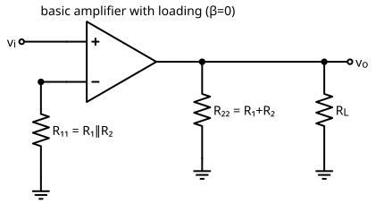

# 第 19 集 · 112-Lec09：電壓–電壓回授的實際 β 網路（負載效應）、三個例子；電壓–電流（轉導）回授 [▶ 影片](https://www.youtube.com/watch?v=W3Er1nosUIw)

← 上一集：[18](18-wilson-mirror-bjt-opamp-design-feedback-intro.md) ｜ [總目錄](../README.md) ｜ 下一集：[20](20-transconductance-feedback-laser-driver.md) →

> **課程**：電子學（三），陽明交大 電子物理系，112 學年度 — 第 19 集（112 學年度 Lec09）
> **講者**：陳振芳 老師
> **來源**：YouTube 錄影逐字稿（2:01:08，whisper）＋ Sedra & Smith《Microelectronic Circuits》7th ed.
> **標記說明**：`【口頭】` 老師口頭補充；`【課本補充】` 課本有、課堂沒講；`⚠️ 待確認` 查不清楚；`[▶ mm:ss]` 影片時間點

---

## 目錄

- [0. 這堂課要做什麼](#0-這堂課要做什麼)
- [1. 複習：理想回授的三式與兩個電阻](#1-複習理想回授的三式與兩個電阻)
- [2. 回授後的等效模型](#2-回授後的等效模型)
- [3. 實際的 β 網路：二埠模型](#3-實際的-β-網路二埠模型)
- [4. 做法：令 β = 0 但留下負載](#4-做法令-β--0-但留下負載)
- [5. 例 1：兩級 CMOS op amp 接電壓回授](#5-例-1兩級-cmos-op-amp-接電壓回授)
- [6. 例 2、3：分立的兩級、一級](#6-例-23分立的兩級一級)
- [7. 電壓–電流回授：輸出要電流（雷射、LED）](#7-電壓電流回授輸出要電流雷射led)
- [8. 實際的 β 網路：一顆電阻 $R$](#8-實際的-β-網路一顆電阻-r)
- [9. 例：兩級 op amp 推雷射](#9-例兩級-op-amp-推雷射)
- [10. 一頁速查表](#10-一頁速查表)
- [11. 與後續集數的連結](#11-與後續集數的連結)
- [⚠️ 待確認清單](#️-待確認清單)

---

## 0. 這堂課要做什麼

上一集的回授公式是**理想**的：β 網路不吃電流、不影響放大器。實際的 β 網路（電阻）會**負載**放大器。這集講怎麼把負載效應算進去，然後換成第二種組態：輸出要電流。

---

## 1. 複習：理想回授的三式與兩個電阻

[▶ 00:31](https://youtu.be/W3Er1nosUIw?t=31)

基本放大器（basic amplifier）：$R_{id}$、$A_dv_{id}$、$R_{od}$。電壓放大一定是電壓源串一個電阻。[▶ 01:01](https://youtu.be/W3Er1nosUIw?t=61)

$$
v_{id} = v_i - v_f,\quad v_f = \beta v_o,\quad v_o = A_dv_{id}
\quad\Longrightarrow\quad
A_f = \frac{A_d}{1 + \beta A_d}
$$

$R_{if} = R_{id}(1 + \beta A_d)$、$R_{of} = R_{od}/(1 + \beta A_d)$。[▶ 06:14](https://youtu.be/W3Er1nosUIw?t=374)

**怎麼記變大還是變小** [▶ 09:24](https://youtu.be/W3Er1nosUIw?t=564)：從輸出看進去，走 $R_{od}$ 到地，也走回授那一圈到地——兩塊**並聯**→ 變小。從輸入看進去，走 $R_{id}$ 再繞一圈回來——**串聯**→ 變大。

---

## 2. 回授後的等效模型

[▶ 12:03](https://youtu.be/W3Er1nosUIw?t=723)

整個回授電路 = 輸入電阻 $R_{if}$、受控源 $A_fv_i$、輸出電阻 $R_{of}$。$R_{if}$ 很大 → 信號源內阻 $R_s$ 上沒有壓降，$v_i = v_s$；$R_{of}$ 很小 → 負載 $R_L$ 不影響輸出。

$$
\frac{v_o}{v_s} \approx \frac{A_d}{1 + \beta A_d}
$$

非常理想的電壓–電壓放大器（voltage-voltage amplifier）。[▶ 14:11](https://youtu.be/W3Er1nosUIw?t=851)

---

## 3. 實際的 β 網路：二埠模型

[▶ 15:14](https://youtu.be/W3Er1nosUIw?t=914)

實際的 β 網路是 $R_1$、$R_2$ 分壓。它是線性二埠，寫兩個線性方程（輸入側用電壓、電流當變數）：[▶ 17:21](https://youtu.be/W3Er1nosUIw?t=1041)

$$
v_1 = h_{11}i_1 + h_{12}v_2,
\qquad
i_2 = h_{21}i_1 + h_{22}v_2
$$

- $h_{11}$ 是電阻：輸出短路（$v_2 = 0$）從回授端看進去 → $R_{11} = R_1\parallel R_2$。
- $h_{12}$ 就是 $\beta$：$i_1 = 0$ 時 $v_1 = \beta v_2$，$\beta = \frac{R_1}{R_1 + R_2}$。
- $h_{22}$：輸入端開路（$i_1 = 0$）從輸出看進去 → $R_{22} = R_1 + R_2$。
- $h_{21}$（從 1 傳到 2）：因為虛短路，$i_1$ 幾乎 0，這項忽略。[▶ 21:28](https://youtu.be/W3Er1nosUIw?t=1288)

所以實際的 β 網路 = **輸入側串一個 $R_{11}$ 加受控源 $\beta v_o$**，**輸出側並一個 $R_{22}$**。【口頭】「看輸入要讓 $v_2 = 0$、看輸出要讓 $i_1 = 0$」——這是因為輸入端是串聯（電壓相加）、輸出端是並聯（電壓取樣）。[▶ 25:32](https://youtu.be/W3Er1nosUIw?t=1532)

---

## 4. 做法：令 β = 0 但留下負載

[▶ 28:20](https://youtu.be/W3Er1nosUIw?t=1700)

要代公式，需要新的 $R_{id}$、$R_{od}$、$A_d$。做法：**位置都不動，只讓 $\beta = 0$**——[▶ 31:26](https://youtu.be/W3Er1nosUIw?t=1886)

1. 輸入側串上 $R_{11} = R_1\parallel R_2$；輸出側並上 $R_{22} = R_1 + R_2$（和 $R_L$）。這是「**有負載的基本放大器**」。
2. 從輸入看進去 → 新的 $R_{id}$；從輸出看進去 → 新的 $R_{od}$；$v_o/v_i$ → 新的 $A_d$。[▶ 32:27](https://youtu.be/W3Er1nosUIw?t=1947)
3. 代 $A_f = \frac{A_d}{1+\beta A_d}$、$R_{if} = R_{id}(1+\beta A_d)$、$R_{of} = R_{od}/(1+\beta A_d)$。

這樣得到的答案和直接解整個電路一樣（只忽略 $h_{21}$）。[▶ 34:00](https://youtu.be/W3Er1nosUIw?t=2040)

> 【課本補充】§11.4.2 (p. 831)：實際情況的 A 電路就是「把 β 網路的 $R_{11}$、$R_{22}$ 當負載接上」的基本放大器；$R_{11}$ 是輸出端短路、$R_{22}$ 是輸入端開路時求得。

---

## 5. 例 1：兩級 CMOS op amp 接電壓回授

[▶ 36:02](https://youtu.be/W3Er1nosUIw?t=2162)

**先檢查是不是負回授** [▶ 37:36](https://youtu.be/W3Er1nosUIw?t=2256)：輸入上升 → 第一級輸出下降（相差 180°）→ 第二級又反一次上升 → 拉回負端讓差值變小。負回授 OK。虛短路：負端 ≈ $v_i$。

【口頭】要算增益很容易（$1 + R_2/R_1$），麻煩的是兩個電阻。[▶ 40:10](https://youtu.be/W3Er1nosUIw?t=2410)

**令 β = 0**（$R_1\parallel R_2$ 接負端到地、$R_1 + R_2$ 並在輸出）[▶ 43:22](https://youtu.be/W3Er1nosUIw?t=2602)：

- $R_{id} = \infty$（MOS 閘極）→ $R_{if} = \infty$。
- $R_{od} = r_{o6}\parallel r_{o7}\parallel(R_1 + R_2)$。[▶ 45:57](https://youtu.be/W3Er1nosUIw?t=2757)
- $A_d = g_{m2}(r_{o2}\parallel r_{o4})\cdot g_{m6}\left[r_{o6}\parallel r_{o7}\parallel(R_1 + R_2)\right]$。

$$
R_{of} = \frac{R_{od}}{1 + \beta A_d} \approx \frac{1}{\beta\,g_{m2}(r_{o2}\parallel r_{o4})\,g_{m6}}
$$

（$R_{od}$ 和 $A_d$ 裡的同一團電阻消掉。）沒有回授時 25 kΩ，有回授後下降約上千倍。【口頭】Rout 越小越好。[▶ 53:15](https://youtu.be/W3Er1nosUIw?t=3195)

> ⚠️ 待確認：老師代的數字（$g_m$、$\beta$）逐字稿不清楚，回授後的 $R_{of}$ 實際是多少 Ω 要回影片看板書。

---

## 6. 例 2、3：分立的兩級、一級

**例 2（兩級）** [▶ 55:52](https://youtu.be/W3Er1nosUIw?t=3352)：兩級共源（反相兩次 = 同相），從輸出經 $R_2$、$R_1$ 回到第一級的源極。為什麼要兩級？一級的話回去變正回授——**一定要檢查**。[▶ 56:24](https://youtu.be/W3Er1nosUIw?t=3384)

- 令 β = 0：第一級源極串 $R_1\parallel R_2$（源極電阻讓第一級增益變小）；輸出並 $R_1 + R_2$。[▶ 1:00:37](https://youtu.be/W3Er1nosUIw?t=3637)
- $R_{of} = R_{od}/(1 + \beta A_d)$，$R_{od}$ 和 $A_d$ 裡的負載項消掉，剩 $\frac{1}{\beta g_m\cdots}$ 之類。[▶ 1:04:13](https://youtu.be/W3Er1nosUIw?t=3853)
- 例 $R_1 = 1$ k、$R_2 = 9$ k → 增益 10；輸出電阻下降約 2000 倍。[▶ 1:05:18](https://youtu.be/W3Er1nosUIw?t=3918)

**例 3（一級）** [▶ 1:07:54](https://youtu.be/W3Er1nosUIw?t=4074)：一顆 MOS 的同相組態（信號從閘極進、回授到源極，輸出和輸入同相），一級就可以。

- 令 β = 0：$A_d = g_m\left[r_o\parallel(R_1 + R_2)\right]$。[▶ 1:13:06](https://youtu.be/W3Er1nosUIw?t=4386)
- 回授後 $A_f \approx 1 + R_2/R_1$，**$g_m$ 消掉了**。[▶ 1:14:07](https://youtu.be/W3Er1nosUIw?t=4447)
- $R_{of} \approx \frac{1}{\beta g_m}$，非常小。【口頭】原來這個電路根本不能當電壓輸出，接了回授就可以。[▶ 1:15:11](https://youtu.be/W3Er1nosUIw?t=4511)

---

## 7. 電壓–電流回授：輸出要電流（雷射、LED）

[▶ 1:17:45](https://youtu.be/W3Er1nosUIw?t=4665)

輸出要送**電流**給雷射或 LED。基本放大器輸出端改成 **轉導**（transconductance）$A_d$：電流源 $A_dv_{id}$ 並 $R_{od}$。輸出取樣電流（**串聯**在輸出迴路），回授電壓 $v_f = \beta i_o$（$\beta$ 單位是 Ω）。[▶ 1:18:16](https://youtu.be/W3Er1nosUIw?t=4696)

【口頭】電壓輸出時負載開路沒負載效應；電流輸出反而要**短路**才沒負載效應。[▶ 1:19:17](https://youtu.be/W3Er1nosUIw?t=4757)

$$
v_{id} = v_i - \beta i_o,\quad i_o = A_dv_{id}
\quad\Longrightarrow\quad
\frac{i_o}{v_i} = \frac{A_d}{1 + \beta A_d}
$$

- 輸入一樣是電壓相加 → $R_{if} = R_{id}(1 + \beta A_d)$（串聯，變大）。[▶ 1:22:53](https://youtu.be/W3Er1nosUIw?t=4973)
- **輸出電阻**：輸出端（雷射）兩頭扯斷，加 $V_x$。【口頭】要電流就要用電流源並 $R_{of}$，不要自找麻煩用電壓。[▶ 1:24:56](https://youtu.be/W3Er1nosUIw?t=5096) 流過的電流產生 $-\beta A_dI_x$ 的受控電流灌回來 → [▶ 1:29:39](https://youtu.be/W3Er1nosUIw?t=5379)

$$
R_{of} = R_{od}(1 + \beta A_d)
$$

**變大**——抓電流就是要輸出電阻越大越好（理想電流源）。跟 $R_s$、$R_L$ 都無關。[▶ 1:33:22](https://youtu.be/W3Er1nosUIw?t=5602)

---

## 8. 實際的 β 網路：一顆電阻 $R$

[▶ 1:33:52](https://youtu.be/W3Er1nosUIw?t=5632)

輸出電流流過一顆電阻 $R$ 到地，$R$ 上的電壓回到負端：$v_f = Ri_o$，**$\beta = R$**（電流轉電壓）。[▶ 1:34:23](https://youtu.be/W3Er1nosUIw?t=5663)

二埠：

- 輸入側看進去（輸出側電流 $= 0$，**開路**）：$R_{11} = R$。[▶ 1:36:58](https://youtu.be/W3Er1nosUIw?t=5818)
- 輸出側看進去（輸入側電流 $= 0$，開路）：$R_{22} = R$，**串**在輸出迴路。[▶ 1:37:30](https://youtu.be/W3Er1nosUIw?t=5850)

令 β = 0：輸入側串 $R$、輸出迴路串 $R$；輸出電流在 $R_{od}$ 和 $R + R_L$ 之間**分流**。[▶ 1:43:11](https://youtu.be/W3Er1nosUIw?t=6191)

回授後 $R_{of} = R_{od}(1 + \beta A_d)$，其中 $R_{od}$ 和 $A_d$ 相乘消掉分流項，剩約 $A_d\cdot R\cdot R_{od}$ 的量級——變得很大。$R$ 取多少看你要的電流（$i_o \approx v_i/R$）。[▶ 1:47:51](https://youtu.be/W3Er1nosUIw?t=6471)

> 【課本補充】§11.5.2 (p. 844)：串聯–串聯（series-series）回授 = 回授轉導放大器，$A_f = \frac{I_o}{V_s} \approx \frac1\beta$，$R_{if} = R_i(1 + A\beta)$、$R_{of} = R_o(1 + A\beta)$。

---

## 9. 例：兩級 op amp 推雷射

[▶ 1:49:56](https://youtu.be/W3Er1nosUIw?t=6596)

兩級 op amp 輸出經雷射、電阻 $R$ 到地；$R$ 上的電壓回到負端。直流不要，所以加一個很大的電容（對 AC 短路）。[▶ 1:50:58](https://youtu.be/W3Er1nosUIw?t=6658)

- 輸入電阻：MOS → 無窮大，$R_{if}$ 還是無窮大。[▶ 1:59:20](https://youtu.be/W3Er1nosUIw?t=7160)
- 令 β = 0、信號拿掉，從雷射兩端看：$r_{o6}$ 加小的 $R$（$R \ll r_{o6}, r_{o7}$）≈ $r_{o6}$。
- 乘上 $1 + \beta A_d$：$R_{of}$ 大約是 $R_{od}$ 的 $100\times100\times4 = 4$ 萬倍。[▶ 2:00:20](https://youtu.be/W3Er1nosUIw?t=7220)

---

## 10. 一頁速查表

| 項目 | 電壓–電壓（series-shunt） | 電壓–電流（series-series） |
|---|---|---|
| 基本放大器輸出 | 電壓源 $A_dv_{id}$ 串 $R_{od}$ | 電流源 $A_dv_{id}$ 並 $R_{od}$ |
| $\beta$ | $\frac{R_1}{R_1+R_2}$（無單位） | $R$（Ω） |
| 閉迴路 | $\frac{v_o}{v_i} \approx 1 + \frac{R_2}{R_1}$ | $\frac{i_o}{v_i} \approx \frac1R$ |
| $R_{if}$ | $R_{id}(1+\beta A_d)$ | $R_{id}(1+\beta A_d)$ |
| $R_{of}$ | $R_{od}/(1+\beta A_d)$ | $R_{od}(1+\beta A_d)$ |
| 輸入側負載 | 串 $R_1\parallel R_2$（輸出短路求） | 串 $R$（輸出開路求） |
| 輸出側負載 | 並 $R_1+R_2$（輸入開路求） | 串 $R$（輸入開路求） |
| 記法 | 並聯變小、串聯變大 | |

**流程**：檢查負回授 → 畫出 β 網路的 $R_{11}$、$R_{22}$ → 令 β = 0 求 $R_{id}$、$R_{od}$、$A_d$ → 代公式。

---

## 11. 與後續集數的連結

| 本集觀念 | 後面在哪裡用到 |
|---|---|
| 二埠模型的負載效應 | 下一集：另兩種組態（電流取樣並聯相加） |
| 轉導回授 | 雷射驅動、電流源 |
| 檢查負回授 | 每一題第一步 |

---

## 附：本集一句話總結

> **實際的 β 網路是個二埠：電壓–電壓回授時它在輸入側留下串聯的 $R_1\parallel R_2$、在輸出側留下並聯的 $R_1+R_2$，把這兩個負載接上、令 β = 0 求出 $R_{id}$、$R_{od}$、$A_d$ 再代公式；兩級 op amp 或一顆 MOS 接成同相回授後增益只剩 $1+R_2/R_1$、$g_m$ 消掉、輸出電阻降成 $1/(\beta g_m\cdots)$。要輸出電流（雷射、LED）就用電壓–電流回授，$\beta = R$，輸入和輸出電阻都乘 $1+\beta A_d$ 變大，成為理想電流源。**

---

## ⚠️ 待確認清單

1. 第 5 節例 1 回授後 $R_{of}$ 的數值。

---

*筆記依據陳振芳老師「電子學（三）」112 學年度 Lec09 錄影逐字稿（whisper，2:01:08）與 Sedra & Smith《Microelectronic Circuits》7th ed. 整理。*
