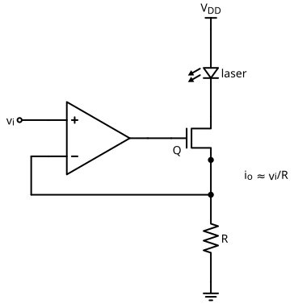

# 第 20 集 · 112-Lec10：電壓–電流（轉導）回授——短路電流與 Norton 模型、雷射驅動器放在汲極、一顆 MOS 加源極電阻 [▶ 影片](https://www.youtube.com/watch?v=oE0OxELNnWU)

← 上一集：[19](19-series-shunt-practical-beta-series-series.md) ｜ [總目錄](../README.md) ｜ 下一集：[21](21-shunt-shunt-shunt-series-feedback.md) →

> **課程**：電子學（三），陽明交大 電子物理系，112 學年度 — 第 20 集（112 學年度 Lec10）
> **講者**：陳振芳 老師
> **來源**：YouTube 錄影逐字稿（1:59:34，whisper）＋ Sedra & Smith《Microelectronic Circuits》7th ed.
> **標記說明**：`【口頭】` 老師口頭補充；`【課本補充】` 課本有、課堂沒講；`[▶ mm:ss]` 影片時間點

---

## 目錄

- [0. 這堂課要做什麼](#0-這堂課要做什麼)
- [1. 複習：電壓轉電流的回授](#1-複習電壓轉電流的回授)
- [2. 例：兩級 op amp + 一顆 MOS 推雷射](#2-例兩級-op-amp--一顆-mos-推雷射)
- [3. 算出來的是「短路電流」：Norton 模型](#3-算出來的是短路電流norton-模型)
- [4. 雷射放到汲極：電阻再大 $(1+g_mr_o)$ 倍](#4-雷射放到汲極電阻再大-1g_mr_o-倍)
- [5. 例：op amp 推 MOS，直接解 vs 回授理論](#5-例op-amp-推-mos直接解-vs-回授理論)
- [6. 最簡單的雷射驅動：一顆 MOS 加源極電阻](#6-最簡單的雷射驅動一顆-mos-加源極電阻)
- [7. 一頁速查表](#7-一頁速查表)
- [8. 與後續集數的連結](#8-與後續集數的連結)

---

## 0. 這堂課要做什麼

繼續上一集的電壓–電流回授（LED、laser driver）。重點：用回授理論算出來的是**短路電流**；雷射要放在哪裡電流才最穩。

---

## 1. 複習：電壓轉電流的回授

[▶ 00:32](https://youtu.be/oE0OxELNnWU?t=32)

輸入端兩個電壓相加（$v_{id} = v_i - v_f$），基本放大器是 V→I 模型（電流源 $A_dv_{id}$ 並 $R_{od}$），$v_f = \beta i_o$。輸出端的 $i_o$ 是**短路**下的電流（把雷射短路）。[▶ 03:38](https://youtu.be/oE0OxELNnWU?t=218)

$$
\frac{i_o}{v_i} = \frac{A_d}{1 + \beta A_d} \approx \frac1\beta,
\qquad
R_{if} = R_{id}(1+\beta A_d),
\qquad
R_{of} = R_{od}(1+\beta A_d)
$$

【口頭】放一個雷射在輸出，從雷射看回去電阻變得很大——這就是我們要的。β 網路只要一顆電阻 $R$，$\beta = R$。[▶ 13:41](https://youtu.be/oE0OxELNnWU?t=821)

---

## 2. 例：兩級 op amp + 一顆 MOS 推雷射

[▶ 18:19](https://youtu.be/oE0OxELNnWU?t=1099)

兩級 op amp 的輸出再接一顆 NMOS（$g_{m2}$、$r_{o2}$），源極接 $R$ 到地、$R$ 上的電壓拉回負端。先檢查：輸入升 → … → $R$ 上電壓升 → 差值變小，負回授。[▶ 19:54](https://youtu.be/oE0OxELNnWU?t=1194)

令 $\beta = 0$，輸入側串 $R$、輸出迴路串 $R$（輸出短路）：[▶ 21:59](https://youtu.be/oE0OxELNnWU?t=1319)

- $R_{id} = \infty$（MOS 閘極）。
- $R_{od}$：輸出那條路扯斷加 $V_x$，信號源拿掉 → 疊接公式 $R + r_{o2} + g_{m2}r_{o2}R$ 之類。[▶ 24:37](https://youtu.be/oE0OxELNnWU?t=1477)
- $A_d$：前面 op amp 的增益 × 這顆 MOS 的 $\dfrac{1}{1/g_{m2} + R}$（電流 = 電壓 ÷（往上 $1/g_m$ 串 $R$））。[▶ 29:15](https://youtu.be/oE0OxELNnWU?t=1755)

代公式：$R_{of} = R_{od}(1 + \beta A_d)$，非常大；$i_o \approx v_i/R$。[▶ 33:24](https://youtu.be/oE0OxELNnWU?t=2004)

---

## 3. 算出來的是「短路電流」：Norton 模型

[▶ 33:55](https://youtu.be/oE0OxELNnWU?t=2035)

剛剛的 $i_o$ 是把輸出兩頭**短路**下的電流 $i_{sc} = v_i/R$，**不一定等於雷射電流**——雷射有負載 $R_L$。

整個回授電路 = 輸入電阻無窮大、電流源 $i_{sc}$ **並** $R_{of}$（Norton 等效）。接上雷射後分流：[▶ 42:20](https://youtu.be/oE0OxELNnWU?t=2540)

$$
i_{\text{laser}} = i_{sc}\cdot\frac{R_{of}}{R_{of} + R_L}
\approx i_{sc}
\quad\text{若 } R_{of} \gg R_L
$$

這就是要 $R_{of}$ 大的理由：雷射電流跟 $R_L$（會隨溫度變）**無關**。[▶ 44:00](https://youtu.be/oE0OxELNnWU?t=2640)

---

## 4. 雷射放到汲極：電阻再大 $(1+g_mr_o)$ 倍

[▶ 49:12](https://youtu.be/oE0OxELNnWU?t=2952)

雷射不放在源極那條（和 $R$ 同一條路的下面），改放在 MOS **汲極上方**：電流一樣（同一條路），但看進去的電阻不同。

- 從源極那裡扯斷看：$\frac{1}{g_m}\parallel\cdots$，小。
- 從汲極扯斷看：疊接公式 $r_o + R + g_mr_oR$——多了 $(1 + g_mr_o)$ 倍。[▶ 58:00](https://youtu.be/oE0OxELNnWU?t=3480)

所以雷射放在汲極，看回去的電阻是 $R_{of}\times(1+g_mr_o)$，例如上萬 kΩ，幾乎無窮大。【口頭】雷射操作起來，就算溫度變、$R_L$ 怎麼變都一樣。**雷射或 LED 要放在汲極（頭上）**。[▶ 1:01:43](https://youtu.be/oE0OxELNnWU?t=3703)

【口頭】這一步跟回授無關，一開始沒辦法用回授算，是電路本身的結構。[▶ 1:03:20](https://youtu.be/oE0OxELNnWU?t=3800)

---

## 5. 例：op amp 推 MOS，直接解 vs 回授理論

[▶ 1:03:50](https://youtu.be/oE0OxELNnWU?t=3830)

op amp（增益 $A_d$、輸出 $R_o$）驅動 MOS 閘極，源極 $R$ 拉回負端，雷射在汲極。

**直接解** [▶ 1:05:56](https://youtu.be/oE0OxELNnWU?t=3956)：虛短路 → 源極 ≈ $v_i$；寫 KCL 把 $i_o$ 解出（短路下）。輸出電阻：信號源拿掉、加 $V_x$，

$$
R_{of} = R + r_o + A_d\,g_mr_o\,R\ \text{（量級）}
$$

[▶ 1:12:57](https://youtu.be/oE0OxELNnWU?t=4377)

**回授理論** [▶ 1:14:28](https://youtu.be/oE0OxELNnWU?t=4468)：$\beta = R$，令 $\beta = 0$ 求 $R_{od}$、$A_d$，代 $R_{od}(1+\beta A_d)$——和直接解**完全一樣**。[▶ 1:23:52](https://youtu.be/oE0OxELNnWU?t=5032)

【口頭】信號處理基本上都用電壓，電流很難運算；但驅動雷射要電流，所以要這種電壓轉電流的電路。[▶ 1:25:59](https://youtu.be/oE0OxELNnWU?t=5159)

---

## 6. 最簡單的雷射驅動：一顆 MOS 加源極電阻

[▶ 1:27:01](https://youtu.be/oE0OxELNnWU?t=5221)

一顆 MOS、源極 $R$ 到地、雷射在汲極。不需要 op amp。

**直接解** [▶ 1:29:06](https://youtu.be/oE0OxELNnWU?t=5346)：$v_i = \frac{i_o}{g_m} + i_oR$（$r_o$ 的修正另算）→

$$
i_o \approx \frac{v_i}{1/g_m + R},
\qquad
R_o = r_o + R + g_mr_oR
$$

（疊接公式。）[▶ 1:33:19](https://youtu.be/oE0OxELNnWU?t=5599)

**用回授看** [▶ 1:35:55](https://youtu.be/oE0OxELNnWU?t=5755)：一顆 MOS 有三隻腳，回授理論要「輸入端、輸出端」兩頭——把 MOS 本身 model 成二埠：輸入（閘–源）、輸出（汲–源）是 V→I 模型：$g_m v$ 並 $r_o$，輸入開路。[▶ 1:38:02](https://youtu.be/oE0OxELNnWU?t=5882) 源極電阻 $R$ 就是 β 網路（$\beta = R$）。

令 $\beta = 0$：$R_{od} = r_o + R$；$A_d$ 含分流 $\frac{r_o}{r_o + R}$。代公式：[▶ 1:46:50](https://youtu.be/oE0OxELNnWU?t=6410)

$$
R_{of} = (r_o + R)\left(1 + \frac{g_mr_oR}{r_o + R}\right) = r_o + R + g_mr_oR
$$

——這就是**疊接公式**。【口頭】模型裡的那一頭在實際元件中不存在（拆不開），但從那裡看和從汲極看是同一條路、一樣的電阻。[▶ 1:52:40](https://youtu.be/oE0OxELNnWU?t=6760)

所以源極電阻其實就是一個電壓→電流的**負回授**：電流上升 → $R$ 上電壓上升 → $V_{GS}$ 下降 → 電流被拉回。[▶ 1:58:58](https://youtu.be/oE0OxELNnWU?t=7138)

> 【課本補充】§11.5.2 (p. 844)：源極（射極）退化電阻是最簡單的串聯–串聯回授；$R_{of} = r_o(1 + g_mR)$ 的量級與 §8.5.2 (p. 547) 的疊接輸出電阻同式。

---

## 7. 一頁速查表

| 項目 | 公式／重點 | 關鍵 |
|---|---|---|
| V→I 回授 | $\frac{i_o}{v_i} \approx \frac1R$，$\beta = R$ | 短路電流 |
| 電阻 | $R_{if}$、$R_{of}$ 都乘 $1+\beta A_d$ | 變大 |
| Norton 模型 | $i_{sc}$ 並 $R_{of}$ | $R_{of} \gg R_L$ 時與 $R_L$ 無關 |
| 雷射位置 | 放在汲極：電阻再乘 $1+g_mr_o$ | 不放在源極 |
| op amp + MOS | $R_{of} \approx R + r_o + A_dg_mr_oR$ | 直接解 = 回授理論 |
| 單顆 MOS + $R$ | $i_o \approx \frac{v_i}{1/g_m + R}$；$R_o = r_o + R + g_mr_oR$ | 源極電阻 = 負回授 |

---

## 8. 與後續集數的連結

| 本集觀念 | 後面在哪裡用到 |
|---|---|
| 二埠化元件 | 下一集：電流取樣、並聯相加（另兩種組態） |
| 疊接公式 = 回授 | 回授觀點看電流源 |

---

## 附：本集一句話總結

> **電壓–電流回授用 $\beta = R$，算出來的 $i_o = v_i/R$ 是輸出短路下的電流，整個電路是 Norton 模型 $i_{sc}$ 並一個很大的 $R_{of} = R_{od}(1+\beta A_d)$，所以雷射電流和雷射本身的 $R_L$ 無關；雷射要放在 MOS 汲極，看回去的電阻再大 $(1+g_mr_o)$ 倍；就連一顆 MOS 加源極電阻也是一個 V→I 負回授，回授公式算出來正好是疊接公式 $r_o + R + g_mr_oR$。**

---

*筆記依據陳振芳老師「電子學（三）」112 學年度 Lec10 錄影逐字稿（whisper，1:59:34）與 Sedra & Smith《Microelectronic Circuits》7th ed. 整理。*
