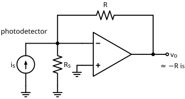

# 第 21 集 · 112-Lec11：電流–電壓（轉阻）回授：光偵測器變理想電流源、一顆 MOS、op amp 例；電流–電流回授與光放大器 [▶ 影片](https://www.youtube.com/watch?v=ADE0OzhV11g)

← 上一集：[20](20-transconductance-feedback-laser-driver.md) ｜ [總目錄](../README.md) ｜ 下一集：[22](22-loop-gain-stability-phase-margin.md) →

> **課程**：電子學（三），陽明交大 電子物理系，112 學年度 — 第 21 集（112 學年度 Lec11）
> **講者**：陳振芳 老師
> **來源**：YouTube 錄影逐字稿（1:58:57，whisper）＋ Sedra & Smith《Microelectronic Circuits》7th ed.
> **標記說明**：`【口頭】` 老師口頭補充；`【課本補充】` 課本有、課堂沒講；`[▶ mm:ss]` 影片時間點

---

## 目錄

- [0. 這堂課要做什麼](#0-這堂課要做什麼)
- [1. 電流–電壓回授：輸入端電流相減](#1-電流電壓回授輸入端電流相減)
- [2. 兩個電阻都變小](#2-兩個電阻都變小)
- [3. 算出來的是開路電壓；光偵測器變理想](#3-算出來的是開路電壓光偵測器變理想)
- [4. 實際 β 網路：一顆跨接電阻 $R$](#4-實際-β-網路一顆跨接電阻-r)
- [5. 例：op amp + 回授電阻](#5-例op-amp--回授電阻)
- [6. 例：一顆 MOS 汲–閘跨接電阻](#6-例一顆-mos-汲閘跨接電阻)
- [7. 例：兩級 op amp 已經內含回授](#7-例兩級-op-amp-已經內含回授)
- [8. 電流–電流回授](#8-電流電流回授)
- [9. 例：光放大器（光偵測器 → 雷射）](#9-例光放大器光偵測器--雷射)
- [10. 四種組態總表](#10-四種組態總表)
- [11. 與後續集數的連結](#11-與後續集數的連結)

---

## 0. 這堂課要做什麼

最後兩種回授：輸入端**電流相減**（並聯）。第一種輸出取電壓（轉阻，transresistance），第二種輸出取電流（電流放大器）。

---

## 1. 電流–電壓回授：輸入端電流相減

[▶ 00:32](https://youtu.be/ADE0OzhV11g?t=32)

輸入是電流 $i_i$，回授電流 $i_f$ 相減：$i_{id} = i_i - i_f$，流進 $R_{id}$。基本放大器是 I→V：電壓源 $A_di_{id}$ 串 $R_{od}$（$A_d$ 單位 Ω）。輸出電壓轉成電流拉回：$i_f = \beta v_o$（$\beta$ 單位 1/Ω）。[▶ 01:35](https://youtu.be/ADE0OzhV11g?t=95)

$$
v_o = A_d(i_i - \beta v_o)
\quad\Longrightarrow\quad
A_f = \frac{v_o}{i_i} = \frac{A_d}{1 + \beta A_d} \approx \frac1\beta
$$

$i_f = \frac{\beta A_d}{1+\beta A_d}i_i \approx i_i$：兩個電流**一步一趨**，進 $R_{id}$ 的電流幾乎 0 → 輸入兩端幾乎沒壓差。[▶ 04:39](https://youtu.be/ADE0OzhV11g?t=279)

---

## 2. 兩個電阻都變小

**輸入電阻** [▶ 06:42](https://youtu.be/ADE0OzhV11g?t=402)：$v = R_{id}(i_i - i_f) = \frac{R_{id}}{1+\beta A_d}i_i$ →

$$
R_{if} = \frac{R_{id}}{1 + \beta A_d}
$$

從輸入看進去：$R_{id}$ 到地，加上回授那一圈也到地——**並聯**，變小。所以這種叫 shunt（並聯）回授。[▶ 08:43](https://youtu.be/ADE0OzhV11g?t=523)

**輸出電阻** [▶ 09:13](https://youtu.be/ADE0OzhV11g?t=553)：信號源拿掉、加 $V_x$，受控源變 $-\beta A_dV_x$，電流放大 $1+\beta A_d$ 倍 →

$$
R_{of} = \frac{R_{od}}{1 + \beta A_d}
$$

兩個都變小：輸入小 → **抓電流**；輸出小 → 送**電壓**。[▶ 13:35](https://youtu.be/ADE0OzhV11g?t=815)

---

## 3. 算出來的是開路電壓；光偵測器變理想

[▶ 14:09](https://youtu.be/ADE0OzhV11g?t=849)

送電壓 → 等效模型是電壓源串 $R_{of}$。上面算的 $v_o$ 是輸出**開路**下的電壓 $v_{oc} \approx i_i/\beta$。接負載 $R_L$ 後會分壓，但 $R_{of}$ 很小，所以跟 $R_L$ 無關。[▶ 17:48](https://youtu.be/ADE0OzhV11g?t=1068)

**輸入端**：電流源都有自己的內阻 $R_s$（不理想）。$R_{if}$ 很小 → 分流時電流全部進來，跟 $R_s$ 無關。[▶ 20:54](https://youtu.be/ADE0OzhV11g?t=1254)

所以這個電路把**不理想的電流源**轉成**理想的電壓源**，增益 $1/\beta$，後面怎麼接都一樣。【口頭】信號處理電路全是電壓，但光偵測器（photodetector）輸出是電流——先抓電流，再轉成電壓。[▶ 24:31](https://youtu.be/ADE0OzhV11g?t=1471)

---

## 4. 實際 β 網路：一顆跨接電阻 $R$

[▶ 26:02](https://youtu.be/ADE0OzhV11g?t=1562)

輸出到輸入接一顆 $R$。電壓除以電阻得電流 → 二埠（這次用 $y$ 參數，兩端都是並聯）：

- 輸入側：令 $v_o = 0$（輸出短路）看進去 → $R$（並在輸入）。[▶ 27:02](https://youtu.be/ADE0OzhV11g?t=1622)
- 輸出側：令輸入電壓 0（短路）看進去 → $R$（並在輸出）。[▶ 28:37](https://youtu.be/ADE0OzhV11g?t=1717)
- 傳輸：輸入短路時 $i_f = -v_o/R$ → $\beta = -\dfrac1R$。[▶ 30:09](https://youtu.be/ADE0OzhV11g?t=1809)

（從輸入傳到輸出那一項照樣忽略，三樣就好。）

> 【課本補充】§11.5.3 (p. 855)：並聯–並聯回授的 β 網路用 $y$ 參數；$R_{11}$、$R_{22}$ 都是另一端**短路**求得。

---

## 5. 例：op amp + 回授電阻

[▶ 32:14](https://youtu.be/ADE0OzhV11g?t=1934)

反相輸入接電流源，輸出經 $R$ 拉回反相端，正端接地。

令 $\beta = 0$：輸入側並 $R$、輸出側並 $R$，其他都歸給基本放大器：[▶ 33:16](https://youtu.be/ADE0OzhV11g?t=1996)

- $R_{id} = R_{in,op}\parallel R$。
- $R_{od} = R_o\parallel R$。
- $A_d = v_o/i_i$：信號在負端 → **多一個負號**：$A_d = -(R_{id})\cdot A_{op}\cdot\frac{R}{R_o + R}$。$\beta = -1/R$，所以 $\beta A_d > 0$。【口頭】$\beta A_d$ 一定要大於 0，算出來小於 0 就錯了（那是正回授）。[▶ 37:23](https://youtu.be/ADE0OzhV11g?t=2243)

代公式：$R_{if}$、$R_{of}$ 都除 $1+\beta A_d$，變很小；

$$
\frac{v_o}{i_i} \approx \frac1\beta = -R
$$

[▶ 42:04](https://youtu.be/ADE0OzhV11g?t=2524)

---

## 6. 例：一顆 MOS 汲–閘跨接電阻

[▶ 43:39](https://youtu.be/ADE0OzhV11g?t=2619)

MOS 閘極看進去本來無窮大，不能抓電流。汲極到閘極接 $R$（汲極有 $r_o$ 負載）：電流相減再進去 → 電流–電壓回授。

**用回授理論** [▶ 46:12](https://youtu.be/ADE0OzhV11g?t=2772)：令 $\beta = 0$，閘極並 $R$、汲極並 $R$：

- $R_{id} = R$（閘極無窮大並 $R$）。
- $R_{od} = r_o\parallel R \approx R$。[▶ 48:43](https://youtu.be/ADE0OzhV11g?t=2923)
- $A_d = -R\cdot g_m(r_o\parallel R)$。

$$
R_{if} = \frac{R}{1 + g_m(r_o\parallel R)} \approx \frac{1}{g_m},
\qquad
R_{of} \approx \frac{1}{g_m},
\qquad
\frac{v_o}{i_i} \approx -R
$$

[▶ 51:24](https://youtu.be/ADE0OzhV11g?t=3084)

**直接解** [▶ 54:33](https://youtu.be/ADE0OzhV11g?t=3273)：加 $V$ 在閘極，$I = g_mV + \frac{V - IR}{r_o}$ 之類 → 得到一樣的 $R_{if}$；輸出電阻：閘–汲之間沒電流、閘極電壓 = 汲極電壓 → 二極體接法 $\frac1{g_m}\parallel r_o$。[▶ 59:45](https://youtu.be/ADE0OzhV11g?t=3585) 輸入電壓非常小（虛接地）。結果和回授理論一樣。[▶ 1:01:51](https://youtu.be/ADE0OzhV11g?t=3711)

---

## 7. 例：兩級 op amp 已經內含回授

[▶ 1:02:52](https://youtu.be/ADE0OzhV11g?t=3772)

兩級 op amp 第二級（共源）從輸出拉一顆 $R$ 回到它自己的閘極——回授已經在裡面了，這整個電路就是一個功能固定的放大器，**不要再接回授**。[▶ 1:04:56](https://youtu.be/ADE0OzhV11g?t=3896)

- 第二級（含 $R$）是轉阻級：輸入電阻 $\approx 1/g_{m6}$（很小）、增益 $\approx -R$。
- 第一級差動放大器化成 Norton：短路電流 $g_{m2}v_s$（電流鏡兩邊相加）並一個很大的 $r_o\parallel r_o$。[▶ 1:07:58](https://youtu.be/ADE0OzhV11g?t=4078)
- 第一級的電流全部流進第二級的小電阻：

$$
v_o \approx -g_{m2}R\,v_s
$$

例 $g_{m2} = 2$ mA/V… 增益約 10（逐字稿說 10 倍）。一個很好的電壓–電壓放大器。[▶ 1:16:53](https://youtu.be/ADE0OzhV11g?t=4613)

輸入加一顆 $R_s$ 時，$i \approx \frac{v_s}{R_s}$（量級），$\frac{v_o}{v_s} \approx -\frac{R}{R_s}$：增益只和電阻比有關，不要有 $g_m$ 那些。[▶ 1:20:34](https://youtu.be/ADE0OzhV11g?t=4834)

---

## 8. 電流–電流回授

[▶ 1:22:39](https://youtu.be/ADE0OzhV11g?t=4959)

輸入抓電流（並聯相減），輸出送電流（串聯取樣）：基本放大器 I→I，電流源 $A_di_{id}$ 並 $R_{od}$；$i_f = \beta i_o$（$\beta$ 無單位）。

$$
\frac{i_o}{i_i} = \frac{A_d}{1 + \beta A_d},
\qquad
R_{if} = \frac{R_{id}}{1 + \beta A_d},
\qquad
R_{of} = R_{od}(1 + \beta A_d)
$$

[▶ 1:28:27](https://youtu.be/ADE0OzhV11g?t=5307)

- 輸入小 → 抓電流（$R_s$ 再大都沒關係，電流全部進來）。
- 輸出大 → 送電流給雷射，雷射電流 $\approx i_o$ 跟雷射負載無關。[▶ 1:35:11](https://youtu.be/ADE0OzhV11g?t=5711)

把不理想的電流源轉成**理想電流源**，增益 $1/\beta$。[▶ 1:39:50](https://youtu.be/ADE0OzhV11g?t=5990)

---

## 9. 例：光放大器（光偵測器 → 雷射）

[▶ 1:40:21](https://youtu.be/ADE0OzhV11g?t=6021)

光偵測器的電流進 op amp 負端；輸出電流經雷射，再由 $R_1$、$R_2$ 分流，一部分電流拉回負端。

β 網路：從輸入側看 $R_1 + R_2$ 之類並聯，從輸出側看 $R_1\parallel R_2$ 串在迴路；分流 $\beta = -\frac{R_1}{R_1 + R_2}$（方向相反，負號）。[▶ 1:42:30](https://youtu.be/ADE0OzhV11g?t=6150)

令 $\beta = 0$ 求 $R_{id}$、$R_{od}$、$A_d$，代公式：[▶ 1:47:47](https://youtu.be/ADE0OzhV11g?t=6467)

$$
\frac{i_o}{i_i} \approx \frac1\beta = -\left(1 + \frac{R_2}{R_1}\right)
$$

【口頭】就像電壓分壓倒回來會有放大，電流分流倒回來也一樣。外面的光打進來 → 抓電流 → 放大 → 送到雷射再以光送出去：一個簡單的**光放大器**（optical amplifier）。[▶ 1:58:17](https://youtu.be/ADE0OzhV11g?t=7097)

> 【課本補充】§11.5.4 (p. 865)：並聯–串聯回授 = 回授電流放大器，$A_f = I_o/I_s \approx 1/\beta$，$R_{if} = R_i/(1+A\beta)$、$R_{of} = R_o(1+A\beta)$。

---

## 10. 四種組態總表

| 組態 | 輸入（相加） | 輸出（取樣） | $A_f \approx 1/\beta$ | $R_{if}$ | $R_{of}$ | 用途 |
|---|---|---|---|---|---|---|
| 電壓–電壓（series-shunt） | 串聯，電壓 | 並聯，電壓 | $v_o/v_i$ | × | ÷ | 電壓放大 |
| 電壓–電流（series-series） | 串聯，電壓 | 串聯，電流 | $i_o/v_i$（S） | × | × | 雷射驅動 |
| 電流–電壓（shunt-shunt） | 並聯，電流 | 並聯，電壓 | $v_o/i_i$（Ω） | ÷ | ÷ | 光偵測 → 電壓 |
| 電流–電流（shunt-series） | 並聯，電流 | 串聯，電流 | $i_o/i_i$ | ÷ | × | 光放大器 |

×／÷ 指乘或除 $(1 + \beta A_d)$。**記法**：串聯變大、並聯變小。$\beta A_d$ 一定 > 0。

---

## 11. 與後續集數的連結

| 本集觀念 | 後面在哪裡用到 |
|---|---|
| 四種組態 | 下一集：綜合例題、穩定度 |
| $\beta A_d > 0$ 檢查 | 判斷正、負回授 |

---

## 附：本集一句話總結

> **輸入端電流相減的兩種回授，輸入電阻都除 $(1+\beta A_d)$ 變很小、專門抓電流：輸出取電壓的轉阻回授（一顆跨接電阻 $R$，$\beta = -1/R$）把光偵測器這種不理想電流源變成理想電壓源，$v_o \approx -Ri_i$，連一顆 MOS 汲閘跨接 $R$ 都是，輸入、輸出電阻都約 $1/g_m$；輸出取電流的電流回授（$R_1$、$R_2$ 分流）讓輸出電阻變大，增益 $-(1+R_2/R_1)$，接上光偵測器和雷射就是光放大器。**

---

*筆記依據陳振芳老師「電子學（三）」112 學年度 Lec11 錄影逐字稿（whisper，1:58:57）與 Sedra & Smith《Microelectronic Circuits》7th ed. 整理。*
