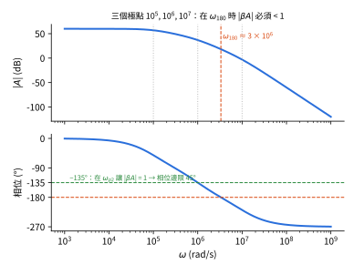

# 第 22 集 · 112-Lec12：電流–電流回授例題、用測試信號求迴路增益 $\beta A$、MOS 電容與極點、震盪條件、相位邊限與頻率補償 [▶ 影片](https://www.youtube.com/watch?v=Q2VaxDq3XSk)

← 上一集：[21](21-shunt-shunt-shunt-series-feedback.md) ｜ [總目錄](../README.md) ｜ 下一集：[E4-01](../E4/01-low-frequency-coupling-caps-miller-intro.md) →

> **課程**：電子學（三），陽明交大 電子物理系，112 學年度 — 第 22 集（112 學年度 Lec12）
> **講者**：陳振芳 老師
> **來源**：YouTube 錄影逐字稿（1:38:28，whisper）＋ Sedra & Smith《Microelectronic Circuits》7th ed.
> **標記說明**：`【口頭】` 老師口頭補充；`【課本補充】` 課本有、課堂沒講；`⚠️ 待確認` 查不清楚；`[▶ mm:ss]` 影片時間點

---

## 目錄

- [0. 這堂課要做什麼](#0-這堂課要做什麼)
- [1. 電流–電流回授例：兩顆 MOS](#1-電流電流回授例兩顆-mos)
- [2. 另一種求法：斷開迴路加測試電壓](#2-另一種求法斷開迴路加測試電壓)
- [3. MOS 的電容](#3-mos-的電容)
- [4. 電容帶來極點](#4-電容帶來極點)
- [5. 震盪條件](#5-震盪條件)
- [6. 負回授什麼時候會震](#6-負回授什麼時候會震)
- [7. 例：三個極點的放大器](#7-例三個極點的放大器)
- [8. 相位邊限 45°](#8-相位邊限-45)
- [9. 電壓隨耦器一定震？頻率補償](#9-電壓隨耦器一定震頻率補償)
- [10. 一頁速查表](#10-一頁速查表)
- [11. 與後續集數的連結](#11-與後續集數的連結)
- [⚠️ 待確認清單](#️-待確認清單)

---

## 0. 這堂課要做什麼

做完最後一個回授例子，學一個更快求 $\beta A_d$ 的方法；然後把**電容**加進來——負回授在高頻可能變成正回授而**震盪**，怎麼避免。

---

## 1. 電流–電流回授例：兩顆 MOS

[▶ 00:34](https://youtu.be/Q2VaxDq3XSk?t=34)

輸入電流進第一顆 MOS 的源極（共閘，看進去 $1/g_{m1}$），第二顆 MOS 送出輸出電流 $i_o$（要放雷射的那條，先短路）；$R_1$、$R_2$ 把一部分 $i_o$ 分流回輸入。β 網路：從輸入看 $R_1 + R_2$ 之類、從輸出看 $R_1\parallel R_2$，$\beta = \frac{R_1}{R_1 + R_2}$。[▶ 02:10](https://youtu.be/Q2VaxDq3XSk?t=130)

令 $\beta = 0$：[▶ 03:43](https://youtu.be/Q2VaxDq3XSk?t=223)

- $R_{id} \approx \frac{1}{g_{m1}}$（並上 β 網路的電阻）。
- $R_{od}$：$v_x$ 加在輸出，前面沒有電流 → 只剩電阻那一串。[▶ 06:22](https://youtu.be/Q2VaxDq3XSk?t=382)
- $A_d$：$i_i$ 全部進來，流過第一顆的負載電阻 $R$ 變成電壓，再乘 $g_{m2}$ → $A_d = -Rg_{m2}$（方向差一個負號）。[▶ 08:26](https://youtu.be/Q2VaxDq3XSk?t=506)

代公式：$R_{if} = \frac{1/g_{m1}}{1 + \beta A_d}$ 更小；$R_{of}$ 變大；$i_o/i_i \approx 1/\beta$。雷射放進去，看回去的電阻很大。[▶ 10:32](https://youtu.be/Q2VaxDq3XSk?t=632)

【口頭】四種回授都講完了，每一種大概講兩個例子。[▶ 11:33](https://youtu.be/Q2VaxDq3XSk?t=693)

---

## 2. 另一種求法：斷開迴路加測試電壓

[▶ 13:04](https://youtu.be/Q2VaxDq3XSk?t=784)

步驟：

1. 把輸入信號拿掉（電壓源短路、電流源開路）。[▶ 13:35](https://youtu.be/Q2VaxDq3XSk?t=815)
2. 在回授迴路**裡面**找個地方斷開，加一個測試電壓 $V_t$（電壓最好算；不要加在迴路外面）。[▶ 14:08](https://youtu.be/Q2VaxDq3XSk?t=848)
3. 沿著迴路走一圈，求回來的信號 $V_r$（return signal）。斷點另一邊要接上原來看進去的電阻，負載才對。

$$
\beta A_d = -\frac{V_r}{V_t}
$$

$\beta A_d$ 叫**迴路增益**（loop gain）：走一圈回來的放大量。負號是因為負回授走一圈會反相。[▶ 15:39](https://youtu.be/Q2VaxDq3XSk?t=939)

**套在上一節的例子** [▶ 16:42](https://youtu.be/Q2VaxDq3XSk?t=1002)：在迴路裡加 $V_t$，經 $1/g_{m1}$、$R$、$g_{m2}$、$R_1$/$R_2$ 分流回來，$g_{m1}$ 剛好消掉，結果和第 1 節的 $\beta A_d$ 一樣。【口頭】這樣更快，完全用電壓算。[▶ 21:54](https://youtu.be/Q2VaxDq3XSk?t=1314)

**為什麼要 $\beta A_d$**：它告訴你電路會不會震。會震就完了，變成振盪器，不是我們的目的。[▶ 22:54](https://youtu.be/Q2VaxDq3XSk?t=1374)

> 【課本補充】§11.3.3 (p. 823)：迴路增益 $A\beta = -\frac{V_r}{V_t}$；斷點處要接上原本看進去的阻抗。

---

## 3. MOS 的電容

[▶ 24:28](https://youtu.be/Q2VaxDq3XSk?t=1468)

之前都沒考慮電容。MOS 的電容：

- **閘極–通道**：氧化層像平行板電容 → $C_{gs}$、$C_{gd}$。[▶ 25:29](https://youtu.be/Q2VaxDq3XSk?t=1529)
- **PN 接面**：源極、汲極和基底（body）之間的空乏區——電壓一變，空乏區的電荷就變 → $C_{sb}$、$C_{db}$。[▶ 26:34](https://youtu.be/Q2VaxDq3XSk?t=1594)

**基底要接哪** [▶ 29:53](https://youtu.be/Q2VaxDq3XSk?t=1793)：PN 接面不能導通 → NMOS 基底接**最負**、PMOS 基底接**最高**電壓。

接好後，兩端都固定（都是 AC 地、或等電位）的電容不充放電，拿掉。剩下會充放電的幾個（例如三個）影響高頻。[▶ 32:59](https://youtu.be/Q2VaxDq3XSk?t=1979)

---

## 4. 電容帶來極點

[▶ 36:07](https://youtu.be/Q2VaxDq3XSk?t=2167)

$$
A(j\omega) = \frac{A_0\left(1 - j\omega/\omega_z\right)}{\left(1 + j\omega/\omega_{p1}\right)\left(1 + j\omega/\omega_{p2}\right)\cdots}
$$

每個 pole（極點）約是某個 $RC$ 的倒數。過一個極點，大小下降 20 dB/decade；過零點又回升 20 dB/decade。相位也跟著變：每個極點最終貢獻 −90°。[▶ 38:42](https://youtu.be/Q2VaxDq3XSk?t=2322)

$R$ 約 1 k～1 M、電容很小 → 極點大概落在 $10^5$～$10^8$ rad/s 之類的範圍。【口頭】電容充放電需要時間，所以高頻跟不上。[▶ 40:53](https://youtu.be/Q2VaxDq3XSk?t=2453)

---

## 5. 震盪條件

[▶ 41:54](https://youtu.be/Q2VaxDq3XSk?t=2514)

振盪器（電子學三前導課講過）：

1. 沒有輸入信號也要有輸出。
2. 正回授：走一圈回來**同相位**，角度差 0°——差一度都不行。在某個頻率才成立 → 那就是震盪頻率。[▶ 43:57](https://youtu.be/Q2VaxDq3XSk?t=2637)
3. 在那個頻率下，走一圈的大小 $\ge 1$。[▶ 44:57](https://youtu.be/Q2VaxDq3XSk?t=2697)

---

## 6. 負回授什麼時候會震

[▶ 46:00](https://youtu.be/Q2VaxDq3XSk?t=2760)

負回授的迴路增益 $\beta A_d = -V_r/V_t$。回來的信號和測試信號**同相**（$V_r/V_t$ 角度 0°）就是正回授：

$$
\angle\beta A_d = -180^\circ
\quad\text{且}\quad
\left|\beta A_d\right| \ge 1
\quad\Longrightarrow\quad\text{震盪}
$$

[▶ 48:06](https://youtu.be/Q2VaxDq3XSk?t=2886)

我們所有例子的 $\beta$ 都是 $R_1$、$R_2$，跟頻率無關（常數）。所以只看 $A_d$ 的相位：**$A_d$ 的角度再掉 180°**（從 −180° 掉到 −360°）就是正回授。[▶ 49:40](https://youtu.be/Q2VaxDq3XSk?t=2980)

【口頭】我們是負回授，不要它震 → 在相位 −180° 那個頻率，大小要**小於 1**。[▶ 53:56](https://youtu.be/Q2VaxDq3XSk?t=3236)

---

## 7. 例：三個極點的放大器

[▶ 54:27](https://youtu.be/Q2VaxDq3XSk?t=3267)

三級共源，每級 $g_mR$（相同），電壓–電壓回授。用第 2 節的方法：$\beta A_d = \beta(g_mR)^3$（三次反相，加回授反相）。每級加一個電容 $C_1$、$C_2$、$C_3$ → 三個極點 $\omega_{pi} = 1/RC_i$：[▶ 58:36](https://youtu.be/Q2VaxDq3XSk?t=3516)

$$
A(j\omega) = \frac{(g_mR)^3}{\left(1 + \frac{j\omega}{\omega_{p1}}\right)\left(1 + \frac{j\omega}{\omega_{p2}}\right)\left(1 + \frac{j\omega}{\omega_{p3}}\right)}
$$

**相位** [▶ 1:04:15](https://youtu.be/Q2VaxDq3XSk?t=3855)：$\angle A = -\tan^{-1}\frac{\omega}{\omega_{p1}} - \tan^{-1}\frac{\omega}{\omega_{p2}} - \tan^{-1}\frac{\omega}{\omega_{p3}}$。

- 在第一個極點 −45°，之後趨近 −90°；第二個極點約 −135°；第三個約 −225°；最後 −270°。[▶ 1:06:22](https://youtu.be/Q2VaxDq3XSk?t=3982)
- 所以 −180° 一定在第二和第三個極點之間。例 $\omega_{p1} = 10^5$、$\omega_{p2} = 10^6$、$\omega_{p3} = 10^7$：解出 $\omega_{180} \approx 3\times10^6$ rad/s。[▶ 1:10:22](https://youtu.be/Q2VaxDq3XSk?t=4222)

**大小** [▶ 1:11:55](https://youtu.be/Q2VaxDq3XSk?t=4315)：低頻 $(g_mR)^3$，過第一極點 −20 dB/dec，過第二 −40，過第三 −60。在 $\omega_{180}$ 代入：

$$
\left|A(\omega_{180})\right| = \frac{(g_mR)^3}{\sqrt{1 + (\omega_{180}/\omega_{p1})^2}\sqrt{1 + (\omega_{180}/\omega_{p2})^2}\sqrt{1 + (\omega_{180}/\omega_{p3})^2}}
$$

假設 $g_mR = 10$（$A_0 = 1000$）。**不震的條件**：$\beta\left|A(\omega_{180})\right| < 1$，所以 $\beta$ 不能太大。[▶ 1:15:34](https://youtu.be/Q2VaxDq3XSk?t=4534)

> ⚠️ 待確認：老師代數字後 $\beta$ 的上限值，逐字稿說「β 只要比 1 小就不會震」，但依上式 $|A(\omega_{180})|$ 約 $1000/(30\times3.2\times1.04) \approx 10$，β 上限應約 0.1；要回影片看板書。

**一個、兩個極點不會震** [▶ 1:17:39](https://youtu.be/Q2VaxDq3XSk?t=4659)：一個極點最多 −90°，兩個最多 −180°（到不了）；三個極點以上，第三個極點附近就可能震。

**為什麼一定會碰到那個頻率** [▶ 1:20:15](https://youtu.be/Q2VaxDq3XSk?t=4815)：電路一定有高頻雜訊（noise），裡面一定有那個頻率，它就會被放大、震起來。

---

## 8. 相位邊限 45°

[▶ 1:21:49](https://youtu.be/Q2VaxDq3XSk?t=4909)

$\beta$ 取太小：不會震，但回授的好處（都靠 $1 + \beta A_d$）就沒了。$\beta$ 要取得**剛好**。[▶ 1:22:20](https://youtu.be/Q2VaxDq3XSk?t=4940)

設計原則：讓 $\left|\beta A\right|$ 在**第二個極點**就掉到 1。那時相位是 −135°，離 −180° 還有 45°——這 45° 叫**相位邊限**（phase margin）。[▶ 1:26:27](https://youtu.be/Q2VaxDq3XSk?t=5187)

$$
\beta\left|A(\omega_{p2})\right| = 1
\quad\Longrightarrow\quad
\beta = \frac{\sqrt{1 + (\omega_{p2}/\omega_{p1})^2}\sqrt{2}\sqrt{1 + (\omega_{p2}/\omega_{p3})^2}}{(g_mR)^3}
$$

有寬裕的程度，$\beta$ 也不會太低。【口頭】一般設計大概取 45°。[▶ 1:33:13](https://youtu.be/Q2VaxDq3XSk?t=5593)

【口頭】沒有回授絕對不會震；會震是因為有回授回來。$\beta$ 越大回授越強，越容易震。[▶ 1:31:04](https://youtu.be/Q2VaxDq3XSk?t=5464)

> 【課本補充】§11.9 (p. 885)：相位邊限 = $|A\beta| = 1$ 那個頻率的相位與 −180° 的差；增益邊限（gain margin）= 相位 −180° 時 $|A\beta|$ 離 0 dB 的距離。

---

## 9. 電壓隨耦器一定震？頻率補償

[▶ 1:33:44](https://youtu.be/Q2VaxDq3XSk?t=5624)

電壓隨耦器（voltage follower）：沒有 $R_1$、$R_2$，直接拉回 → $\beta = 1$，回授最強，這個 op amp 毫無疑問一定震。但電壓隨耦器又很好用。[▶ 1:34:46](https://youtu.be/Q2VaxDq3XSk?t=5686)

**辦法**：我們都操作在低頻 → 把**第一個極點往前移**（移到很低頻）。$A$ 很早就開始掉，到第二個極點時大小已經小於 1，就安全了；而 −180° 那點不太會因此往前移。[▶ 1:36:21](https://youtu.be/Q2VaxDq3XSk?t=5781)

IC 設計時，有時要**故意加一個大電容**做這件事——頻率補償（frequency compensation）。[▶ 1:37:53](https://youtu.be/Q2VaxDq3XSk?t=5873)

> 【課本補充】§11.10 (p. 889)：頻率補償——加一個主極點（dominant pole）或把原本的 $\omega_{p1}$ 往低頻移；兩級 CMOS op amp 用 **Miller 補償電容**跨接在第二級，把 $\omega_{p1}$ 拉低、$\omega_{p2}$ 推高（pole splitting）。

---

## 10. 一頁速查表

| 項目 | 公式／重點 | 關鍵 |
|---|---|---|
| 電流–電流例 | $R_{id} \approx 1/g_{m1}$、$A_d = -Rg_{m2}$ | $i_o/i_i \approx 1/\beta$ |
| 迴路增益 | $\beta A_d = -V_r/V_t$ | 輸入拿掉、迴路內斷開 |
| MOS 電容 | $C_{gs}$、$C_{gd}$、$C_{sb}$、$C_{db}$ | NMOS 基底接最負 |
| 極點 | $\omega_p = 1/RC$；−20 dB/dec、−90° | |
| 震盪條件 | $\angle\beta A = -180^\circ$ 且 $\lvert\beta A\rvert \ge 1$ | $\beta$ 常數 → 看 $A$ |
| 1、2 個極點 | 不會震 | 最多 −90°／−180° |
| 3 個極點 | $\omega_{180}$ 在 $\omega_{p2}$～$\omega_{p3}$ | 例 $3\times10^6$ |
| 相位邊限 | $\lvert\beta A(\omega_{p2})\rvert = 1$ → 45° | 一般設計 |
| 電壓隨耦器 | $\beta = 1$ 最容易震 | |
| 頻率補償 | 第一極點往前移（加大電容） | 主極點 |

---

## 11. 與後續集數的連結

| 本集觀念 | 後面在哪裡用到 |
|---|---|
| 極點、波德圖 | 電子學（四）：頻率響應 |
| MOS 電容 | 高頻小信號模型、Miller 效應 |
| 頻率補償 | 兩級 op amp 的 Miller 電容 |

---

## 附：本集一句話總結

> **迴路增益 $\beta A_d$ 可以把輸入拿掉、在迴路裡加測試電壓走一圈求得 $-V_r/V_t$；MOS 的氧化層和 PN 接面電容讓放大器有極點，每個極點最多轉 −90°，三個極點以上 $A$ 的相位就會到 −180°，若此時 $\lvert\beta A\rvert \ge 1$，負回授就變成正回授而震盪；所以要讓 $\lvert\beta A\rvert$ 在第二個極點就掉到 1、留 45° 相位邊限，像 $\beta = 1$ 的電壓隨耦器則要故意加大電容把第一個極點往前移（頻率補償）。**

---

## ⚠️ 待確認清單

1. 第 7 節三極點例子中 $\beta$ 的上限數值（逐字稿「β 比 1 小」與估算約 0.1 不一致）。

---

*筆記依據陳振芳老師「電子學（三）」112 學年度 Lec12 錄影逐字稿（whisper，1:38:28）與 Sedra & Smith《Microelectronic Circuits》7th ed. 整理。*
