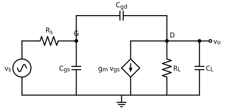

# 第 2 集 · Lec02：CS 放大器完整解（兩個極點一個零點）、Miller 效應的物理意義、源極隨耦器的高頻、CD–CS 把 Miller 打掉 [▶ 影片](https://www.youtube.com/watch?v=suF4WF8GyX0)

← 上一集：[01](01-low-frequency-coupling-caps-miller-intro.md) ｜ [總目錄](../README.md) ｜ 下一集：[03](03-cd-cs-opamp-cascode-cc-cb-diff-cmrr.md) →

> **課程**：電子學（四），陽明交大 電子物理系，112 學年度 — 第 2 集（Lec02）
> **講者**：陳振芳 老師
> **來源**：YouTube 錄影逐字稿（1:47:43，whisper）＋ Sedra & Smith《Microelectronic Circuits》7th ed.
> **標記說明**：`【口頭】` 老師口頭補充；`【課本補充】` 課本有、課堂沒講；`[▶ mm:ss]` 影片時間點

---

## 目錄

- [0. 這堂課要做什麼](#0-這堂課要做什麼)
- [1. CS 的三個電容，個別看](#1-cs-的三個電容個別看)
- [2. 零點與極點，再算一次](#2-零點與極點再算一次)
- [3. 完整解：兩個極點](#3-完整解兩個極點)
- [4. 第一極點 = 時間常數相加；第二極點](#4-第一極點--時間常數相加第二極點)
- [5. Miller 效應的物理意義](#5-miller-效應的物理意義)
- [6. 源極隨耦器（CD）的高頻](#6-源極隨耦器cd的高頻)
- [7. $R_L$ 很大：零點和極點抵消，完美隨耦](#7-r_l-很大零點和極點抵消完美隨耦)
- [8. CD–CS：前面加隨耦器，Miller 不見了](#8-cdcs前面加隨耦器miller-不見了)
- [9. 一頁速查表](#9-一頁速查表)
- [10. 與後續集數的連結](#10-與後續集數的連結)

---

## 0. 這堂課要做什麼

兩級 CMOS op amp 的第二級（共源）頻寬被 Miller 效應拉得很低。這集把 CS 完整解出來，看 Miller 為什麼發生，再用**源極隨耦器**放在前面把它打掉。

---

## 1. CS 的三個電容，個別看

[▶ 00:30](https://youtu.be/suF4WF8GyX0?t=30)

$R_s = 50$ k（第一級的輸出電阻）、$g_m = 4$ mA/V、$R_L = 25$ k。電容：$C_1 = C_{gs}$（輸入到地）、$C_2 = C_{gd}$（跨接）、$C_3$（輸出到地）。兩端固定電壓的電容微分後沒電流，拿掉。[▶ 01:31](https://youtu.be/suF4WF8GyX0?t=91)

個別看（假設都 1 pF）：$C_1R_s$、$C_3R_L$ 對應約 $10^7$；但 $C_2$ 把輸入、輸出扯在一起，要另外算。[▶ 03:35](https://youtu.be/suF4WF8GyX0?t=215)

---

## 2. 零點與極點，再算一次

**零點** [▶ 05:38](https://youtu.be/suF4WF8GyX0?t=338)：寫兩個節點方程、消掉 $v$，或直接令 $v_o = 0$：流過 $C_2$ 的電流 $sC_2v$ 要等於 $g_mv$：

$$
s_z = \frac{g_m}{C_2} \approx 4\times10^9
$$

**$C_2$ 的時間常數** [▶ 09:48](https://youtu.be/suF4WF8GyX0?t=588)：信號源拿掉（第一步！），在 $C_2$ 兩端加 $V_x$。$I_x$ 流過 $R_s$ → 閘極電壓 $I_xR_s$ → $g_mI_xR_s$ 流過 $R_L$：

$$
R_x = R_s(1 + g_mR_L) + R_L
$$

$\omega_P = \frac{1}{C_2R_x} \approx 2\times10^5$——頻寬變得很小。[▶ 13:31](https://youtu.be/suF4WF8GyX0?t=811)

**高頻極限** [▶ 15:34](https://youtu.be/suF4WF8GyX0?t=934)：電容短路，閘極和汲極接在一起 → 二極體接法，輸出被輸入透過 $C_2$ 拉著，變成一個常數（$\frac{1}{g_m}\parallel R_L$ 的分壓），所以不會掉到 0。極點往下、零點往上，最後平掉。

---

## 3. 完整解：兩個極點

[▶ 18:08](https://youtu.be/suF4WF8GyX0?t=1088)

三個電容一起寫 KCL（輸入節點、輸出節點兩條），解出：

$$
\frac{V_o}{V_s} = -g_mR_L\cdot\frac{1 - s/s_z}{1 + b_1s + b_2s^2}
$$

分母二次 → **兩個極點**。【口頭】硬拆開個別看比較簡單，合起來很難。[▶ 20:46](https://youtu.be/suF4WF8GyX0?t=1246)

若兩極點差一段距離（$\omega_{P1} \ll \omega_{P2}$）：

$$
1 + b_1s + b_2s^2 \approx \left(1 + \frac{s}{\omega_{P1}}\right)\left(1 + \frac{s}{\omega_{P2}}\right)
\quad\Longrightarrow\quad
b_1 \approx \frac{1}{\omega_{P1}},\quad b_2 = \frac{1}{\omega_{P1}\omega_{P2}}
$$

[▶ 22:55](https://youtu.be/suF4WF8GyX0?t=1375)

---

## 4. 第一極點 = 時間常數相加；第二極點

**第一極點** [▶ 23:56](https://youtu.be/suF4WF8GyX0?t=1436)：$s$ 的係數 $b_1$ 正好是每個電容各自的 RC 相加（其他電容**開路**）：

$$
\frac{1}{\omega_{P1}} \approx C_1R_s + C_2\left[R_s(1 + g_mR_L) + R_L\right] + C_3R_L
$$

就是 summation。【口頭】沒有這個近似根本寫不出來，寫出來是根號一大串。$C_2$ 那一項最大——頻率稍微一高，它馬上來不及充電。[▶ 29:06](https://youtu.be/suF4WF8GyX0?t=1746)

**第二極點** [▶ 30:09](https://youtu.be/suF4WF8GyX0?t=1809)：在很高頻，$C_2$ 已經短路（閘汲接在一起），剩 $C_1$、$C_3$ 並在一起，往外看 $R_s\parallel\frac1{g_m}\parallel R_L \approx \frac1{g_m}$：

$$
\omega_{P2} \approx \frac{1}{(C_1 + C_3)\left(R_s\parallel\frac{1}{g_m}\parallel R_L\right)}
$$

$1/g_m$ 只有幾百 Ω → 很高頻。[▶ 32:45](https://youtu.be/suF4WF8GyX0?t=1965)

數值：$\omega_{P1} \approx 2\times10^5$（被 $1 + g_mR_L = 101$ 倍拖累）、$\omega_{P2}$ 和零點 $4\times10^9$ 都很遠。頻寬 $\approx \omega_{P1}$。[▶ 36:53](https://youtu.be/suF4WF8GyX0?t=2213)

> 【課本補充】§10.4.3 (p. 739 起)：**開路時間常數法**（open-circuit time constants）：$\omega_H \approx 1/\sum C_iR_i$，$R_i$ 是其他電容**開路**時從 $C_i$ 看出去的電阻。（低頻用短路時間常數、高頻用開路時間常數。）

---

## 5. Miller 效應的物理意義

[▶ 38:26](https://youtu.be/suF4WF8GyX0?t=2306)

頻率夠低時，增益 $-g_mR_L = -100$：輸入升 1，輸出降 100。$C_2$ 兩端的電壓差是 **101 倍**的輸入電壓——要充的電荷非常多。[▶ 40:00](https://youtu.be/suF4WF8GyX0?t=2400)

站在輸入端看：流進 $C_2$ 的電流 $= sC_2(v - v_o) = sC_2(1 + g_mR_L)v$ → 等效成輸入端到地一顆

$$
C_{in} = C_2(1 + g_mR_L)
$$

站在輸出端看：等效 $C_2\left(1 + \frac{1}{g_mR_L}\right) \approx C_2$。[▶ 46:17](https://youtu.be/suF4WF8GyX0?t=2777)

【口頭】兩個電路絕不相等，但**對電容充放電需要的時間**一樣。等效上電容很大很大，頻率就要很低才來得及。再加上 $R_s$ 又很大——這就是問題所在。[▶ 47:48](https://youtu.be/suF4WF8GyX0?t=2868)

---

## 6. 源極隨耦器（CD）的高頻

[▶ 51:29](https://youtu.be/suF4WF8GyX0?t=3089)

想法：CS 前面不要直接接大 $R_s$，先接一個 common drain（源極隨耦器）。

CD 的電容：汲極是 AC 地，$C_{gd}$ 變成**輸入到地**（$C_1$）；$C_{gs}$ **跨在輸入和輸出（源極）之間**（$C_2$）；源極到基底 $C_{sb}$ 在輸出到地（$C_3$）。[▶ 53:34](https://youtu.be/suF4WF8GyX0?t=3214)

- 只看 $C_1 = C_{gd}$：$\frac{1}{C_1R_s} \approx 10^7$。[▶ 57:09](https://youtu.be/suF4WF8GyX0?t=3429)
- 只看 $C_3$：往上 $1/g_m$ 並 $R_L$，很小 → 很高頻。[▶ 58:11](https://youtu.be/suF4WF8GyX0?t=3491)

**只看 $C_2 = C_{gs}$** [▶ 59:17](https://youtu.be/suF4WF8GyX0?t=3557)：橫跨輸入輸出，解起來有零點也有極點。

- 零點：令 $v_o = 0$ → $sC_2v_{gs} + g_mv_{gs} = 0$ → $s_z = -\frac{g_m}{C_2}$（左半平面）。[▶ 1:06:38](https://youtu.be/suF4WF8GyX0?t=3998)
- 極點：加 $V_x$ 求放電電阻 [▶ 1:07:48](https://youtu.be/suF4WF8GyX0?t=4068)：

$$
R_x = \frac{R_s + R_L}{1 + g_mR_L}
$$

——**反而變小**（Miller 是變大）。[▶ 1:10:37](https://youtu.be/suF4WF8GyX0?t=4237)

---

## 7. $R_L$ 很大：零點和極點抵消，完美隨耦

[▶ 1:11:39](https://youtu.be/suF4WF8GyX0?t=4299)

低頻增益 $\frac{g_mR_L}{1 + g_mR_L}$（接近 1）。$R_L$ 增加：極點 $\frac{1 + g_mR_L}{C_2(R_s + R_L)} \to \frac{g_m}{C_2}$ 往後移，零點 $\frac{g_m}{C_2}$ 不動 → **兩個重疊、消掉**，從頭到尾都平。[▶ 1:16:53](https://youtu.be/suF4WF8GyX0?t=4613)

物理意義 [▶ 1:25:47](https://youtu.be/suF4WF8GyX0?t=5147)：完美隨耦器，閘極和源極 100% 一起走，$C_{gs}$ 兩端電壓差 0 → $i = C\frac{dv}{dt} = 0$，電容根本不用充放電。【口頭】輸出在那邊來來去去，數學很複雜，但這種情況電容完全沒影響。

**完整 CD**（三個電容一起，$R_L$ 用理想電流源）[▶ 1:27:50](https://youtu.be/suF4WF8GyX0?t=5270)：時間常數相加，$C_2$ 那項幾乎沒了，剩 $C_1R_s$ 主導 → 約 $10^7$。

---

## 8. CD–CS：前面加隨耦器，Miller 不見了

[▶ 1:35:36](https://youtu.be/suF4WF8GyX0?t=5736)

CS 前面加 CD：大 $R_s$ 先接到 CD 的閘極，CS 看到的源極電阻變成 CD 的輸出電阻 $\approx \frac{1}{g_m}$。

CS 那顆 $C_{gd}$ 的時間常數：[▶ 1:40:19](https://youtu.be/suF4WF8GyX0?t=6019)

$$
C_2\left[\frac{1}{g_m}(1 + g_mR_L) + R_L\right] \approx 2C_2R_L
$$

$g_m$ 消掉，**$g_mR_L$ 倍的 Miller 不見了**。總時間常數約 $2.5CR_s$ 的量級 → 頻寬約 $10^7$（原本 $10^5$，好一百倍）。[▶ 1:42:55](https://youtu.be/suF4WF8GyX0?t=6175)

而且增益不會減少（隨耦器增益 ≈ 1）。【口頭】common source 不能沒有（要放大），所以前面加一個 voltage follower——大電阻還在，但不是接在 CS 的輸入。下次講第二個方法（疊接）。[▶ 1:46:02](https://youtu.be/suF4WF8GyX0?t=6362)

> 【課本補充】§10.8 (p. 779)：CD–CS（以及 CC–CE）組態——用隨耦器把低阻抗送進 CS 的輸入，減輕 Miller 效應。

---

## 9. 一頁速查表

| 項目 | 公式／重點 | 例 |
|---|---|---|
| CS 零點 | $s_z = g_m/C_{gd}$（右半平面） | $4\times10^9$ |
| CS 第一極點 | $\frac{1}{\omega_{P1}} = C_{gs}R_s + C_{gd}[R_s(1+g_mR_L)+R_L] + C_LR_L$ | $2\times10^5$ |
| CS 第二極點 | $\frac{1}{(C_{gs}+C_L)(R_s\parallel 1/g_m\parallel R_L)}$ | 很高 |
| Miller | 輸入端 $C_{gd}(1+g_mR_L)$；輸出端 $\approx C_{gd}$ | 電壓差 101 倍 |
| 開路時間常數 | $\omega_H \approx 1/\sum C_iR_i^o$ | 其他電容開路 |
| CD 的 $C_{gs}$ | $R_x = \frac{R_s+R_L}{1+g_mR_L}$（變小）；零點 $-g_m/C_{gs}$ | |
| CD 大 $R_L$ | 零極點抵消，完美隨耦 | $C_{gs}$ 不充電 |
| CD–CS | CS 的 $R_s \to 1/g_m$：$C_{gd}$ 項 $\approx 2C_{gd}R_L$ | $10^5 \to 10^7$ |

---

## 10. 與後續集數的連結

| 本集觀念 | 後面在哪裡用到 |
|---|---|
| 打掉 Miller | 下一集：疊接（cascode）的頻率響應 |
| 開路時間常數 | 之後所有高頻估計 |
| 第二極點 | 頻率補償、相位邊限 |

---

## 附：本集一句話總結

> **CS 放大器完整解有兩個極點和一個 $g_m/C_{gd}$ 的零點，第一極點就是各電容（其他開路）的時間常數相加，其中 $C_{gd}$ 因為兩端電壓差是輸入的 $1+g_mR_L$ 倍、要充非常多電荷，等效被放大成 $C_{gd}(1+g_mR_L)$（Miller 效應），頻寬只剩 $2\times10^5$；源極隨耦器的 $C_{gs}$ 兩端幾乎同步、放電電阻反而變小，大 $R_L$ 時零極點抵消；把隨耦器放在 CS 前面，CS 看到的只是 $1/g_m$，Miller 倍數消失，頻寬拉回 $10^7$，增益不變。**

---

*筆記依據陳振芳老師「電子學（四）」112 學年度 Lec02 錄影逐字稿（whisper，1:47:43）與 Sedra & Smith《Microelectronic Circuits》7th ed. 整理。*
