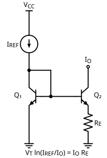

# 第 7 集 · Lec07：IC 音頻功率放大器（直流自穩在 VDD/2、電流回授增益 50）、三端穩壓 IC（與 VDC、溫度無關的參考電壓）、741 型 op amp 的偏壓與 Widlar 電流源 [▶ 影片](https://www.youtube.com/watch?v=B2cqm9BEkbs)

← 上一集：[06](06-follower-loading-class-a-b-ab-protection.md) ｜ [總目錄](../README.md) ｜ 下一集：[08](08-741-dc-bias-gain-cmrr-offset.md) →

> **課程**：電子學（四），陽明交大 電子物理系，112 學年度 — 第 7 集（Lec07）
> **講者**：陳振芳 老師
> **來源**：YouTube 錄影逐字稿（1:48:04，whisper）＋ Sedra & Smith《Microelectronic Circuits》7th ed.
> **標記說明**：`【口頭】` 老師口頭補充；`【課本補充】` 課本有、課堂沒講；`⚠️ 待確認` 查不清楚；`[▶ mm:ss]` 影片時間點

---

## 目錄

- [0. 這堂課要做什麼](#0-這堂課要做什麼)
- [1. IC 功率放大器：直流自己穩在 $V_{DD}/2$](#1-ic-功率放大器直流自己穩在-v_dd2)
- [2. 交流：電流回授，增益 $-2R/R_1$](#2-交流電流回授增益--2rr_1)
- [3. 中心腳要接大電容](#3-中心腳要接大電容)
- [4. 輸入端不能直接接地](#4-輸入端不能直接接地)
- [5. 三端穩壓 IC：簡單齊納電路的問題](#5-三端穩壓-ic簡單齊納電路的問題)
- [6. 讓電流和 $V_{DC}$ 無關](#6-讓電流和-v_dc-無關)
- [7. 溫度補償：齊納上升、兩個 $V_{BE}$ 下降](#7-溫度補償齊納上升兩個-v_be-下降)
- [8. 誤差放大器 + 回授：$V_O = V_R(1 + R_2/R_1)$](#8-誤差放大器--回授v_o--v_r1--r_2r_1)
- [9. 741 型 op amp：達靈頓輸出、隔離負載](#9-741-型-op-amp達靈頓輸出隔離負載)
- [10. 偏壓與 Widlar 電流源](#10-偏壓與-widlar-電流源)
- [11. 一頁速查表](#11-一頁速查表)
- [12. 與後續集數的連結](#12-與後續集數的連結)
- [⚠️ 待確認清單](#️-待確認清單)

---

## 0. 這堂課要做什麼

用前面學的高功率基本電路去看真實的 IC：音頻功率放大器（低頻、高功率）、穩壓 IC、741 型 op amp。【口頭】都是最基本、最簡單的版本。

---

## 1. IC 功率放大器：直流自己穩在 $V_{DD}/2$

[▶ 01:04](https://youtu.be/B2cqm9BEkbs?t=64)

典型高功率 op amp = 差動輸入 + 共射放大 + Class AB 推挽。外接回授才能得到穩定的直流和交流；不接回授，輸出直流跑到哪裡都不知道。[▶ 02:40](https://youtu.be/B2cqm9BEkbs?t=160)

這顆 IC **自己內建回授**：輸出端拉一顆電阻 $2R$ 回到差動對的一邊（射極），另一邊接電流源 $I$（電流鏡）。[▶ 05:43](https://youtu.be/B2cqm9BEkbs?t=343)

直流：兩邊電流相等（電流鏡），電阻上的電流 $= I$。設計讓上下各一個 $R$ 分壓 →

$$
V_O = \frac12V_{DD}
$$

正中間，上下掃動範圍最大。【口頭】不是讓你外接，它自己接好了。[▶ 08:52](https://youtu.be/B2cqm9BEkbs?t=532)

---

## 2. 交流：電流回授，增益 $-2R/R_1$

[▶ 10:55](https://youtu.be/B2cqm9BEkbs?t=655)

信號從射極那一點經 $R_1$ 進來（$R_1$ 對直流沒影響，那一點固定是 $V_{BE}$）。射極看進去 $r_e$ 很小（例 25 Ω），$R_1$ 放 1 k 就遠大於它 → 99% 的電壓跨在 $R_1$ 上，電流 $i = v_i/R_1$。[▶ 12:58](https://youtu.be/B2cqm9BEkbs?t=778)

這個電流被電流鏡鏡像到另一邊，和回授電阻的電流 $\frac{v_o}{2R}$ 相遇，差額流進共射級（負載 $r_o\parallel\beta R$ 之類，增益很大）。寫出來：[▶ 19:41](https://youtu.be/B2cqm9BEkbs?t=1181)

$$
v_o = \frac{-2i\cdot G}{1 + G/(\cdots)}
\quad\xrightarrow{\ G\to\infty\ }\quad
v_o = -\frac{2R}{R_1}v_i
$$

增益夠大時，進入共射級的電流幾乎 0——兩個電流被回授電阻**全部拿走**。例 $2R = 50$ k、$R_1 = 1$ k → 增益 50，非常穩定（和直流、$g_m$ 無關，只和電阻比有關）。[▶ 23:54](https://youtu.be/B2cqm9BEkbs?t=1434)

這是**電流–電壓回授**（I–V feedback）：輸入端是電流的一步一趨。[▶ 31:43](https://youtu.be/B2cqm9BEkbs?t=1903)

> 【課本補充】§12.8.1 (p. 962)：固定增益 IC 功率放大器（LM380 型）——內建回授，直流輸出 $\approx V_S/2$，增益固定約 50。

---

## 3. 中心腳要接大電容

[▶ 26:03](https://youtu.be/B2cqm9BEkbs?t=1563)

上下兩個 $R$ 中間那隻腳（中心腳），規格叫你接**大電容**：讓 AC 從這裡漏到地，不要從另一條路回去影響回授；直流照舊。（那條路的電阻是 $R_1$ 的 25 倍，電流本來就小，加電容保證 AC 消掉。）[▶ 26:34](https://youtu.be/B2cqm9BEkbs?t=1594)

---

## 4. 輸入端不能直接接地

[▶ 34:20](https://youtu.be/B2cqm9BEkbs?t=2060)

如果輸入端直接接 0 V：差動對 PNP 那顆射極約 0.7 V、集極是 0，基–集正偏——不在主動區，不行。[▶ 35:23](https://youtu.be/B2cqm9BEkbs?t=2123)

→ 輸入前面多加一顆 BJT（射極隨耦），把電壓墊高一個 $V_{BE}$，這樣輸入接地也能正常工作，而且輸入電阻仍很大（op amp 很重要的一點）。[▶ 37:28](https://youtu.be/B2cqm9BEkbs?t=2248)

重算直流電流：$I = \frac{V_{DD} - 3V_{BE}}{2R}$（多一個 $V_{BE}$），差別很小。[▶ 40:38](https://youtu.be/B2cqm9BEkbs?t=2438)

---

## 5. 三端穩壓 IC：簡單齊納電路的問題

[▶ 42:43](https://youtu.be/B2cqm9BEkbs?t=2563)

78xx 系列：輸入很粗糙的直流（10～35 V），輸出非常準的 8 V（或 5、10、12…）。[▶ 43:14](https://youtu.be/B2cqm9BEkbs?t=2594)

以前的簡單電路：齊納二極體 $V_{Z0}$ 經電阻 $R$ 接電源，op amp 放大 $1 + R_2/R_1$。問題：齊納崩潰後仍有斜率（例 5 Ω）。[▶ 46:58](https://youtu.be/B2cqm9BEkbs?t=2818)

例：$V_{DC}$ 從 10 V 變到 30 V，$R = 1$ k → 齊納電流從 7 mA 變到 27 mA，變化 20 mA × 5 Ω = 0.1 V → 參考電壓跟著變。$R$ 加大到 10 k（IC 的極限）還是有約 2 mA 變化。[▶ 48:34](https://youtu.be/B2cqm9BEkbs?t=2914)

---

## 6. 讓電流和 $V_{DC}$ 無關

[▶ 51:08](https://youtu.be/B2cqm9BEkbs?t=3068)

用 BJT 做電流源給齊納：齊納電壓（例 3 V）固定在 BJT 基極，射極電阻 $R$ 上是 $3 - 0.7 = 2.3$ V → $I = 2.3/R$（例 1 mA），和 $V_{DC}$ 無關；再把這個電流灌回齊納。[▶ 53:45](https://youtu.be/B2cqm9BEkbs?t=3225)

考慮 Early 效應：$V_{DC}$ 多 20 V，多出的電流是 $20/r_o$，只要 $r_o$ 夠大就幾乎不變（例多 0.2 之類的量級，再經一層又除 $r_o$）。[▶ 55:47](https://youtu.be/B2cqm9BEkbs?t=3347)

---

## 7. 溫度補償：齊納上升、兩個 $V_{BE}$ 下降

[▶ 58:27](https://youtu.be/B2cqm9BEkbs?t=3507)

- $V_{BE}$：飽和電流隨溫度加倍 → $V_{BE}$ 溫度係數為負（溫度升，$V_{BE}$ 降）。
- 齊納：看物理機制。這裡用的那種，溫度升時崩潰電壓上升（係數為正）。[▶ 59:58](https://youtu.be/B2cqm9BEkbs?t=3598)

設計：齊納 $V_{Z0}$ 上升 $\Delta$，串上兩個 $V_{BE}$（各下降），從中間分壓點拉出來：[▶ 1:03:03](https://youtu.be/B2cqm9BEkbs?t=3783)

$$
V_R = \frac12\left(V_{Z0} + \Delta\right) - \ldots\ \text{（兩個 } V_{BE}\text{ 的變化抵消掉 } \Delta\text{）}
$$

故意製造一個上升、一個下降 → 中間那點的電壓 $V_R$ **和溫度、$V_{DC}$ 都無關**。[▶ 1:06:42](https://youtu.be/B2cqm9BEkbs?t=4002)

> ⚠️ 待確認：分壓點的確切係數（$\frac12$、兩個 $V_{BE}$ 的位置）逐字稿不清楚，要回影片看板書電路。

---

## 8. 誤差放大器 + 回授：$V_O = V_R(1 + R_2/R_1)$

[▶ 1:08:13](https://youtu.be/B2cqm9BEkbs?t=4093)

$V_R$ 接差動放大器（誤差放大器）的一邊，另一邊接輸出經 $R_1$、$R_2$ 分壓的 $\beta V_O$；差動放大器輸出推達靈頓輸出管。[▶ 1:10:48](https://youtu.be/B2cqm9BEkbs?t=4248)

$$
V_O = \frac{\frac12\beta g_mr_o\cdot\frac{V_R}{\beta}}{1 + \frac12\beta g_mr_o}\cdots
\approx \frac{V_R}{\beta} = V_R\left(1 + \frac{R_2}{R_1}\right)
$$

回授要增益很大。調電阻比就得到 8、10、12 V，這系列全部都有。電阻在 IC 裡控制得非常好 → precise。[▶ 1:17:38](https://youtu.be/B2cqm9BEkbs?t=4658)

還可以加短路保護（很小的射極電阻 + 保護管），怕燒壞。[▶ 1:19:42](https://youtu.be/B2cqm9BEkbs?t=4782)

---

## 9. 741 型 op amp：達靈頓輸出、隔離負載

[▶ 1:20:43](https://youtu.be/B2cqm9BEkbs?t=4843)

最基本的高功率 op amp 一定包含三個東西：差動輸入、共射放大、AB 類輸出。慢慢改良：[▶ 1:21:13](https://youtu.be/B2cqm9BEkbs?t=4873)

- 輸出管一顆只有 $\beta R_L$，對共射造成負載 → 用兩顆（達靈頓），變 $\beta^2R_L$。[▶ 1:22:44](https://youtu.be/B2cqm9BEkbs?t=4964)
- 共射級的輸入 $r_\pi$ 會把第一級的 $r_{o2}\parallel r_{o4}$ 並掉 → 前面加一顆射極隨耦器，看進去 $\beta r_\pi$，多 100 倍，不互相影響。[▶ 1:27:21](https://youtu.be/B2cqm9BEkbs?t=5241)
- AB 類偏壓：一顆 BJT + 一顆二極體（電流不同面積不同），$I = I_Se^{V_{BE}/V_T}$ → 例 $V_{BE} \approx 0.62$；扣掉基極電流 10 μA 後約 0.618。兩者加起來給輸出管各約 0.6 V，靜態電流約 0.3 mA，靜態功率 $0.3\ \text{mA}\times15\ \text{V}\times2$，很小。[▶ 1:30:58](https://youtu.be/B2cqm9BEkbs?t=5458)

---

## 10. 偏壓與 Widlar 電流源

[▶ 1:35:43](https://youtu.be/B2cqm9BEkbs?t=5743)

參考電流：上面 PNP、下面 NPN 二極體接法，中間一顆電阻：$\frac{30 - 1.4}{R} = 1$ mA → $R = 28.6$ k（±15 V）。[▶ 1:36:44](https://youtu.be/B2cqm9BEkbs?t=5804)

差動放大器要很小的電流（μA），才能讓輸入電阻很大（MΩ 以上）。用一般電流鏡要很大的電阻；**Widlar 電流源**在輸出那顆射極加一顆小電阻 $R$：[▶ 1:38:14](https://youtu.be/B2cqm9BEkbs?t=5894)

$$
V_T\ln\frac{I_{REF}}{I_O} = I_OR
$$

用計算器解：1 mA 參考 → 例 10～20 μA，只要一顆小電阻。[▶ 1:40:17](https://youtu.be/B2cqm9BEkbs?t=6017)

電流很小的好處：$r_e$ 從 25 Ω 變 2.5 k，$r_\pi$ 變 250 k → 每個電阻都變大，輸入電阻很大。但**後面輸出級電流一定要大**，不然 AC 電流也不會大。[▶ 1:42:49](https://youtu.be/B2cqm9BEkbs?t=6169)

> 【課本補充】§8.6.4 (p. 565)：Widlar 電流源 $V_T\ln\frac{I_{REF}}{I_O} = I_OR_E$；§13.3 (p. 1028)：741 op amp 的偏壓網路正是用 Widlar 源產生 μA 級的輸入級電流。

---

## 11. 一頁速查表

| 項目 | 公式／重點 | 例 |
|---|---|---|
| IC 功放直流 | 內建 $2R$ 回授 → $V_O = V_{DD}/2$ | |
| IC 功放交流 | $v_o \approx -\frac{2R}{R_1}v_i$（電流回授） | 50 倍 |
| 中心腳 | 接大電容漏掉 AC | |
| 輸入不能接地 | 加射極隨耦墊高 $V_{BE}$ | $I = \frac{V_{DD}-3V_{BE}}{2R}$ |
| 齊納問題 | 電流變化 × 斜率電阻 | 20 mA × 5 Ω |
| 電流與 $V_{DC}$ 無關 | BJT 電流源 $\frac{V_Z - 0.7}{R}$ | 1 mA |
| 溫度補償 | 齊納正係數 + 兩個 $V_{BE}$ 負係數 | $V_R$ 恆定 |
| 穩壓輸出 | $V_O = V_R(1 + R_2/R_1)$ | 78xx |
| 741 改良 | 達靈頓輸出、共射前加隨耦 | $\beta^2R_L$、$\beta r_\pi$ |
| Widlar | $V_T\ln\frac{I_{REF}}{I_O} = I_OR$ | μA 級 |

---

## 12. 與後續集數的連結

| 本集觀念 | 後面在哪裡用到 |
|---|---|
| 741 完整分析 | 下一集起 |
| 溫度係數 | 能隙參考電壓 |
| 大電流輸出 | 功率電晶體、散熱 |

---

## 附：本集一句話總結

> **IC 音頻功放內建一顆 $2R$ 回授電阻，直流自己穩在 $V_{DD}/2$，交流則是電流回授，增益只剩 $-2R/R_1$（例 50），中心腳要接大電容、輸入要墊一個 $V_{BE}$；三端穩壓 IC 先用 BJT 電流源讓齊納電流和輸入電壓無關，再讓齊納的正溫度係數和兩個 $V_{BE}$ 的負係數抵消得到恆定的 $V_R$，經誤差放大器回授得 $V_O = V_R(1+R_2/R_1)$；741 型 op amp 用達靈頓和隨耦器隔開負載，用 Widlar 電流源以一顆小電阻做出 μA 級的輸入級電流，讓輸入電阻很大。**

---

## ⚠️ 待確認清單

1. 第 7 節溫度補償的分壓點係數與電路接法。

---

*筆記依據陳振芳老師「電子學（四）」112 學年度 Lec07 錄影逐字稿（whisper，1:48:04）與 Sedra & Smith《Microelectronic Circuits》7th ed. 整理。*
