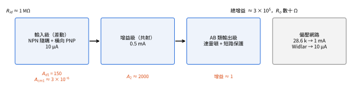

# 第 8 集 · Lec08：741 op amp——直流偏壓、靜態功率、為什麼輸入用 NPN+PNP（橫向 PNP 耐壓）、共模回授、增益與輸入電阻、輸出電阻、偏移調整 [▶ 影片](https://www.youtube.com/watch?v=y51u8kCFlos)

← 上一集：[07](07-ic-power-amp-regulator-741-bias.md) ｜ [總目錄](../README.md) ｜ 下一集：[09](09-class-d-pwm-schmitt-inverter-lc-filter.md) →

> **課程**：電子學（四），陽明交大 電子物理系，112 學年度 — 第 8 集（Lec08）
> **講者**：陳振芳 老師
> **來源**：YouTube 錄影逐字稿（1:58:06，whisper）＋ Sedra & Smith《Microelectronic Circuits》7th ed.
> **標記說明**：`【口頭】` 老師口頭補充；`【課本補充】` 課本有、課堂沒講；`⚠️ 待確認` 查不清楚；`[▶ mm:ss]` 影片時間點

---

## 目錄

- [0. 這堂課要做什麼](#0-這堂課要做什麼)
- [1. 741 的方塊](#1-741-的方塊)
- [2. 直流偏壓](#2-直流偏壓)
- [3. 輸出直流沒辦法事先設計好：要調](#3-輸出直流沒辦法事先設計好要調)
- [4. 小信號參數：每顆 $g_mr_o = 4000$](#4-小信號參數每顆-g_mr_o--4000)
- [5. 靜態功率](#5-靜態功率)
- [6. 為什麼輸入級要 NPN 接 PNP](#6-為什麼輸入級要-npn-接-pnp)
- [7. 第一級的共模增益：共模回授](#7-第一級的共模增益共模回授)
- [8. 差模增益、輸入電阻、總增益](#8-差模增益輸入電阻總增益)
- [9. 輸出電阻與短路保護](#9-輸出電阻與短路保護)
- [10. 偏移調整](#10-偏移調整)
- [11. 電流這麼小會不會有問題？](#11-電流這麼小會不會有問題)
- [12. 一頁速查表](#12-一頁速查表)
- [13. 與後續集數的連結](#13-與後續集數的連結)
- [⚠️ 待確認清單](#️-待確認清單)

---

## 0. 這堂課要做什麼

把 741 這個很大的電路整個算一遍：前面電流很小（得到很大的電阻），後面電流一定要大。

---

## 1. 741 的方塊

[▶ 00:30](https://youtu.be/y51u8kCFlos?t=30)

±15 V。三個部分：差動放大器（輸入級）→ 共射（增益級）→ Class AB 輸出級。加上偏壓網路：[▶ 07:47](https://youtu.be/y51u8kCFlos?t=467)

- 參考電流：$\frac{30 - 1.4}{28.6\ \text{k}} = 1$ mA。[▶ 01:30](https://youtu.be/y51u8kCFlos?t=90)
- Widlar 電流源（射極加 5 k）給差動放大器很小的電流。[▶ 02:34](https://youtu.be/y51u8kCFlos?t=154)
- 輸入級：NPN 射極隨耦接 PNP 共基（兩顆串著）；負載是電流鏡，電流鏡下面放兩顆電阻（偏移調整的腳）。[▶ 04:08](https://youtu.be/y51u8kCFlos?t=248)
- 中間有隨耦器隔開；輸出級 AB 類用兩顆電晶體當二極體偏壓。[▶ 05:44](https://youtu.be/y51u8kCFlos?t=344)
- 一條線從輸入級拉回偏壓電路：讓共模增益變得非常小（第 7 節）。[▶ 08:48](https://youtu.be/y51u8kCFlos?t=528)

參數：$I_S = 10^{-14}$ A、$V_A = 100$ V、$\beta = 100$（兩顆特別大的除外）。[▶ 10:21](https://youtu.be/y51u8kCFlos?t=621)

---

## 2. 直流偏壓

[▶ 10:53](https://youtu.be/y51u8kCFlos?t=653)

基極電流都忽略。

- 1 mA 的那顆：$V_{BE} = V_T\ln\frac{I}{I_S} \approx 0.62$ V（$\ln$ 用 0.025）。[▶ 11:54](https://youtu.be/y51u8kCFlos?t=714)
- **Widlar**：$V_{BE1} = V_{BE2} + I\cdot5\ \text{k}$ → 解出約 **10 μA**（另一顆 $V_{BE} \approx 0.52$ V）。[▶ 13:00](https://youtu.be/y51u8kCFlos?t=780)
- 輸入級每邊 10 μA；電流鏡那邊 $\frac{0.62}{62\ \text{k}}$ 之類也是 10 μA；某節點直流約 $0.52 + 0.62 + 0.52 - 15 \approx -13.86$ V。[▶ 16:03](https://youtu.be/y51u8kCFlos?t=963)
- 第二級（共射）0.5 mA。[▶ 18:38](https://youtu.be/y51u8kCFlos?t=1118)
- 輸出級：偏壓讓兩顆輸出管各約 0.57 V，一開始只導通一點點，約 0.3 mA。[▶ 21:19](https://youtu.be/y51u8kCFlos?t=1279)

> ⚠️ 待確認：各節點電壓（−13.86 V、0.57 V 等）和電阻值是逐字稿拼湊的，需對照板書／課本 Fig. 13.13。

---

## 3. 輸出直流沒辦法事先設計好：要調

[▶ 22:20](https://youtu.be/y51u8kCFlos?t=1340)

輸出點的直流電壓在 IC 做出來之前是不知道的——兩邊只要差一點點，乘上很大的負載電阻（增益），就跑掉了。【口頭】設計成一樣沒用，沒有人做得到。[▶ 23:20](https://youtu.be/y51u8kCFlos?t=1400)

所以 IC 把兩隻腳拉出來，讓你外接可調電阻做 calibration（見第 10 節）。[▶ 24:21](https://youtu.be/y51u8kCFlos?t=1461)

---

## 4. 小信號參數：每顆 $g_mr_o = 4000$

[▶ 27:31](https://youtu.be/y51u8kCFlos?t=1651)

$$
g_mr_o = \frac{I_C}{V_T}\cdot\frac{V_A}{I_C} = \frac{V_A}{V_T} = \frac{100}{0.025} = 4000
$$

跟電流無關，**每一顆都一樣**。[▶ 29:33](https://youtu.be/y51u8kCFlos?t=1773)

電流很小，電阻都很大：

- 10 μA：$r_o = 10$ MΩ，$r_e = 2.5$ k，$r_\pi = 250$ k。[▶ 32:13](https://youtu.be/y51u8kCFlos?t=1933)
- 有射極電阻的電流源輸出電阻：$r_o\left[1 + g_m(R\parallel r_\pi)\right]$ → 例約 **25 MΩ**。[▶ 35:20](https://youtu.be/y51u8kCFlos?t=2120)
- 疊接那類看上去 $10\ \text{M}\times4000$ 之類 → 更大。[▶ 39:01](https://youtu.be/y51u8kCFlos?t=2341)
- 第一級輸出節點的總負載：往下、往上、往右（第二級看進去 $\beta r_\pi$ 的串接）三個並聯 → 約 **750 k**。[▶ 41:03](https://youtu.be/y51u8kCFlos?t=2463)
- 第二級負載：往下、往上各約 200 k → 並聯約 100 k。[▶ 43:06](https://youtu.be/y51u8kCFlos?t=2586)

---

## 5. 靜態功率

[▶ 44:10](https://youtu.be/y51u8kCFlos?t=2650)

把所有支路的直流電流加起來（1 mA、0.3 mA、幾條 0.01 mA、0.5 mA、0.3 mA…）乘上 30 V：

$$
P_Q = \left(\sum I\right)\times30\ \text{V} \approx \text{數十 mW}
$$

【口頭】mW 都算小。[▶ 47:15](https://youtu.be/y51u8kCFlos?t=2835)

---

## 6. 為什麼輸入級要 NPN 接 PNP

[▶ 47:45](https://youtu.be/y51u8kCFlos?t=2865)

跟半導體結構有關：只有一顆時，$V_{BE}$ 反向會崩潰。

- **垂直 NPN**（vertical）：射極 $n^+$ 擴散在 $p$ 基極裡，濃度高；射–基接面兩邊都高濃度 → 空乏區很窄。[▶ 50:22](https://youtu.be/y51u8kCFlos?t=3022)
- **橫向 PNP**（lateral）：射極、集極都是在 $n$ 型（低濃度，$10^{15}$ 量級）裡擴散的 $p$，橫著放。[▶ 51:25](https://youtu.be/y51u8kCFlos?t=3085)

PN 接面空乏區寬度由**低濃度的那邊**決定：$W \propto \sqrt{\frac{2\varepsilon V}{qN_{\text{low}}}}$。濃度差兩個數量級 → 寬度差約一個數量級。[▶ 54:30](https://youtu.be/y51u8kCFlos?t=3270) 崩潰時電場到臨界值 $E_{crit}$，$V_R \approx E_{crit}W$ → 寬度大 10 倍，崩潰電壓大約 10 倍。[▶ 58:08](https://youtu.be/y51u8kCFlos?t=3488)

NPN 反向 $V_{BE}$ 約 7 V 就崩潰；橫向 PNP 可以到 50 V。輸入端可能被加很大的差動電壓，串一顆橫向 PNP 就能承受。[▶ 1:00:11](https://youtu.be/y51u8kCFlos?t=3611)

> 【課本補充】§13.3.1 (p. 1028)：741 輸入級 $Q_3$、$Q_4$ 是橫向 PNP，提供輸入級較高的反向崩潰電壓保護（約 50 V）。

---

## 7. 第一級的共模增益：共模回授

[▶ 1:01:43](https://youtu.be/y51u8kCFlos?t=3703)

兩邊加共模：輸入級電流增加 → 偏壓電路的那條回授線偵測到，把尾電流拉回來（common-mode feedback）。

用 $R = 25$ MΩ（電流源輸出電阻）和 $r_e$ 算：共模電流 $i \approx \frac{v_{cm}}{2R}$ 之類，再經回授除掉 $\frac{R}{r_e}$ 的倍數。[▶ 1:04:20](https://youtu.be/y51u8kCFlos?t=3860)

電流鏡兩邊因為基極電流（多一條路）差 $\frac{2}{\beta^2}$，差額流進輸出節點（往右 750 k）：[▶ 1:11:32](https://youtu.be/y51u8kCFlos?t=4292)

$$
A_{cm,1} \approx 3\times10^{-6}
$$

非常小。[▶ 1:16:22](https://youtu.be/y51u8kCFlos?t=4582)

> 【課本補充】§13.3（741 的共模分析）：輸入級的共模回授迴路讓共模增益大幅降低，CMRR 很高。

---

## 8. 差模增益、輸入電阻、總增益

**差模** [▶ 1:17:53](https://youtu.be/y51u8kCFlos?t=4673)：$\pm\frac12v_{id}$；信號經 NPN 射極、PNP 射極（每邊兩個 $r_e$ 串聯）→ 電流 $i = \frac{v_{id}/2}{2r_e} = \frac{v_{id}}{4r_e}$。共模回授對差模沒作用。電流鏡把兩邊電流加起來，乘上 750 k 的負載：[▶ 1:21:27](https://youtu.be/y51u8kCFlos?t=4887)

$$
A_{d,1} = 2\cdot\frac{1}{4r_e}\cdot R_{L1} = \frac{750\ \text{k}}{2\times2.5\ \text{k}} = 150
$$

**輸入電阻** [▶ 1:25:02](https://youtu.be/y51u8kCFlos?t=5102)：兩端之間 $v_{id}$，電流 $\frac{v_{id}}{4r_e}$ 除以 $\beta$ 才是基極電流：

$$
R_{id} = 4(\beta + 1)r_e \approx 4\times100\times2.5\ \text{k} = 1\ \text{M}\Omega
$$

很大，op amp 很重要的特性。

**第二級** [▶ 1:27:07](https://youtu.be/y51u8kCFlos?t=5227)：0.5 mA → $g_m = 20$ mA/V，乘上約 100 k → 2000。

$$
A_d \approx 150\times2000 = 3\times10^5
$$

共模只有 $3\times10^{-6}$（後面乘一樣的）→ 兩者差約 $10^8$ 量級——CMRR 非常大。[▶ 1:29:40](https://youtu.be/y51u8kCFlos?t=5380)

---

## 9. 輸出電阻與短路保護

[▶ 1:30:11](https://youtu.be/y51u8kCFlos?t=5411)

信號拿掉，從輸出看回去：第二級輸出（100 k 並 200 k 之類）→ 經達靈頓、隨耦器除兩次 $\beta$ → 約 1 k 再除 $\beta$，加上輸出管自己的 $r_e$。[▶ 1:33:15](https://youtu.be/y51u8kCFlos?t=5595)

大信號時輸出管電流從很小到很大，$r_e$ 沒辦法算，假設約 25 Ω 再除 100 → 忽略。另外有短路保護的小電阻（例 25 Ω、3 Ω 之類）：最大電流 $\approx 0.6\ \text{V}/R$。輸出電阻 = 這些加起來，數十 Ω。[▶ 1:36:17](https://youtu.be/y51u8kCFlos?t=5777)

**模型** [▶ 1:38:20](https://youtu.be/y51u8kCFlos?t=5900)：$R_{id} = 1$ MΩ（不太拉電流）、$A_d = 3\times10^5$、$R_o$ 數十 Ω。

---

## 10. 偏移調整

[▶ 1:38:53](https://youtu.be/y51u8kCFlos?t=5933)

電流鏡下面兩顆電阻的兩隻腳拉出來（offset null），外接一顆可調電阻，中間那隻腳接 −15 V。[▶ 1:39:56](https://youtu.be/y51u8kCFlos?t=5996)

調電阻 → 兩邊的 $R$ 改變 → 電流鏡兩邊電流差 $\Delta I$：

$$
\Delta V_{BE} + \Delta I\cdot R = 0
\quad\Longrightarrow\quad
\Delta I\left(\frac{1}{g_m} + R\right) = \cdots
$$

微調一個 $\Delta I$，乘上很大的負載就改變輸出直流——一直調到輸出直流為 0。【口頭】電阻用這麼小有它的好處。[▶ 1:42:34](https://youtu.be/y51u8kCFlos?t=6154)

> 【課本補充】§13.3（741 offset nulling）：在 $Q_5$、$Q_6$ 的射極電阻之間接 10 kΩ 電位器，中點接 $V^-$，調整輸入級的不平衡以歸零輸出偏移。

---

## 11. 電流這麼小會不會有問題？

[▶ 1:47:49](https://youtu.be/y51u8kCFlos?t=6469)

總電流（直流 + 交流）一定要滿足方向 → 交流振幅不能超過直流（10 μA）。

例：非反相放大 10 倍（1 k、9 k），輸出 10 V（最大）。回授下 $v_{id} = \frac{10\ \text{V}}{3\times10^5} \approx 3\times10^{-5}$ V，輸入級的 AC 電流 $= \frac{v_{id}}{4r_e}$——遠小於 10 μA，沒問題。[▶ 1:50:59](https://youtu.be/y51u8kCFlos?t=6659)

第二級：10 V 輸出、負載約 100 k → 要 0.1 mA，有 0.5 mA 直流，夠。後面輸出級電流一定要大。[▶ 1:56:11](https://youtu.be/y51u8kCFlos?t=6971)

【口頭】我們都是接回授用，所以模型裡根本不用考慮共模，只有差模。[▶ 1:54:35](https://youtu.be/y51u8kCFlos?t=6875)

---

## 12. 一頁速查表

| 項目 | 數值／公式 | 關鍵 |
|---|---|---|
| 參考電流 | $\frac{30-1.4}{28.6\text{k}} = 1$ mA | |
| Widlar | 5 k → 10 μA | |
| $g_mr_o$ | $V_A/V_T = 4000$ | 每顆一樣 |
| 10 μA | $r_o = 10$ M、$r_e = 2.5$ k、$r_\pi = 250$ k | |
| 橫向 PNP | 反向 $V_{BE}$ 約 50 V（NPN 約 7 V） | 低濃度、空乏區寬 |
| 第一級 | $A_d = 150$、$A_{cm} \approx 3\times10^{-6}$ | 共模回授 |
| $R_{id}$ | $4(\beta+1)r_e \approx 1$ MΩ | |
| 第二級 | $20\times100\text{k} = 2000$ | 0.5 mA |
| 總增益 | $3\times10^5$ | CMRR ~ $10^8$ |
| 輸出 | 數十 Ω，短路保護 $0.6/R$ | |
| 偏移調整 | 外接電位器到 −15 V | 調 $\Delta I$ |
| 小電流 OK | 回授下 $v_{id} \sim 3\times10^{-5}$ V | |

---

## 13. 與後續集數的連結

| 本集觀念 | 後面在哪裡用到 |
|---|---|
| 741 頻率補償 | 30 pF Miller 電容、slew rate |
| 輸出級 | 功率電晶體、散熱 |
| 偏移 | 輸入偏移、偏壓電流 |

---

## 附：本集一句話總結

> **741 用 28.6 k 做 1 mA 參考、Widlar 電流源做出 10 μA 給輸入級，所有 BJT 的 $g_mr_o$ 都是 4000，小電流讓 $r_\pi$、$r_o$ 都很大；輸入級串一顆橫向 PNP 是因為低濃度讓空乏區寬、反向崩潰可到 50 V；共模回授讓第一級共模增益只有 $3\times10^{-6}$，差模 150、輸入電阻約 1 MΩ，第二級 2000，總增益 $3\times10^5$；輸出直流事先算不準，要用外接電位器調偏移；接成回授後輸入差動電壓只有幾十 μV，10 μA 的小電流完全夠用。**

---

## ⚠️ 待確認清單

1. 第 2 節各節點電壓與電阻值需對照板書或課本 Fig. 13.13。

---

*筆記依據陳振芳老師「電子學（四）」112 學年度 Lec08 錄影逐字稿（whisper，1:58:06）與 Sedra & Smith《Microelectronic Circuits》7th ed. 整理。*
