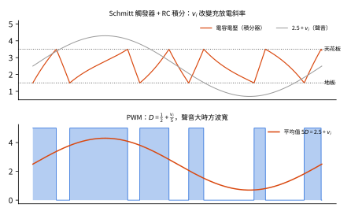

# 第 9 集 · Lec09：AB 類為什麼那麼熱、D 類的想法（開關不耗電）、用 Schmitt 觸發器 + RC 做方波、音訊調變成 PWM、CMOS 反相器當開關、LR／LRC 低通濾波還原 [▶ 影片](https://www.youtube.com/watch?v=F1tDvUGEoCA)

← 上一集：[08](08-741-dc-bias-gain-cmrr-offset.md) ｜ [總目錄](../README.md) ｜ 下一集：[10](10-lr-integrator-steady-state-lc-filter.md) →

> **課程**：電子學（四），陽明交大 電子物理系，112 學年度 — 第 9 集（Lec09）
> **講者**：陳振芳 老師
> **來源**：YouTube 錄影逐字稿（1:51:49，whisper）＋ Sedra & Smith《Microelectronic Circuits》7th ed.
> **標記說明**：`【口頭】` 老師口頭補充；`【課本補充】` 課本有、課堂沒講；`[▶ mm:ss]` 影片時間點

---

## 目錄

- [0. 這堂課要做什麼](#0-這堂課要做什麼)
- [1. AB 類輸出管為什麼那麼熱](#1-ab-類輸出管為什麼那麼熱)
- [2. D 類的想法：讓輸出管當開關](#2-d-類的想法讓輸出管當開關)
- [3. 方波產生器：Schmitt 觸發器 + RC](#3-方波產生器schmitt-觸發器--rc)
- [4. 方波的週期](#4-方波的週期)
- [5. 加入聲音信號：PWM](#5-加入聲音信號pwm)
- [6. 平均值就是聲音信號](#6-平均值就是聲音信號)
- [7. 輸出開關：CMOS 反相器](#7-輸出開關cmos-反相器)
- [8. 還原：不能用 RC，要用 LR](#8-還原不能用-rc要用-lr)
- [9. 一階不夠陡：LRC 二階低通](#9-一階不夠陡lrc-二階低通)
- [10. 一頁速查表](#10-一頁速查表)
- [11. 與後續集數的連結](#11-與後續集數的連結)

---

## 0. 這堂課要做什麼

AB 類輸出級還有一個大問題：輸出管本身消耗很大的功率，要很大的散熱封裝。這集講 **D 類**放大器：把聲音變成數位的 PWM，讓輸出管只當開關。

---

## 1. AB 類輸出管為什麼那麼熱

[▶ 00:33](https://youtu.be/F1tDvUGEoCA?t=33)

上面那顆 NPN：集極接 10 V，射極是輸出 $v_o = V_o\sin\omega t$。

$$
v_{CE} = 10 - v_o,
\qquad
i_C = \frac{v_o}{R_L}
$$

兩個相乘就是這顆管子消耗的功率。$v_o$ 在 0 或最高時乘積才為 0，中間的時候電流很大、電壓也還很大 → 消耗很大。[▶ 03:36](https://youtu.be/F1tDvUGEoCA?t=216)

【口頭】所以需要特別的封裝來散熱，體積沒辦法做小，散熱不夠就燒壞。問題在於 $V_{CC}$ 是平的、輸出卻是正弦。[▶ 05:41](https://youtu.be/F1tDvUGEoCA?t=341)

---

## 2. D 類的想法：讓輸出管當開關

[▶ 07:13](https://youtu.be/F1tDvUGEoCA?t=433)

如果信號是**數位**的（0101）：

- 導通時：管子像一條線，電壓降約 0，電流 $10/R$ 很大 → 乘積約 0。
- 截止時：電流 0 → 乘積 0。

管子幾乎不耗功率。[▶ 08:45](https://youtu.be/F1tDvUGEoCA?t=525)

但聲音一定是類比的。要先把類比信號轉成數位——**脈波寬度調變**（Pulse Width Modulation，PWM）——推動開關，最後再還原成類比送到喇叭。【口頭】不能把數位信號直接送到喇叭。[▶ 09:50](https://youtu.be/F1tDvUGEoCA?t=590)

---

## 3. 方波產生器：Schmitt 觸發器 + RC

[▶ 12:56](https://youtu.be/F1tDvUGEoCA?t=776)

先要一個方波（square wave）產生器。用 0～5 V 單電源 op amp：共模範圍不能靠近 0 或 5 V，所以中心線擺在 **2.5 V**。[▶ 14:34](https://youtu.be/F1tDvUGEoCA?t=874)

**積分**：輸出（0 或 5 V）經 $R$ 對 $C$ 充電，電容另一端在 2.5 V：電流 $\frac{2.5}{R}$，電容電壓線性變化，斜率

$$
S = \frac{2.5}{RC}
$$

[▶ 19:43](https://youtu.be/F1tDvUGEoCA?t=1183)

**比較器要兩個 level**：回授接**正端**——正回授，叫 **Schmitt 觸發器**。輸出只有兩種：5 V 或 0 V，沒有其他。[▶ 21:17](https://youtu.be/F1tDvUGEoCA?t=1277)

- 輸出 5 V 時，正端 $V_+ = 2.5 + 2.5\beta$（天花板），$\beta = \frac{R_1}{R_1 + R_2}$。
- 輸出 0 V 時，$V_+ = 2.5 - 2.5\beta$（地板）。
- 兩個差 $5\beta$。[▶ 33:21](https://youtu.be/F1tDvUGEoCA?t=2001)

【口頭】解 Schmitt 觸發器的要點：先假設輸出是哪一個，算出 $V_+$，再檢查。[▶ 25:31](https://youtu.be/F1tDvUGEoCA?t=1531)

**動作** [▶ 28:08](https://youtu.be/F1tDvUGEoCA?t=1688)：電容電壓 $V_C$ 往上升，碰到天花板 → 比較器翻轉、輸出掉為 0 → $V_+$ 變成地板，電容開始往下 → 碰到地板 → 翻回 5 V……一直重複。（積分方向要對，中間要加一個反相器。）[▶ 33:51](https://youtu.be/F1tDvUGEoCA?t=2031)

> 【課本補充】§18.4 (p. 1404)、§18.5 (p. 1412)：雙穩態電路（Schmitt 觸發器）的兩個門檻 $V_{TH}$、$V_{TL}$；把它和 RC 積分接成迴路就是**無穩態**（astable）方波產生器。

---

## 4. 方波的週期

[▶ 44:51](https://youtu.be/F1tDvUGEoCA?t=2691)

**佔空比**（duty cycle）：高電位佔一個週期的幾分之幾。現在對稱，$\frac12$。

半週期內電壓要走 $5\beta$，斜率 $\frac{2.5}{RC}$：[▶ 45:57](https://youtu.be/F1tDvUGEoCA?t=2757)

$$
T_1 = T_2 = \frac{5\beta}{2.5/RC} = 2\beta RC,
\qquad
T = 4\beta RC
$$

例 $R = 1$ k、$C = 1$ nF → $RC = 10^{-6}$；讓頻率高一點，約 $10^7$ rad/s 量級。[▶ 47:28](https://youtu.be/F1tDvUGEoCA?t=2848)

---

## 5. 加入聲音信號：PWM

[▶ 49:33](https://youtu.be/F1tDvUGEoCA?t=2973)

聲音 20 Hz～20 kHz（$10^2$～$10^5$），比方波慢兩個數量級以上 → 在一個方波週期裡，聲音 $v_i$ 可以當**常數**。[▶ 50:06](https://youtu.be/F1tDvUGEoCA?t=3006)

把 $v_i$ 加到 2.5 V 那一端：充電電流變 $\frac{2.5 - v_i}{R}$、放電電流變 $\frac{2.5 + v_i}{R}$（或相反）。斜率變了，時間就變：[▶ 53:11](https://youtu.be/F1tDvUGEoCA?t=3191)

$$
T_1 = \frac{5\beta RC}{2.5 - v_i},
\qquad
T_2 = \frac{5\beta RC}{2.5 + v_i}
$$

$$
D = \frac{T_1}{T_1 + T_2} = \frac{2.5 + v_i}{5} = \frac12 + \frac{v_i}{5}
$$

[▶ 59:36](https://youtu.be/F1tDvUGEoCA?t=3576)

例 $v_i$ 從 −2 到 2 V：$D$ 從 0.1 到 0.9。聲音的大小**藏在佔空比裡**：信號大時方波寬、信號小時方波窄。[▶ 1:03:14](https://youtu.be/F1tDvUGEoCA?t=3794)

---

## 6. 平均值就是聲音信號

[▶ 1:07:24](https://youtu.be/F1tDvUGEoCA?t=4044)

PWM 對一個週期取平均：

$$
\overline{v} = \frac{1}{T}\int_0^{T_1}5\,dt = 5D = 2.5 + v_i
$$

[▶ 1:11:04](https://youtu.be/F1tDvUGEoCA?t=4264)

就是聲音信號（加 2.5 V 直流）。取平均 = 經過一個**低通濾波器**：脈衝震得很快的部分濾掉，留下慢的聲音。[▶ 1:12:37](https://youtu.be/F1tDvUGEoCA?t=4357)

---

## 7. 輸出開關：CMOS 反相器

[▶ 1:16:47](https://youtu.be/F1tDvUGEoCA?t=4607)

PWM 推一個 **CMOS 反相器**（NMOS + PMOS，PMOS 寬度大一點讓兩個 $k$ 一樣）：

- 輸入 5 V：NMOS 導通，$V_{DS} \approx 0$，在三極體區（triode），平方項拿掉就是電阻 $\frac{1}{k(V_{GS} - V_t)}$；PMOS 截止。[▶ 1:19:28](https://youtu.be/F1tDvUGEoCA?t=4768)
- 輸入 0 V：PMOS 導通、NMOS 截止。

$k$ 做很大（$W$ 大、$L$ 小）→ 導通電阻非常小。導通時電壓 ≈ 0、截止時電流 = 0 → **功率消耗接近 0**，管子可以做很小。[▶ 1:28:13](https://youtu.be/F1tDvUGEoCA?t=5293)

【口頭】它接的是電源：要多少電流、灌多少電流都由電源提供／吸收，所以後面電源要能給很大的電流。[▶ 1:24:39](https://youtu.be/F1tDvUGEoCA?t=5079)

> 【課本補充】§14.3 (p. 1114)：CMOS 反相器——任一時刻只有一顆導通，靜態功率幾乎為 0。

---

## 8. 還原：不能用 RC，要用 LR

[▶ 1:30:47](https://youtu.be/F1tDvUGEoCA?t=5447)

反相器輸出（PWM）要經低通濾波器送喇叭。最簡單的 RC 低通？喇叭只有 4 Ω 或 8 Ω——串一顆 $R$，功率全被這顆電阻吃光。不能用電阻，**只能用電感**。[▶ 1:33:19](https://youtu.be/F1tDvUGEoCA?t=5599)

LR 電路（$R$ 就是喇叭）：電壓瞬間上升時，電感的感應電動勢 $L\frac{di}{dt}$（$L \propto N^2$）讓電流**慢慢**上升：[▶ 1:35:54](https://youtu.be/F1tDvUGEoCA?t=5754)

$$
L\frac{di}{dt} + iR = V
\quad\Longrightarrow\quad
i(t) = \frac{V}{R}\left(1 - e^{-tR/L}\right)
$$

最後逼近 $V/R$。【口頭】電容是電壓要時間、電感是電流要時間——剛好互換。[▶ 1:41:08](https://youtu.be/F1tDvUGEoCA?t=6068)

頻率上：

$$
\frac{V_o}{V_i} = \frac{R}{R + j\omega L} = \frac{1}{1 + j\omega/\omega_0},
\qquad
\omega_0 = \frac{R}{L}
$$

確實是低通，電感不耗功率。[▶ 1:43:11](https://youtu.be/F1tDvUGEoCA?t=6191)

---

## 9. 一階不夠陡：LRC 二階低通

[▶ 1:44:12](https://youtu.be/F1tDvUGEoCA?t=6252)

PWM 的頻譜：方波頻率 $10^7$ 和它的諧波，加上底下的聲音（$10^5$ 以下）。轉折點要設在比聲音高一點。一階只有 −20 dB/dec，斜率不夠陡，方波的成分雖然被乘小了，還會漏一點過去（輸出有很小的三角波漣波）。[▶ 1:47:48](https://youtu.be/F1tDvUGEoCA?t=6468)

→ 在喇叭兩端再並一顆電容 $C$：讓高頻的三角波從 $C$ 漏掉，不要走到 $R$。變成 **LRC 二階低通**（second order），−40 dB/dec，更好。轉折附近會凸一下（峰值），只要信號不要碰到那裡就好。[▶ 1:49:21](https://youtu.be/F1tDvUGEoCA?t=6561)

> 【課本補充】§12.9 (p. 967)：D 類功率放大器——比較器把音訊和三角波比較成 PWM，驅動互補開關，再經 LC 低通濾波送到喇叭；理想效率 100%。

---

## 10. 一頁速查表

| 項目 | 公式／重點 | 例 |
|---|---|---|
| AB 類管耗 | $(V_{CC} - v_o)\cdot\frac{v_o}{R_L}$ | 要散熱 |
| D 類 | 開關：導通 $V \approx 0$、截止 $I = 0$ | 幾乎不耗電 |
| Schmitt 門檻 | $2.5 \pm 2.5\beta$，差 $5\beta$ | 正回授 |
| 積分斜率 | $2.5/RC$ | |
| 方波週期 | $T = 4\beta RC$ | |
| PWM | $D = \frac12 + \frac{v_i}{5}$ | $v_i = \pm2$：0.1～0.9 |
| 平均 | $5D = 2.5 + v_i$ | 低通還原 |
| CMOS 開關 | triode 電阻 $\frac{1}{k(V_{GS}-V_t)}$，$k$ 大 | 管子可做小 |
| LR 低通 | $\omega_0 = R/L$ | 不能用 RC |
| LRC | 二階 −40 dB/dec | 濾掉漣波 |

---

## 11. 與後續集數的連結

| 本集觀念 | 後面在哪裡用到 |
|---|---|
| CMOS 反相器 | 下一集：反相器特性、數位電路 |
| PWM、開關 | 交換式電源 |
| LC 濾波 | 濾波器設計 |

---

## 附：本集一句話總結

> **AB 類輸出管同時承受大電壓和大電流，很燙；D 類改讓輸出管當開關（導通電壓 0、截止電流 0）幾乎不耗電。做法：用正回授的 Schmitt 觸發器加 RC 積分做出週期 $4\beta RC$ 的方波，聲音信號改變充放電斜率，佔空比變成 $\frac12 + \frac{v_i}{5}$（PWM），推大 $k$ 的 CMOS 反相器開關，再用電感（不能用電阻，喇叭只有幾 Ω）做 LR 低通取平均 $2.5 + v_i$ 還原聲音，並一顆電容成為 LRC 二階低通把殘留的方波漣波濾乾淨。**

---

*筆記依據陳振芳老師「電子學（四）」112 學年度 Lec09 錄影逐字稿（whisper，1:51:49）與 Sedra & Smith《Microelectronic Circuits》7th ed. 整理。*
