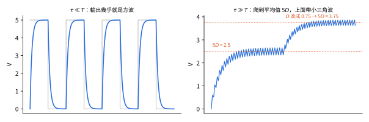

# 第 10 集 · Lec10：D 類的濾波器細看——LR 的時間常數兩種情況、方波的傅立葉成分、LR 當積分器（方波 → 三角波）、穩態平均 = 5D、加電容成 LC 二階、電感電流推導 [▶ 影片](https://www.youtube.com/watch?v=CKrQqh1lpx8)

← 上一集：[09](09-class-d-pwm-schmitt-inverter-lc-filter.md) ｜ [總目錄](../README.md) ｜ 下一集：[11](11-lrc-response-pwm-dc-supply-bridge.md) →

> **課程**：電子學（四），陽明交大 電子物理系，112 學年度 — 第 10 集（Lec10）
> **講者**：陳振芳 老師
> **來源**：YouTube 錄影逐字稿（1:21:11，whisper）＋ Sedra & Smith《Microelectronic Circuits》7th ed.
> **標記說明**：`【口頭】` 老師口頭補充；`【課本補充】` 課本有、課堂沒講；`[▶ mm:ss]` 影片時間點

---

## 目錄

- [0. 這堂課要做什麼](#0-這堂課要做什麼)
- [1. 為什麼不用 RC](#1-為什麼不用-rc)
- [2. LR 的步階響應](#2-lr-的步階響應)
- [3. 情況一：$\tau \ll T$——輸出跟著方波走](#3-情況一tau--t輸出跟著方波走)
- [4. 方波的頻譜](#4-方波的頻譜)
- [5. 情況二：$\tau \gg T$——積分成三角波](#5-情況二tau--t積分成三角波)
- [6. 穩態：平均值 = 輸入的平均值](#6-穩態平均值--輸入的平均值)
- [7. 佔空比改變：平均值跟著走，$\overline{v_o} = 5D$](#7-佔空比改變平均值跟著走overlinev_o--5d)
- [8. 加電容：LC 二階低通](#8-加電容lc-二階低通)
- [9. 用電感電流再推一次](#9-用電感電流再推一次)
- [10. 一頁速查表](#10-一頁速查表)
- [11. 與後續集數的連結](#11-與後續集數的連結)

---

## 0. 這堂課要做什麼

上一集 D 類放大器的最後一步：PWM（0／5 V 方波，佔空比被聲音調變）經低通濾波送喇叭。這集仔細看 LR、LC 濾波器在時間上到底做了什麼。

---

## 1. 為什麼不用 RC

[▶ 00:33](https://youtu.be/CKrQqh1lpx8?t=33)

PWM 是很高頻的脈衝（$\omega \sim 10^7$），聲音藏在佔空比 $D = T_1/(T_1 + T_2)$ 裡。RC 低通的電阻和喇叭串聯，電流非常大，所有功率都消耗在電阻上——不能用。[▶ 03:40](https://youtu.be/CKrQqh1lpx8?t=220)

---

## 2. LR 的步階響應

[▶ 04:41](https://youtu.be/CKrQqh1lpx8?t=281)

$$
v_i = L\frac{di}{dt} + v_o,\quad i = \frac{v_o}{R}
\quad\Longrightarrow\quad
\tau\frac{dv_o}{dt} = v_i - v_o,\quad \tau = \frac{L}{R}
$$

輸入從 0 跳到 5 V：$v_o < 5$ 時右邊為正，$v_o$ 上升；到 5 V 就不變（穩態）。[▶ 06:43](https://youtu.be/CKrQqh1lpx8?t=403)

$$
v_o(t) = 5\left(1 - e^{-t/\tau}\right)
$$

【口頭】繞越多圈（$L$ 越大）要越久才達到。電感讓電流慢慢上升，電流乘 $R$ 電壓就慢慢上升。[▶ 08:16](https://youtu.be/CKrQqh1lpx8?t=496)

---

## 3. 情況一：$\tau \ll T$——輸出跟著方波走

[▶ 09:19](https://youtu.be/CKrQqh1lpx8?t=559)

方波週期 $T$。若 $\tau$ 很小：每次上升都很快到 5 V、下降很快到 0——輸出幾乎就是方波，只有邊緣圓一點。（電感電流一定要**連續**，所以不會瞬間跳。）[▶ 10:22](https://youtu.be/CKrQqh1lpx8?t=622)

頻率上：$\omega_0 = 1/\tau$ 很大，方波的所有成分都在通帶內，全部過去——這不是我們要的。[▶ 14:59](https://youtu.be/CKrQqh1lpx8?t=899)

---

## 4. 方波的頻譜

[▶ 11:54](https://youtu.be/CKrQqh1lpx8?t=714)

0／5 V、佔空比 1/2 的方波，傅立葉級數：

$$
v(t) = 2.5 + \frac{10}{\pi}\left(\sin\omega t + \frac13\sin3\omega t + \frac15\sin5\omega t + \cdots\right)
$$

（老師只寫了 $\sin\omega t + \frac13\sin3\omega t + \cdots$ 的形式；以下**不是逐字稿內容**，是依標準傅立葉級數推論的：前面的係數 $\frac{10}{\pi}$ 來自振幅 2.5 V 的方波 $\times\frac4\pi$。）

第一根（直流）就是**平均值**；後面是 $\omega$、$3\omega$、$5\omega$……越來越小，都在 $10^7$ 以上。[▶ 12:55](https://youtu.be/CKrQqh1lpx8?t=775)

【口頭】這個你要接受，我們用了好多次，當成已知。

---

## 5. 情況二：$\tau \gg T$——積分成三角波

[▶ 17:41](https://youtu.be/CKrQqh1lpx8?t=1061)

這才是我們要的：$\omega_0 = 1/\tau \ll \omega$。

**時間上** [▶ 19:44](https://youtu.be/CKrQqh1lpx8?t=1184)：$\tau$ 很長，輸入一上去，$v_o$ 只沿著指數的**起始斜率**爬一小段，就輪到下降了。

- 上升斜率：$\frac{5 - v_o}{\tau}$。
- 下降斜率：$\frac{0 - v_o}{\tau}$。

一開始 $v_o \approx 0$：上升快、下降很慢 → 一點一點往上爬。爬到一半（2.5 V）時，上升和下降斜率一樣大 → 上去一點、下來一點，**平了**：穩態。[▶ 25:48](https://youtu.be/CKrQqh1lpx8?t=1548)

**頻率上** [▶ 31:31](https://youtu.be/CKrQqh1lpx8?t=1891)：把方波拆成兩群——平均值（直流，$\omega_0$ 以下，原封不動過去）和平均為 0 的高頻方波（在 −20 dB/dec 區，被**積分**）。方波積分就是三角波。[▶ 33:04](https://youtu.be/CKrQqh1lpx8?t=1984)

$$
v_o = \underbrace{\overline{v_i}}_{\text{平均值}} + \underbrace{\text{高頻小三角波}}_{\text{漣波}}
$$

---

## 6. 穩態：平均值 = 輸入的平均值

[▶ 26:18](https://youtu.be/CKrQqh1lpx8?t=1578)

穩態時 $v_o$ 有一個平均值，再加上一個高頻三角波。上升、下降斜率相同（差值都是 2.5 V）→ 平均值 = 2.5 V = 輸入方波的平均值。【口頭】不到穩態看不出這個圖。[▶ 28:22](https://youtu.be/CKrQqh1lpx8?t=1702)

低頻一樣、高頻被積分——LR 就是把 PWM 的平均值「抓」出來。[▶ 36:41](https://youtu.be/CKrQqh1lpx8?t=2201)

---

## 7. 佔空比改變：平均值跟著走，$\overline{v_o} = 5D$

[▶ 37:48](https://youtu.be/CKrQqh1lpx8?t=2268)

輸入突然變成 $T_1 > T_2$（佔空比變大）：上升的時間變長、下降的時間變短（斜率先不變）→ 平均值往上走，直到新的穩態：上升量 = 下降量。[▶ 41:55](https://youtu.be/CKrQqh1lpx8?t=2515)

$$
\frac{5 - \overline{v_o}}{\tau}T_1 = \frac{\overline{v_o}}{\tau}T_2
\quad\Longrightarrow\quad
\overline{v_o} = 5\cdot\frac{T_1}{T_1 + T_2} = 5D
$$

[▶ 48:40](https://youtu.be/CKrQqh1lpx8?t=2920)

佔空比增加，輸出增加。佔空比被聲音調變 → 輸出的平均值就是聲音。（5 是方波的高度。）[▶ 50:43](https://youtu.be/CKrQqh1lpx8?t=3043)

---

## 8. 加電容：LC 二階低通

[▶ 52:17](https://youtu.be/CKrQqh1lpx8?t=3137)

輸出 = 低頻平均值 + 高頻三角波。電感在低頻短路（沒影響）、高頻影響很大。改看電流：流進喇叭的電流也有一個高頻三角波成分，要拿掉。[▶ 55:22](https://youtu.be/CKrQqh1lpx8?t=3322)

在喇叭兩端並一顆 $C$：對 $10^7$ 的頻率，$\frac{1}{\omega C}$ 很小（$C$ 約 μF 就夠）→ 高頻三角波電流從 $C$ 漏掉；低頻時 $C$ 開路，平均電流走 $R$。兩個個別分開。[▶ 57:57](https://youtu.be/CKrQqh1lpx8?t=3477)

LC 二階低通：轉折 $\omega_0 = \frac{1}{\sqrt{LC}}$（$C$ 用 1 μF，$L$ 也差不多），轉折處會翹起來一點，之後 −40 dB/dec 很陡。轉折點放在聲音頻率之上、PWM 頻率（$4\times10^7$ 之類）之下。[▶ 1:04:42](https://youtu.be/CKrQqh1lpx8?t=3882)

$$
v_o = 5D = 5\left(\frac12 + \frac{v_i}{5}\right) = 2.5 + v_i
$$

聲音信號跑出來了（帶 2.5 V 直流）。[▶ 1:06:48](https://youtu.be/CKrQqh1lpx8?t=4008)

---

## 9. 用電感電流再推一次

[▶ 1:09:54](https://youtu.be/CKrQqh1lpx8?t=4194)

在一個 PWM 週期內聲音是低頻信號，$v_o$ 可以當常數（$\overline{v_o}$，電容把它穩住）。電感電壓 $v_L = L\frac{di}{dt}$：[▶ 1:11:28](https://youtu.be/CKrQqh1lpx8?t=4288)

- $T_1$ 期間（輸入 5 V）：$\Delta i = \frac{(5 - \overline{v_o})T_1}{L}$，電流線性上升。
- $T_2$ 期間（輸入 0）：$\Delta i = -\frac{\overline{v_o}T_2}{L}$，線性下降。

電感電流一定要**連續**，穩態時一週期淨變化為 0：[▶ 1:14:00](https://youtu.be/CKrQqh1lpx8?t=4440)

$$
(5 - \overline{v_o})T_1 = \overline{v_o}T_2
\quad\Longrightarrow\quad
\overline{v_o} = 5D
$$

和前面一模一樣。電感電流 = 平均值 $I_{avg}$ + 高頻三角波；三角波走電容、平均值走喇叭。[▶ 1:17:13](https://youtu.be/CKrQqh1lpx8?t=4633)

**大功率**：$\overline{v_o}$ 在 0～5 V 之間，不可能跳出去；電流看 $R$ 放多小，幾安培都沒問題——從電源經 CMOS 開關提供，開關本身不耗電。這是一個 high power 的電路。[▶ 1:18:48](https://youtu.be/CKrQqh1lpx8?t=4728)

> 【課本補充】§12.9 (p. 967)：D 類輸出經 LC 低通，喇叭上得到 PWM 的平均值；開關管只在導通／截止兩態，理想效率 100%。

---

## 10. 一頁速查表

| 項目 | 公式／重點 | 關鍵 |
|---|---|---|
| LR 方程 | $\tau\frac{dv_o}{dt} = v_i - v_o$，$\tau = L/R$ | |
| $\tau \ll T$ | 輸出 ≈ 方波 | 不要 |
| $\tau \gg T$ | 方波 → 平均值 + 三角波 | 積分器 |
| 方波頻譜 | $2.5 + \frac{10}{\pi}(\sin\omega t + \frac13\sin3\omega t + \cdots)$ | 第一根 = 平均 |
| 穩態 | 上升量 = 下降量 | |
| 平均值 | $\overline{v_o} = 5D$ | $= 2.5 + v_i$ |
| LC | $\omega_0 = 1/\sqrt{LC}$，−40 dB/dec | 三角波走 $C$ |
| 電感推導 | $(5-\overline{v_o})T_1 = \overline{v_o}T_2$ | 電流連續 |
| 功率 | 電流由電源經開關，幾 A | 開關不耗電 |

---

## 11. 與後續集數的連結

| 本集觀念 | 後面在哪裡用到 |
|---|---|
| 電感電流連續、伏秒平衡 | 交換式電源（buck 轉換器） |
| D 類整體 | 下一集：整個系統串起來 |

---

## 附：本集一句話總結

> **D 類放大器不能用 RC（喇叭只有幾 Ω，功率全吃在電阻上），改用 LR：時間常數遠小於方波週期時輸出只是跟著方波走，遠大於時則把方波拆成「直流平均值」和「被積分成三角波的高頻部分」，穩態時上升量等於下降量，得到 $\overline{v_o} = 5D = 2.5 + v_i$；再並一顆電容讓三角波電流從電容漏掉，成為 LC 二階低通；從電感電流連續（一週期淨變化 0）也推出同樣的 $5D$，大電流從電源經開關給，開關本身不耗電。**

---

*筆記依據陳振芳老師「電子學（四）」112 學年度 Lec10 錄影逐字稿（whisper，1:21:11）與 Sedra & Smith《Microelectronic Circuits》7th ed. 整理。*
