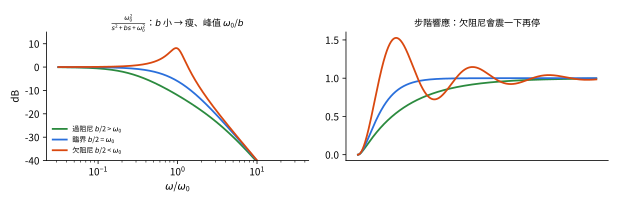

# 第 11 集 · Lec11：D 類整套複習、LRC 的頻率響應與暫態（三種阻尼）、用三角波比較器做 PWM、回授讓它成為精準的直流電源、互補 PWM 的橋式輸出 [▶ 影片](https://www.youtube.com/watch?v=m6e-032Btrg)

← 上一集：[10](10-lr-integrator-steady-state-lc-filter.md) ｜ [總目錄](../README.md) ｜ 下一集：[12](12-laser-driver-hysteretic-dead-time.md) →

> **課程**：電子學（四），陽明交大 電子物理系，112 學年度 — 第 11 集（Lec11）
> **講者**：陳振芳 老師
> **來源**：YouTube 錄影逐字稿（1:58:43，whisper）＋ Sedra & Smith《Microelectronic Circuits》7th ed.
> **標記說明**：`【口頭】` 老師口頭補充；`【課本補充】` 課本有、課堂沒講；`⚠️ 待確認` 查不清楚；`[▶ mm:ss]` 影片時間點

---

## 目錄

- [0. 這堂課要做什麼](#0-這堂課要做什麼)
- [1. D 類整套再走一次](#1-d-類整套再走一次)
- [2. 大電流、小封裝](#2-大電流小封裝)
- [3. LRC 的頻率響應](#3-lrc-的頻率響應)
- [4. LRC 的暫態：三種情況](#4-lrc-的暫態三種情況)
- [5. 另一種 PWM：三角波比較器](#5-另一種-pwm三角波比較器)
- [6. 直流電源：輸入直流就輸出直流](#6-直流電源輸入直流就輸出直流)
- [7. 加回授：精準的直流電源](#7-加回授精準的直流電源)
- [8. 這個回授會不會震](#8-這個回授會不會震)
- [9. 橋式輸出：互補的兩個 PWM](#9-橋式輸出互補的兩個-pwm)
- [10. 兩頭輸出的比較器](#10-兩頭輸出的比較器)
- [11. 一頁速查表](#11-一頁速查表)
- [12. 與後續集數的連結](#12-與後續集數的連結)
- [⚠️ 待確認清單](#️-待確認清單)

---

## 0. 這堂課要做什麼

D 類輸出級整個串起來；看 LRC 濾波器的完整特性；換一種方法產生 PWM，發現同一個電路也是一個**大功率直流電源**；最後用兩個互補 PWM 做橋式輸出。

---

## 1. D 類整套再走一次

[▶ 00:00](https://youtu.be/m6e-032Btrg?t=0)

1. **積分器** + **Schmitt 觸發器**（正回授，天花板 $2.5 + 2.5\beta$、地板 $2.5 - 2.5\beta$）→ 在很高頻自己震起來，產生 PWM。[▶ 00:32](https://youtu.be/m6e-032Btrg?t=32)
2. 聲音 $v_i$（最大 2.5 V）改變斜率 $\frac{2.5 \mp v_i}{RC}$ → $D = \frac12 + \frac{v_i}{5}$。[▶ 08:43](https://youtu.be/m6e-032Btrg?t=523)
3. **CMOS 反相器**當開關。[▶ 01:34](https://youtu.be/m6e-032Btrg?t=94)
4. **LC 低通**：電感把高頻濾掉（高頻三角波走電容），剩低頻。[▶ 11:21](https://youtu.be/m6e-032Btrg?t=681)

電感電流：$T_1$ 時電感兩端 $5 - v_o$，電流以 $\frac{5 - v_o}{L}$ 上升；$T_2$ 時以 $\frac{v_o}{L}$ 下降。電感電流不能瞬間改變。一開始 $v_o \approx 0$，上升快下降慢，一直往上跑，到穩態時上升量 = 下降量：[▶ 14:30](https://youtu.be/m6e-032Btrg?t=870)

$$
(5 - v_o)T_1 = v_oT_2
\quad\Longrightarrow\quad
v_o = 5D = 2.5 + v_i
$$

---

## 2. 大電流、小封裝

[▶ 25:47](https://youtu.be/m6e-032Btrg?t=1547)

電感電流 = 平均值 $I_{avg}$ + 三角波。$I_{avg}R_L = v_o$——$R_L$ 是 1 Ω 的話電流就是安培級。這些電流從電源經 CMOS 開關來，電源要能給幾安培。[▶ 27:48](https://youtu.be/m6e-032Btrg?t=1668)

開關的 $k$ 很大，導通在 triode 區（電阻很小），電流很大但功率消耗非常小 → **不需要特殊封裝散熱**，這是關鍵。[▶ 29:52](https://youtu.be/m6e-032Btrg?t=1792)

最後輸出有 2.5 V 直流，喇叭前面加大電容擋直流，$v_i$ 送進去。【口頭】它其實是一個 current amplifier。[▶ 31:59](https://youtu.be/m6e-032Btrg?t=1919)

---

## 3. LRC 的頻率響應

[▶ 39:42](https://youtu.be/m6e-032Btrg?t=2382)

$L$ 串聯，$R$（喇叭）並 $C$：

$$
\frac{V_o}{V_i} = \frac{R\parallel\frac{1}{sC}}{sL + R\parallel\frac{1}{sC}}
= \frac{\omega_0^2}{s^2 + bs + \omega_0^2},
\qquad
\omega_0 = \frac{1}{\sqrt{LC}},\quad b = \frac{1}{RC}
$$

[▶ 41:21](https://youtu.be/m6e-032Btrg?t=2481)

- 在 $\omega = \omega_0$：大小 $= \frac{\omega_0}{b}$（峰值），相位 −90°。[▶ 43:53](https://youtu.be/m6e-032Btrg?t=2633)
- $b$ 是寬度（掉到 $\frac{1}{\sqrt2}$ 的頻寬）。[▶ 42:53](https://youtu.be/m6e-032Btrg?t=2573)
- 高頻 −40 dB/dec，最後相位 −180°（二階）。[▶ 48:01](https://youtu.be/m6e-032Btrg?t=2881)

---

## 4. LRC 的暫態：三種情況

[▶ 50:07](https://youtu.be/m6e-032Btrg?t=3007)

時間上：寫微分方程，假設解 $e^{st}$ 代入：

$$
s^2 + bs + \omega_0^2 = 0
\quad\Longrightarrow\quad
s = -\frac{b}{2} \pm \sqrt{\left(\frac{b}{2}\right)^2 - \omega_0^2}
$$

[▶ 55:15](https://youtu.be/m6e-032Btrg?t=3315)

例：輸入正弦在 $t = 0$ 拿掉，看輸出怎麼掉下來：

| 情況 | 條件 | 解 | 頻率圖的樣子 |
|---|---|---|---|
| 過阻尼 | $\frac{b}{2} > \omega_0$ | $Ae^{-(\alpha-\beta)t} + Be^{-(\alpha+\beta)t}$，指數衰減 | 胖（$b$ 大） |
| 臨界阻尼 | $\frac{b}{2} = \omega_0$ | $(A + Bt)e^{-\alpha t}$ | |
| 欠阻尼 | $\frac{b}{2} < \omega_0$ | $e^{-\alpha t}(\cdots e^{\pm j\omega t})$，震一下就沒了 | 瘦（$b$ 小，峰高） |

[▶ 57:19](https://youtu.be/m6e-032Btrg?t=3439)

【口頭】胖瘦的比決定是哪一種。這是典型的二階低通濾波器。[▶ 1:03:01](https://youtu.be/m6e-032Btrg?t=3781)

---

## 5. 另一種 PWM：三角波比較器

[▶ 1:03:31](https://youtu.be/m6e-032Btrg?t=3811)

一個比較器：一端送 0～5 V 的**三角波**，另一端送電壓 $V$。$V$ 比三角波高時輸出一個狀態、低時另一個（需要時加反相器）。[▶ 1:04:02](https://youtu.be/m6e-032Btrg?t=3842)

三角波高度 5，高過 $V$ 的時間比例就是 $V/5$：

$$
D = \frac{V}{5}
$$

已經是 PWM 了。後面一樣接 CMOS 反相器 + LC：[▶ 1:07:35](https://youtu.be/m6e-032Btrg?t=4055)

$$
v_o = 5D = V
$$

---

## 6. 直流電源：輸入直流就輸出直流

[▶ 1:09:07](https://youtu.be/m6e-032Btrg?t=4147)

如果 $V$ 不是聲音、而是**直流**（例 3 V），輸出就是 3 V 直流——差別在於：比較器那端不提供任何電流，輸出端卻可以提供 $3\ \text{V}/1\ \Omega = 3$ A。電流是電源經開關給的。→ 可以提供非常大電流的 **power source**。[▶ 1:09:37](https://youtu.be/m6e-032Btrg?t=4177)

以下**不是逐字稿內容**，是依電路結構推論的：這就是交換式（切換式）直流轉換器——降壓轉換器（buck converter）——的原理。

**問題** [▶ 1:11:09](https://youtu.be/m6e-032Btrg?t=4269)：$v_o = V$ 有大前提——電源最高點真的是 5 V、三角波高度真的是 5……如果是 5.1 或 4.8，佔空比就不對。這些都是變數，到最後不一定是 $V$。

---

## 7. 加回授：精準的直流電源

[▶ 1:12:40](https://youtu.be/m6e-032Btrg?t=4360)

把輸出 $v_o$ 拉回來，和設定值 $V$ 相減，經一個**積分器**（op amp + $R_2$、$C$）再送進比較器。從比較器到輸出整體當成一個增益 $A$（不一定是 1，有太多不確定性）。[▶ 1:13:41](https://youtu.be/m6e-032Btrg?t=4421)

積分器：$V_c = -\frac{1}{R_2C}\int(v_o - V)\,dt + \text{const}$，而 $v_o = AV_c$：[▶ 1:16:47](https://youtu.be/m6e-032Btrg?t=4607)

$$
\frac{dv_o}{dt} = -\frac{A}{R_2C}(v_o - V)
\quad\Longrightarrow\quad
v_o \to V
$$

穩態時積分器輸入必須是 0 → $v_o = V$。$A$ 是 1.2、1.5、2 都無所謂，改變的只是時間常數 $\frac{R_2C}{A}$。有任何變化，回授一定把它拉回 $V$。[▶ 1:19:29](https://youtu.be/m6e-032Btrg?t=4769)

→ 非常 precise、可以提供很大電流的**直流電源**。要什麼電壓送進來什麼電壓。（加一級增益也可以：$v_o = $ 增益 × $V$。）[▶ 1:21:34](https://youtu.be/m6e-032Btrg?t=4894)

---

## 8. 這個回授會不會震

[▶ 1:22:34](https://youtu.be/m6e-032Btrg?t=4954)

震盪條件：在迴路裡加測試信號，回來同相（一度都不能差，coherence）且大小 ≥ 1。[▶ 1:24:04](https://youtu.be/m6e-032Btrg?t=5044)

- 積分器（反相）：$-\frac{1}{j\omega R_2C}$ → 相位 +90°。
- LC 濾波器在 $\omega_0$ 處 −90°。

兩個加起來剛好 0° → 震盪頻率就是 $\omega_0 = \frac{1}{\sqrt{LC}}$（只有這個頻率）。[▶ 1:28:46](https://youtu.be/m6e-032Btrg?t=5326)

在 $\omega_0$ 的迴路增益：

$$
\frac{\omega_0}{b}\cdot\frac{A}{\omega_0R_2C} = \frac{A\,RC}{R_2C}
$$

要 < 1 才不會震 → 選 $R_2$（積分器的時間常數）夠大。[▶ 1:29:51](https://youtu.be/m6e-032Btrg?t=5391)

> ⚠️ 待確認：迴路增益的確切表示式（$A$、$R$、$R_2$、$C$ 的組合）逐字稿不清楚，上式是依「峰值 $\omega_0/b$ × 積分器增益 $1/\omega_0R_2C$」整理的。

---

## 9. 橋式輸出：互補的兩個 PWM

[▶ 1:40:22](https://youtu.be/m6e-032Btrg?t=6022)

音頻放大器版：比較器有**兩頭輸出**，互補。兩個 PWM 各經 CMOS 反相器 + LC：[▶ 1:44:38](https://youtu.be/m6e-032Btrg?t=6278)

- 一邊佔空比 $D = \frac12 + \frac{v_i}{5}$ → $v_{o1} = 2.5 + v_i$。
- 另一邊互補 $1 - D$ → $v_{o2} = 2.5 - v_i$。

喇叭接在兩個輸出之間：[▶ 1:47:46](https://youtu.be/m6e-032Btrg?t=6466)

$$
v_{o1} - v_{o2} = 2v_i
$$

直流 2.5 V 互相抵消，**不需要很大的耦合電容**擋直流；信號還是兩倍。【口頭】要擋直流需要 $C$ 無窮大，很大的 $C$ 不划算。[▶ 1:49:19](https://youtu.be/m6e-032Btrg?t=6559)

> 【課本補充】§12.9 (p. 967)：D 類常用 H 橋（bridge-tied load）輸出，喇叭兩端接互補驅動，電壓擺幅加倍、直流抵消。

---

## 10. 兩頭輸出的比較器

[▶ 1:50:53](https://youtu.be/m6e-032Btrg?t=6653)

用差動放大器（大信號）：兩邊電流 $I_1$、$I_2$。輸入差一點點，電流就幾乎全部切到一邊（總和固定 $I$）→ 兩個集極（汲極）輸出一高一低，互補。好的比較器中間沒有過渡區，很快就上來（例 0／5 V）。[▶ 1:51:53](https://youtu.be/m6e-032Btrg?t=6713)

兩個輸出的相位綁在一起：這個高那個就低。【口頭】class D 主要是把電流放大的 high power amplifier。[▶ 1:58:01](https://youtu.be/m6e-032Btrg?t=7081)

---

## 11. 一頁速查表

| 項目 | 公式／重點 | 關鍵 |
|---|---|---|
| D 類 | 積分 + Schmitt → PWM → CMOS → LC | $v_o = 5D$ |
| 電感伏秒 | $(5 - v_o)T_1 = v_oT_2$ | 穩態 |
| LRC | $\frac{\omega_0^2}{s^2 + bs + \omega_0^2}$，$\omega_0 = 1/\sqrt{LC}$、$b = 1/RC$ | 峰值 $\omega_0/b$ |
| 暫態 | $\frac b2 \gtrless \omega_0$：過／臨界／欠阻尼 | 胖瘦 |
| 三角波比較 | $D = V/5$ | $v_o = V$ |
| 直流電源 | 輸入不給電流、輸出幾 A | buck |
| 回授 | 積分器：$v_o \to V$，時間常數 $R_2C/A$ | 精準 |
| 穩定 | 積分 +90°、LC −90° → $\omega_0$ 處判斷 | $R_2$ 夠大 |
| 橋式 | $v_{o1} - v_{o2} = 2v_i$ | 不需大電容 |

---

## 12. 與後續集數的連結

| 本集觀念 | 後面在哪裡用到 |
|---|---|
| 交換式電源 | 下一集 |
| 二階系統暫態 | 濾波器、控制 |
| 互補比較器 | 數位電路 |

---

## 附：本集一句話總結

> **D 類放大器用電感伏秒平衡得到 $v_o = 5D = 2.5 + v_i$，大電流由電源經低阻開關提供，不需散熱封裝；LRC 濾波器是 $\frac{\omega_0^2}{s^2 + bs + \omega_0^2}$，峰值 $\omega_0/b$，暫態依 $b/2$ 與 $\omega_0$ 分過阻尼、臨界、欠阻尼三種。改用三角波比較器時 $D = V/5$、$v_o = V$——輸入直流就成了能給幾安培的直流電源，再用積分器回授把輸出精準地拉到 $V$（注意積分器 +90° 與 LC −90° 在 $\omega_0$ 可能震）；兩個互補 PWM 做橋式輸出，喇叭得到 $2v_i$ 且直流抵消，不需大耦合電容。**

---

## ⚠️ 待確認清單

1. 第 8 節迴路增益的確切表示式。

---

*筆記依據陳振芳老師「電子學（四）」112 學年度 Lec11 錄影逐字稿（whisper，1:58:43）與 Sedra & Smith《Microelectronic Circuits》7th ed. 整理。*
